# Head 2 + Head 3: evidence and code map

Every path is a link: click it to open the file (VS Code or GitHub). Links with `#L…` jump to the line.
Branch: `feature/video-memory`, 19 November 2026.

## The question

> **Can a phone take a person's own videos, process them in the background, and search them by text, all on the device,
> within a phone's limits on speed, memory, storage and battery? Show the evidence.**

Each part of the question below has **evidence** (write-ups with the numbers, and the raw logs behind them), **graphs** (drawn from
those numbers; the ones marked *new* by [plot_evidence_map.py](../src/benchmarks/plot_evidence_map.py), `task evidence-map-plots`) and
**code** (what was built).

Overview documents: [Head-2-Setup-and-storage.docx](documents/Head-2-Setup-and-storage.docx) ·
[Head-3-Video-intake.docx](documents/Head-3-Video-intake.docx) (built from
[head2-defense.js](documents/source/head2-defense.js) and [head3-defense.js](documents/source/head3-defense.js)).

---

## 1. "all on the device": where the vectors live (Head 2)

**Evidence**

| Claim | Write-up | Raw evidence |
|---|---|---|
| Android blocks sqlite-vec on all 3 phones | [2026-11-05-sqlite-vec-proof-pack.md](results/2026-11-05-sqlite-vec-proof-pack.md), [01-why-android-blocks-extensions.md](results/eyko-89-android-sqlite-extensions/01-why-android-blocks-extensions.md) | [eyko-89-android-sqlite-extensions/evidence/](results/eyko-89-android-sqlite-extensions/evidence/) |
| Our own sqlite-vec build | [2026-11-07-sqlite-vec-android-build.md](results/2026-11-07-sqlite-vec-android-build.md) | [2026-11-07-sqlite-vec-android-build/](results/2026-11-07-sqlite-vec-android-build/) |
| Routes R1, R2, R4 (all slower than our own loop) | [route-r1-bundled.md](results/2026-11-08-route-r1-bundled.md), [route-r2-requery.md](results/2026-11-08-route-r2-requery.md), [route-r4-static.md](results/2026-11-08-route-r4-static.md) | |
| The decision | [ADR 0001 vector storage](adr/0001-vector-storage.md) | |

**Graphs**

Not measurements, so no graph: the proof that Android blocks sqlite-vec (raw logs), our own build, and the ADR.
*Routes R1, R2, R4 (sqlite_vec_* lines) against our own search, A32 and Infinix panels*

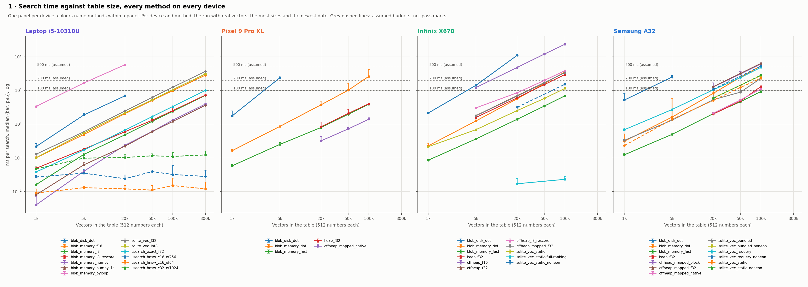

*Memory and speed: our mapped file against sqlite-vec R1 (Google's SQLite), R2 (requery), R4 (our SQLite) and Java arrays (new)*

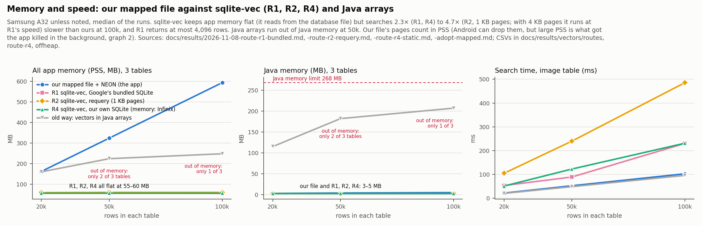

**Code**

| What | File |
|---|---|
| NEON vector search in C (the 5.5× speed-up); main loop | [eykonvec.c](../android/app/src/main/cpp/eykonvec.c#L26) |
| How vectors are held: mapped file, fallback mode | [VideoVectors.kt](../android/app/src/main/java/com/eykon/memory/video/VideoVectors.kt#L28) |
| "Has the table changed?" by `MAX(id)` | [VideoVectors.kt](../android/app/src/main/java/com/eykon/memory/video/VideoVectors.kt#L88) |
| Memory-mapped block and the native call | [VectorBlock.kt](../android/app/src/main/java/com/eykon/memory/video/VectorBlock.kt) |
| Builds the native library / our sqlite-vec | [build_vector_native.py](../src/benchmarks/build_vector_native.py), [build_sqlite_vec_android.py](../src/benchmarks/build_sqlite_vec_android.py) |
| The routes that were tried | [RouteR1Test.kt](../android/app/src/androidTest/java/com/eykon/memory/spike/RouteR1Test.kt), [RouteR2Test.kt](../android/app/src/androidTest/java/com/eykon/memory/spike/RouteR2Test.kt), [RouteR4StaticTest.kt](../android/app/src/androidTest/java/com/eykon/memory/spike/RouteR4StaticTest.kt), [NativeSqlite.kt](../android/app/src/androidTest/java/com/eykon/memory/spike/NativeSqlite.kt) |
| Same tables on laptop and phone | [schema.py](../src/video_memory/schema.py), [VideoSchema.kt](../android/app/src/main/java/com/eykon/memory/video/VideoSchema.kt), [test_schema_parity.py](../tests/test_schema_parity.py) |

## 2. "search them by text … speed, memory" (Head 2)

**Evidence**

| Claim | Write-up | Raw evidence |
|---|---|---|
| **EYKO-100**, the vector loop alone (four running sums, keep the best 20 instead of sorting): 100k vectors, A32 536.8 → 91.0 ms (**5.9×**), Pixel 261.6 → 38.8 ms (6.7×); same top 20 on 400 of 400 checks | [Head-2-Setup-and-storage.docx](documents/Head-2-Setup-and-storage.docx) (Figure 3, B5) | [a32-2026-11-04-sweep-real.csv](results/vectors/a32-2026-11-04-sweep-real.csv), [pixel9proxl-2026-11-04-sweep-real.csv](results/vectors/pixel9proxl-2026-11-04-sweep-real.csv) (`blob_memory_dot` → `blob_memory_fast`) |
| **EYKO-102**, the whole search (text to result cards: plain number arrays, frames read as id + video + time only, path and caption read for the hits alone): 20k kept frames, A32 1,286 → 302 ms (**4.3×**), Pixel 493 → 119 ms (**4.1×**); **2,400 of 2,400 hits identical** | [Head-7-Search.docx](documents/Head-7-Search.docx) (section 5, Figures 1–2) | [vectors/search/](results/vectors/search/) (before / after CSVs and hit lists), [compare_search_hits.py](../src/benchmarks/compare_search_hits.py) |
| Mapped NEON vectors 5.5× faster (573.8 → 102.5 ms at 100k, A32) | [2026-11-08-mapped-fast.md](results/2026-11-08-mapped-fast.md), [2026-11-08-adopt-mapped.md](results/2026-11-08-adopt-mapped.md) | [vectors/](results/vectors/) |
| Speed from 1k to 300k on 3 phones | [2026-11-05-vectors-phone-sweep.md](results/2026-11-05-vectors-phone-sweep.md) | [vectors/](results/vectors/) (`*-sweep*.csv`) |
| 4–5 MB of Java memory instead of out-of-memory at 50k | [2026-11-07-vectors-off-heap.md](results/2026-11-07-vectors-off-heap.md) | [vectors/offheap/](results/vectors/offheap/) |
| Background kill between 30k and 40k rows × 3 (open risk) | [2026-11-09-background-kill-mapped-native.md](results/2026-11-09-background-kill-mapped-native.md) | [vectors/bgkill/](results/vectors/bgkill/) |
| Hot A32 and low-battery Pixel | [2026-11-09-final-setup-conditions.md](results/2026-11-09-final-setup-conditions.md) | [vectors/](results/vectors/) (`a32-2026-11-08-eyko112-*.csv`) |
| Laptop: 13 methods, recall 1.000, HNSW 16× faster | [2026-11-13-vectors-laptop-v2.md](results/2026-11-13-vectors-laptop-v2.md) | [eyko-91-vectors-laptop-v2/](results/eyko-91-vectors-laptop-v2/) |
| Graphs and the capacity model | [2026-11-15-vectors-graphs-and-capacity.md](results/2026-11-15-vectors-graphs-and-capacity.md) | [vectors/plots/](results/vectors/plots/) |

**Graphs**

*EYKO-102: the app's whole search before (grey) and after*

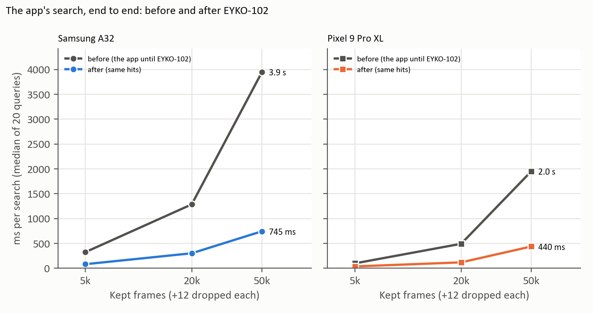

*EYKO-100: old against faster vector loop, same answers*

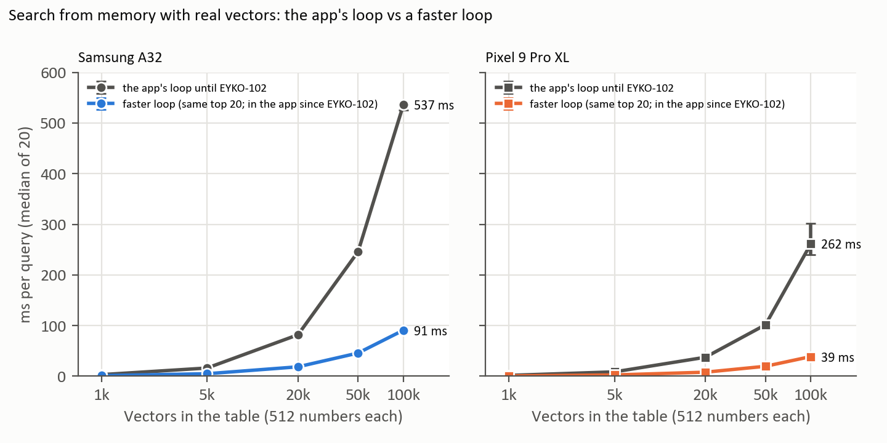

*Mapped NEON vectors: 5.5× faster on the A32 (new)*

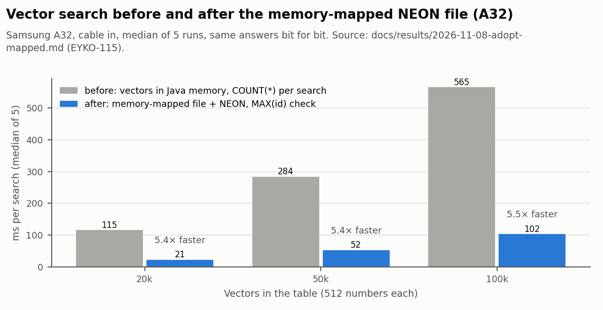

*Speed from 1k to 300k, every method on every device*

*Speed: the same exact search on the laptop and each phone*

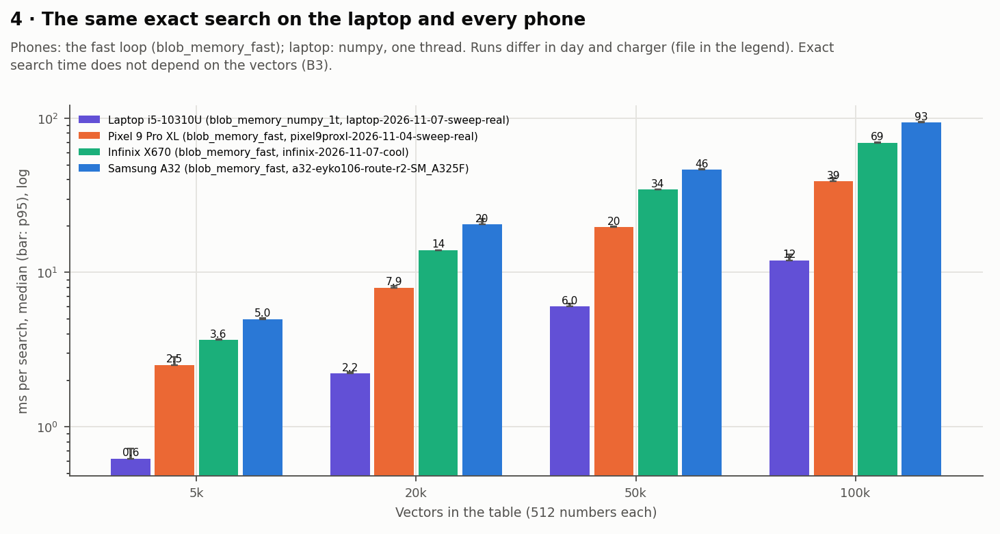

*Memory against table size*

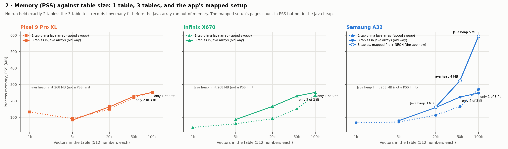

*Memory: all three tables in Java memory run out at 50k*

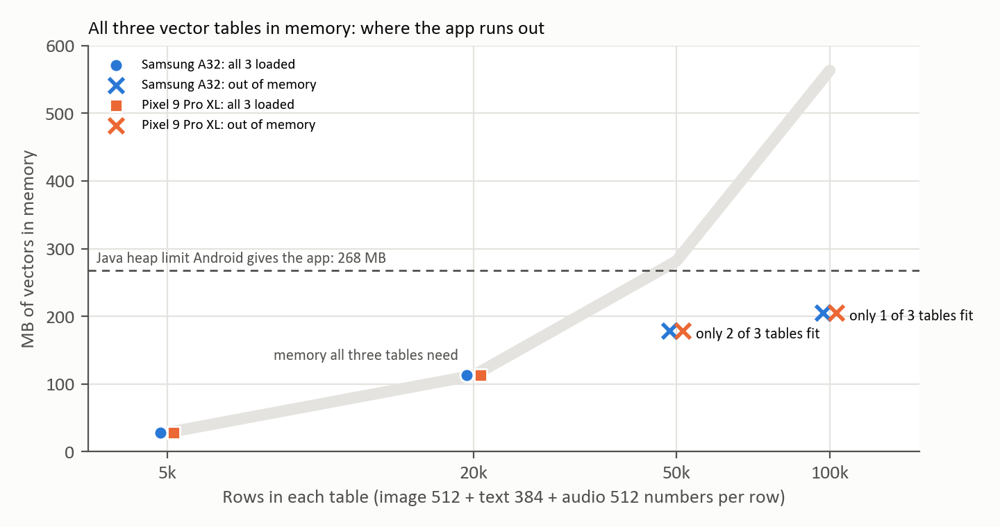

*Memory and speed: our mapped file against sqlite-vec R1 (Google's SQLite), R2 (requery), R4 (our SQLite) and Java arrays (new)*

*Background kill between 30k and 40k rows (new)*

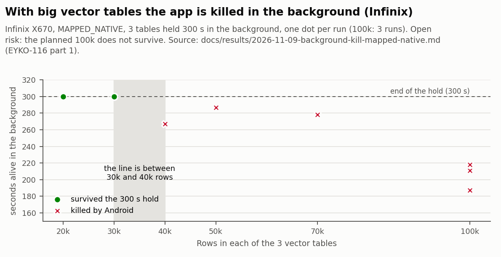

*Hot A32 and low-battery Pixel*

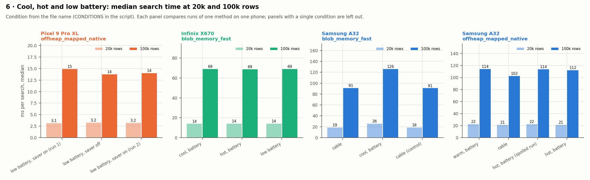

*Laptop: time of the 13 methods*

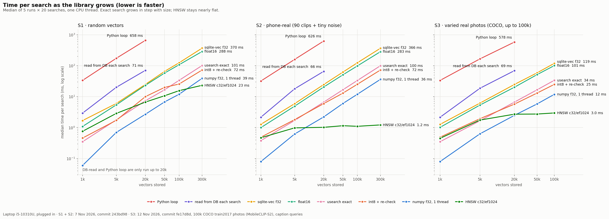

*Laptop: recall of the 13 methods*

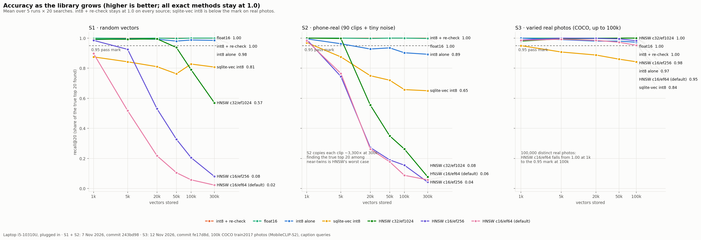

*Capacity model: days of video until search is too slow*

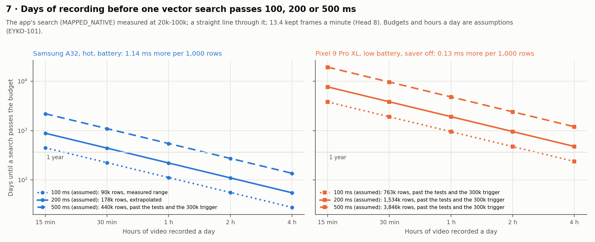

*Vector file size against table size*

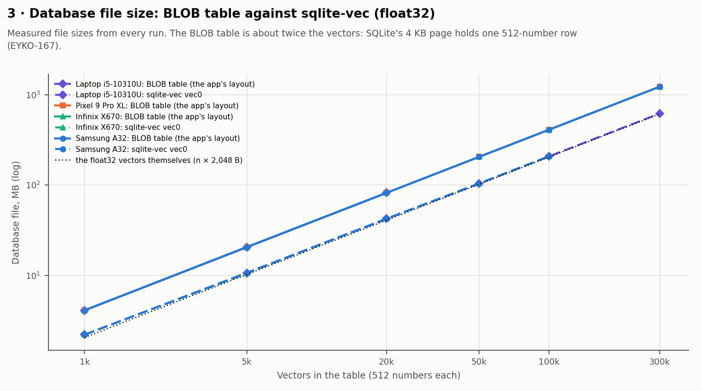

**Code**

| What | File |
|---|---|
| The app's search (the faster loop) | [VideoSearch.kt](../android/app/src/main/java/com/eykon/memory/video/VideoSearch.kt), [SearchWindows.kt](../android/app/src/main/java/com/eykon/memory/video/SearchWindows.kt) |
| Phone speed and memory tests | [VideoSearchSpeedTest.kt](../android/app/src/androidTest/java/com/eykon/memory/video/VideoSearchSpeedTest.kt), [OffHeapVectorTest.kt](../android/app/src/androidTest/java/com/eykon/memory/video/OffHeapVectorTest.kt), [VectorStorageSpikeTest.kt](../android/app/src/androidTest/java/com/eykon/memory/spike/VectorStorageSpikeTest.kt), [BenchKit.kt](../android/app/src/androidTest/java/com/eykon/memory/spike/BenchKit.kt) |
| Same hits before and after | [compare_search_hits.py](../src/benchmarks/compare_search_hits.py) |
| Laptop benchmark and graphs | [vector_storage_v2.py](../src/benchmarks/vector_storage_v2.py), [_vector_methods.py](../src/benchmarks/_vector_methods.py), [_vector_sources.py](../src/benchmarks/_vector_sources.py), [plot_vector_storage.py](../src/benchmarks/plot_vector_storage.py) |

## 3. "take a person's own videos" and "storage" (Head 3)

**Evidence**

| Claim | Write-up | Raw evidence |
|---|---|---|
| Read in place, no copy: 9.2 GB → 126 MB per hour | [2026-11-13-read-from-gallery.md](results/2026-11-13-read-from-gallery.md) (after), [2026-11-09-storage-and-crash.md](results/2026-11-09-storage-and-crash.md) (before) | [eyko126/](results/eyko126/), [vectors/crash/](results/vectors/crash/) |
| Recording place kept | [2026-11-13-keep-recording-place.md](results/2026-11-13-keep-recording-place.md) | |
| Duplicates and full phones refused | [2026-11-10-eyko-71-duplicates-and-space.md](results/2026-11-10-eyko-71-duplicates-and-space.md) | |
| Awkward files | [2026-11-12-head3-bad-inputs.md](results/2026-11-12-head3-bad-inputs.md) | [head3/bad-inputs/](results/head3/bad-inputs/) |
| .avi out; .3gp/.mkv/.webm in | [2026-11-17-file-types.md](results/2026-11-17-file-types.md) | [file-types log](results/head3/pixel-2026-11-17-file-types-eykonvideo.txt), [avi refused](results/head3/pixel-2026-11-17-avi-refused.png) |
| 500 MB is 1.5–4 min; A32 at 17.3 Mbps | [head3-background-and-limits.md](research/2026-11-16-head3-background-and-limits.md) (Part 2), [pr23-pixel-a32-checks.md](results/2026-11-18-pr23-pixel-a32-checks.md) (step 6) | |

**Graphs**

*Read in place: storage per hour before and after (new)*

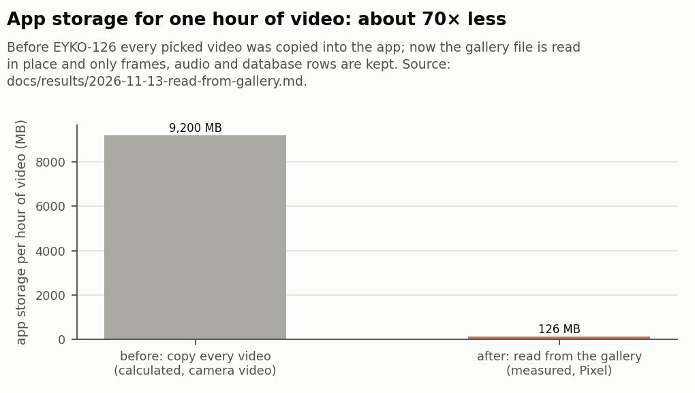

*Before: storage measured while copying (Infinix)*

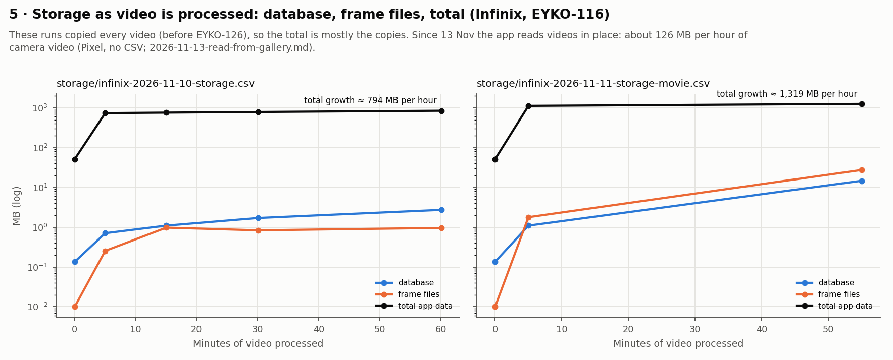

*500 MB held only 1.5 to 4 minutes of video (new)*

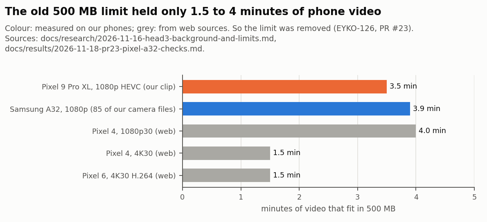

Not measurements, so screenshots instead: [place kept](results/eyko127-pixel-saved-with-place.png), [.avi refused](results/head3/pixel-2026-11-17-avi-refused.png), [awkward files](results/head3/bad-inputs/pixel-2026-11-15/). Duplicates and full phones: no graph (pass or refuse).

**Code**

| What | File |
|---|---|
| Adding a video; the no-copy path | [VideoCapture.kt](../android/app/src/main/java/com/eykon/memory/video/VideoCapture.kt#L58) |
| Copy path and free-space check | [VideoCopy.kt](../android/app/src/main/java/com/eykon/memory/video/VideoCopy.kt) |
| Accepted file types, recording place | [VideoMetadata.kt](../android/app/src/main/java/com/eykon/memory/video/VideoMetadata.kt) |
| Gallery file or copy | [VideoSource.kt](../android/app/src/main/java/com/eykon/memory/video/VideoSource.kt) |
| The screen (place note, maker hint) | [VideoScreen.kt](../android/app/src/main/java/com/eykon/memory/ui/screens/VideoScreen.kt) |
| Permissions and service types | [AndroidManifest.xml](../android/app/src/main/AndroidManifest.xml) |

## 4. "process them in the background" (Head 3)

**Evidence**

| Claim | Write-up | Raw evidence |
|---|---|---|
| WorkManager: Infinix 55 min of video, never killed | [2026-11-12-eyko44-workmanager-phone-checks.md](results/2026-11-12-eyko44-workmanager-phone-checks.md) | [head3/eyko44/](results/head3/eyko44/) |
| Pixel resumes after a reboot | [2026-11-15-eyko44-pixel-checks.md](results/2026-11-15-eyko44-pixel-checks.md) | [eyko44-pixel/](results/eyko44-pixel/) |
| 8-minute clip in deep Doze | [2026-11-15-eyko85-background-long-clip.md](results/2026-11-15-eyko85-background-long-clip.md) | [eyko85/](results/eyko85/) |
| Android's and the makers' rules | [head3-background-and-limits.md](research/2026-11-16-head3-background-and-limits.md) (Part 1) | |
| `mediaProcessing`, 6 h pause, maker hint, Samsung sleeping apps | [2026-11-18-pr23-pixel-a32-checks.md](results/2026-11-18-pr23-pixel-a32-checks.md) | [service type](results/head3/pr23/pixel-service-type.txt), [timeout log](results/head3/pr23/pixel-timeout-log.txt), [Samsung card](results/head3/pr23/a32-samsung-card.png), [A32 background log](results/head3/pr23/a32-background-log.txt), [all of pr23/](results/head3/pr23/) |
| Safe re-runs; unfixable jobs fail at once | [2026-11-11-stages-safe-to-rerun.md](results/2026-11-11-stages-safe-to-rerun.md) | [eyko119/](results/eyko119/) |

**Graphs**

*Minutes from adding a clip to ready, app in front and in the background*

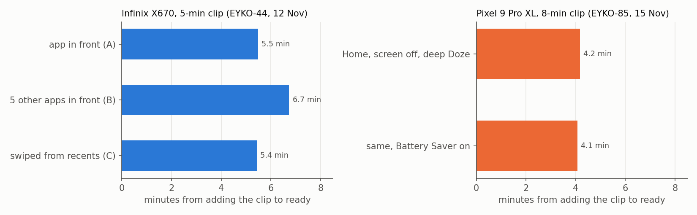

Not measurements, so screenshots instead: [Samsung hint](results/head3/pr23/a32-samsung-card.png), [hint gone after Unrestricted](results/head3/pr23/a32-no-card-unrestricted.png), [paused note](results/head3/pr23/pixel-paused-note-after-open.png). Safe re-runs and the rules research: no graph.

**Code**

| What | File |
|---|---|
| The background job; `mediaProcessing` from Android 15 | [VideoJobWorker.kt `serviceType`](../android/app/src/main/java/com/eykon/memory/video/VideoJobWorker.kt#L169) |
| The 6 h timeout note | [VideoJobWorker.kt](../android/app/src/main/java/com/eykon/memory/video/VideoJobWorker.kt#L51) |
| Queue and the stages | [VideoJobs.kt](../android/app/src/main/java/com/eykon/memory/video/VideoJobs.kt), [VideoWorker.kt](../android/app/src/main/java/com/eykon/memory/video/VideoWorker.kt), [VideoPipeline.kt](../android/app/src/main/java/com/eykon/memory/video/VideoPipeline.kt) |
| Starting the queue (process start, app opened) | [MemoryApp.kt](../android/app/src/main/java/com/eykon/memory/MemoryApp.kt), [MainActivity.kt](../android/app/src/main/java/com/eykon/memory/MainActivity.kt) |
| Maker battery hint | [MakerSettings.kt](../android/app/src/main/java/com/eykon/memory/video/MakerSettings.kt) |

## 5. "speed … battery": the stages (Head 3)

**Evidence**

| Claim | Write-up | Raw evidence |
|---|---|---|
| Minutes of work per minute of video, 3 phones | [pixel-kit-clips-timing.md](results/2026-11-11-pixel-kit-clips-timing.md), [intake-infinix.md](results/2026-11-14-head3-intake-infinix.md), [intake-two-phones.md](results/2026-11-15-head3-intake-two-phones.md), [intake-a32.md](results/2026-11-17-head3-intake-a32.md) | [stage_times.csv](results/head3/stage_times.csv), [run_summary.csv](results/head3/run_summary.csv), [head3/raw/](results/head3/raw/), [eyko64/](results/eyko64/) |
| Split 3× faster, same JPEGs | [2026-11-17-split-frames-faster.md](results/2026-11-17-split-frames-faster.md) | [split-timing/](results/split-timing/) |
| `latest` relink: 7.5M → 73k comparisons, same links | [2026-11-17-latest-stage-profile.md](results/2026-11-17-latest-stage-profile.md) | [latest-profile/](results/latest-profile/), [Pixel object crops](results/latest/pixel9proxl-object-crops-2026-10-13.json) |
| The 0.87 "same object" threshold | [2026-10-13-eyko-15-crop-threshold.md](results/2026-10-13-eyko-15-crop-threshold.md) | [crop-identity reviewed](results/latest/crop-identity-2026-10-13-reviewed.csv) |

**Graphs**

*Minutes of work per minute of video, 3 phones*

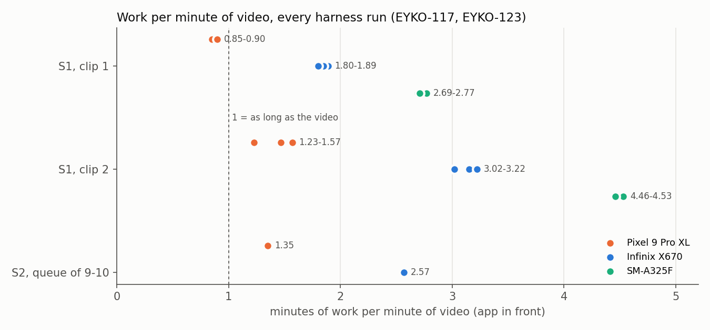

*Seconds per stage, 3 phones*

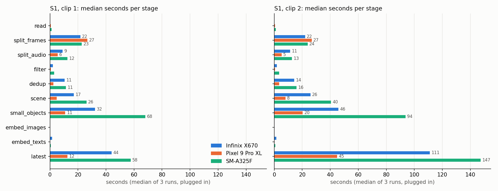

*Split about 3× faster, same JPEGs (new)*

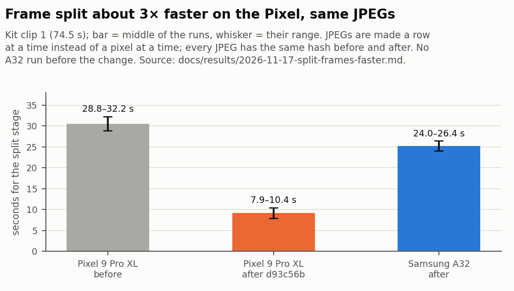

*`latest`: time against sightings, and relink comparisons*

*The 0.87 same-object threshold, person-checked pairs (new)*

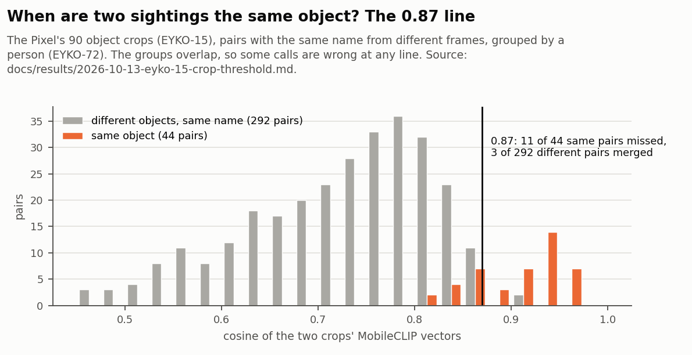

**Code**

| What | File |
|---|---|
| Frame split (`toJpeg`, bulk rows) | [FrameExtractor.kt](../android/app/src/main/java/com/eykon/memory/video/FrameExtractor.kt), [VideoSplit.kt](../android/app/src/main/java/com/eykon/memory/video/VideoSplit.kt) |
| `latest`: threshold 0.87 | [VideoLatest.kt](../android/app/src/main/java/com/eykon/memory/video/VideoLatest.kt#L42) |
| `forget` (re-split relink) | [VideoLatest.kt](../android/app/src/main/java/com/eykon/memory/video/VideoLatest.kt#L114) |
| `relink` | [VideoLatest.kt](../android/app/src/main/java/com/eykon/memory/video/VideoLatest.kt#L144) |
| `link` (the glasses example) | [VideoLatest.kt](../android/app/src/main/java/com/eykon/memory/video/VideoLatest.kt#L171) |
| `cropVectors` (decode once per frame) | [VideoLatest.kt](../android/app/src/main/java/com/eykon/memory/video/VideoLatest.kt#L223) |
| Laptop profile of `latest` | [latest_profile.py](../src/benchmarks/latest_profile.py) |
| Phone run scripts | [run-head3.ps1](phone-kit/run-head3.ps1), [head3_intake.py](../src/benchmarks/head3_intake.py), [head3_compare.py](../src/benchmarks/head3_compare.py) |

## 6. "show the evidence": the tests

| Area | On the phone | On the laptop JVM |
|---|---|---|
| Intake | [VideoCaptureTest.kt](../android/app/src/androidTest/java/com/eykon/memory/video/VideoCaptureTest.kt), [VideoStorageTest.kt](../android/app/src/androidTest/java/com/eykon/memory/video/VideoStorageTest.kt) | [VideoCopyTest.kt](../android/app/src/test/java/com/eykon/memory/video/VideoCopyTest.kt), [VideoMetadataTest.kt](../android/app/src/test/java/com/eykon/memory/video/VideoMetadataTest.kt) |
| Background, re-runs | [VideoJobSchedulingTest.kt](../android/app/src/androidTest/java/com/eykon/memory/video/VideoJobSchedulingTest.kt), [VideoWorkerTest.kt](../android/app/src/androidTest/java/com/eykon/memory/video/VideoWorkerTest.kt), [VideoRerunSafetyTest.kt](../android/app/src/androidTest/java/com/eykon/memory/video/VideoRerunSafetyTest.kt), [VideoFinishTest.kt](../android/app/src/androidTest/java/com/eykon/memory/video/VideoFinishTest.kt) | [MakerSettingsTest.kt](../android/app/src/test/java/com/eykon/memory/video/MakerSettingsTest.kt) |
| Relink | [VideoLatestTest.kt](../android/app/src/androidTest/java/com/eykon/memory/video/VideoLatestTest.kt) | [VideoLatestLinkTest.kt](../android/app/src/test/java/com/eykon/memory/video/VideoLatestLinkTest.kt), [VideoLatestCropTest.kt](../android/app/src/test/java/com/eykon/memory/video/VideoLatestCropTest.kt) |
| Search, vectors | [VideoSearchTest.kt](../android/app/src/androidTest/java/com/eykon/memory/video/VideoSearchTest.kt), [VideoSearchSpeedTest.kt](../android/app/src/androidTest/java/com/eykon/memory/video/VideoSearchSpeedTest.kt) | [VideoVectorsRankTest.kt](../android/app/src/test/java/com/eykon/memory/video/VideoVectorsRankTest.kt), [VideoVectorsBlobTest.kt](../android/app/src/test/java/com/eykon/memory/video/VideoVectorsBlobTest.kt) |
| Split | [VideoSplitTest.kt](../android/app/src/androidTest/java/com/eykon/memory/video/VideoSplitTest.kt), [SplitTimingBenchmarkTest.kt](../android/app/src/androidTest/java/com/eykon/memory/video/SplitTimingBenchmarkTest.kt) | [VideoSplitMathTest.kt](../android/app/src/test/java/com/eykon/memory/video/VideoSplitMathTest.kt) |

| Proof of the test runs | File |
|---|---|
| Test counts and coverage | [2026-11-13-test-inventory.md](results/2026-11-13-test-inventory.md) |
| 110 pass on the Pixel | [pixel9proxl-ondevice-2026-11-15.txt](results/test-inventory/pixel9proxl-ondevice-2026-11-15.txt) |
| 125 JVM + 26 on-device pass (PR #23) | [pixel-ondevice-tests.txt](results/head3/pr23/pixel-ondevice-tests.txt) |
| Reproduced on a second laptop | [2026-11-06-clean-clone-reproduction.md](results/2026-11-06-clean-clone-reproduction.md) |
| Labels checked by a person (EYKO-72) | [crop-identity reviewed](results/latest/crop-identity-2026-10-13-reviewed.csv), [perception/](results/perception/) |

Not in git: the compiled `libeykonvec.so` (built from `eykonvec.c` by `build_vector_native.py`).
