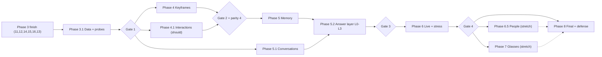

# Eykon — Master Roadmap (Phases 3 → 8)

> [!IMPORTANT]
> **Direction annotation — 12 October 2026 (additions only).**
> The active task list is now the **Synverk board** (project Eykon, cards
> `EYKO-1` … `EYKO-35`). This roadmap stays as background and method: the
> pessimist rules (§5.1), the Mobile Emulation Profile (§4.1), the KPIs (§7)
> and the issue list (§9) still apply. Where a card and this roadmap
> disagree, the card wins.
>
> What changed, decided with the user:
> - **Product:** a general "second brain". Order of work: objects first,
>   then speech and actions, then sounds and meetings. Meetings are
>   important but are not the lead use case.
> - **Perception:** cheap specialised models are the default (Option A);
>   the VLM is the optional last resort and the comparison baseline. Both
>   are run on the same data to compare cost and accuracy (EYKO-33). This is
>   the L0–L3 idea from v2, with L0 as the default build.
> - **§8 decisions now closed:** detector = YOLOX-Nano, Apache-2.0, ONNX
>   (no AGPL); test framework = pytest (dev dependency); database = raw
>   `sqlite3`, no ORM; speech = faster-whisper as laptop baseline behind one
>   function, phone engine measured at the phone gate, English only.
> - **§8 decisions still open:** vector storage (sqlite-vec vs float32
>   BLOBs, Android spike EYKO-31); hand finder for small objects (EYKO-32).
> - **Laptop is the lab, phone is the exam** stays, sharpened: only the
>   option that wins the evaluation is ported to the phone (EYKO-34).
> - The phase folders 3.1 – 8 are not deleted; they are the detailed method
>   to draw on when a card needs it.

> Created 05 October 2026. Sources: `new_Dev.md` (brainstorm), LightMem-Ego
> (Chen et al., arXiv:2607.11487, read in full), existing `docs/plans/`,
> `.memory/` logs and on-device KPI runs (Pixel 9 Pro XL, Infinix Note 12).
> Phase 1 and Phase 2 plans are untouched. Nothing previously documented has
> been deleted — older plans are annotated, not replaced.

> [!IMPORTANT]
> **Roadmap v2 annotation — 07 October 2026 (additions only).**
> `docs/new/eykon-roadmap-v2.md` extends this roadmap. Everything below stays
> valid; v2 adds scenario packs (objects/daily life, meetings, classroom,
> people as stretch), an LLM-optional design measured as configurations L0–L3,
> one fixed slot schema between perception and memory, and new decimal phases:
>
> | Phase | Name | Tier | Plan folder |
> |---|---|---|---|
> | 3 | Vision pipeline, finish order 11 → 12 → 14 → 15 → 16 → 13 | must | `phase-3-vision/` |
> | 3.1 | Scenario data and direction probes (A, B, C) | must | `phase-3.1-data-probes/` |
> | 4 | Keyframe intelligence (+ hand-activity gate, two-path Step 09) | must | `phase-4-keyframes/` |
> | 4.1 | Object interaction tracking, no LLM | should (depends on Probe B) | `phase-4.1-interactions/` |
> | 5 | Hierarchical memory (+ interaction events into the state table) | must | `phase-5-memory/` |
> | 5.1 | Conversation intelligence: meetings, classroom | must / should | `phase-5.1-conversations/` |
> | 5.2 | Answer layer and LLM-optional evaluation (L0–L3) | must | `phase-5.2-answer-layer/` |
> | 6 | Live capture and stress (+ 30-min live meeting, full day) | must | `phase-6-live/` |
> | 6.5 | People layer: faces and voices, opt-in | stretch | `phase-6.5-people/` |
> | 7 | Glasses and split computing | stretch | `phase-7-glasses/` |
> | 8 | Final evaluation, thesis and defense | must | `phase-8-final/` |
>
> Decision gates (v2 §6): Gate 1 after Phase 3.1, Gate 2 after the Phase 4
> ablation, Gate 3 after Phase 5.2, Gate 4 after the phone parity gates.
>
> **Planning defaults agreed 07 October 2026** (the user accepted the
> recommended settings; each can be revisited):
> - No defense date yet. Tiers stay as in v2; time caps are written as
>   "to be fixed when the date is known" inside the step docs.
> - Existing Phase 4 and Phase 5 docs are annotated, not rewritten. New phases
>   get full overview + step docs.
> - The supervisor is assumed to accept "LLM-optional with a measured
>   comparison". If that changes, Phase 5.2 decides the final claim.
> - Recordings: about 10 mock meetings with 3–4 consenting people, plus at
>   least one lecture or study-group session.
> - YouTube downloads are **not** used until the department confirms. Public
>   datasets (AMI, EPIC-KITCHENS, Ego4D subset if the licence allows) plus our
>   own consented recordings.
> - Primary phone if time forces a choice: Pixel 9 Pro XL. Infinix stays the
>   low-end check.
> - Phase 4 Step 01 (egocentric dataset) is **merged into Phase 3.1** so data
>   is collected once.
> - Database convention: plain `sqlite3` with parameterised queries
>   (`docs/invariants/core.md`), not an ORM.
> - Speech recognition scope: English only.
> - Phase 2 Steps 06–07 are folded into the later phone parity gates.
> - Every other undecided item is written as an "Open decisions" entry inside
>   the step that needs it, not decided here.

---

## 1. What we are actually building (one paragraph)

A fully on-device system that continuously perceives the world through an
egocentric camera and microphone, decides **online** (no look-ahead) which
moments are worth remembering, turns them into structured, timestamped memory
in SQLite, organises that memory hierarchically (current → short-term →
long-term episodic/semantic), keeps object/entity state consistent when the
world changes, and answers present-tense and historical questions by voice or
text — with **zero network calls at runtime**. Laptop first as the lab, phone
as the real target, smart glasses as the final capture device.

## 2. The defendable research problems (what makes this an FYP, not plumbing)

| # | Problem | Why no library solves it | Phase |
|---|---|---|---|
| P1 | **Budget-constrained online keyframe / event segmentation** on egocentric streams | Must decide per frame in milliseconds, no look-ahead, while missing neither 0.5 s actions (keys put down) nor flooding on static scenes | 4 |
| P2 | **Hierarchical memory + temporal state reconciliation** | LightMem-Ego itself states its update mechanism "lacks a principled policy for revising, merging, forgetting, or promoting memories" — this is the gap we target | 5 |
| P3 | **Asymmetric scheduling under a phone thermal/RAM envelope** (perception vs. live Q&A on one SoC) | Shared memory bus + ~2.5–3 W passive limit; our Infinix run already hit 4.68 W avg and 58.9 °C SoC | 6 |
| P4 | **Split computing for glasses ↔ phone** under BLE/Wi-Fi bandwidth and glasses battery | Where to cut the pipeline (raw stream vs. gated keyframes vs. embeddings) is an open trade-off | 7 |

## 3. Positioning vs. LightMem-Ego (verified facts, not brainstorm numbers)

What LightMem-Ego actually reports (Sections 3–5 + Limitations of the paper):

- Architecture: thin phone/glasses client → **backend server**. The client only
  samples, compresses, timestamps and uploads frames + audio chunks.
- Memory: current (rolling buffer) → short-term (micro-events with
  representative frames, *provisional* caption, async transcript backfill) →
  long-term (episodic + semantic). A **query router** picks the cheapest
  sufficient memory level.
- Results: R@3 = 74.1, MRR = 0.627; QA accuracy 51.9 % (LLM-judged) / 55.6 %
  (human-judged); P50 end-to-end latency 5.86 s (phone, short-term) and
  14.87 s (phone, long-term).
- Limitations (their words, paraphrased): relies on **upstream API calls** for
  ASR, vision, generation and QA; no principled revise/merge/forget/promote
  policy; no privacy pipeline (no redaction, no retention policy).

Our delta: (1) everything on-device, (2) a principled state/lifecycle policy,
(3) a gated perception cascade instead of fixed low-rate upload, (4) privacy
controls in the loop. We **borrow** their hierarchy, provisional-caption +
async-refine idea and query router. We must cite them as the reference
design, not pretend they don't exist.

> [!WARNING]
> `new_Dev.md` quotes some numbers for LightMem-Ego (e.g. "77.8 % retrieval",
> "P90 8.61–13.60 s") that do **not** match what we read in the paper body,
> and cites several papers we could not locate ("Mem-Alpha", "TokenPilot",
> "EgoLife on Edge Devices"). Every citation must be verified before it goes
> into a panel document — see Phase 3 Step 16.

## 4. Laptop vs. mobile — recommendation

**Recommendation: "Laptop is the lab, phone is the exam, every phase ends with
an exam."** Not pure laptop-first, not fully parallel.

- Pure laptop-first (what Phase 3 did) produced exactly the risk you described:
  the 30-min soak test says "zero throttling" but it ran on a fan-cooled laptop
  at 13.3 s/frame; that says nothing about a phone in a pocket.
- Fully parallel (build every step twice) doubles the work and the Kotlin side
  lags anyway, so it is parallel only on paper.
- Middle path, enforced by structure:
  1. Each step is researched and implemented on the laptop under a **Mobile
     Emulation Profile** (below).
  2. Each phase has a **Mobile Parity Gate** as its last step: the same logic,
     same model files, same golden test inputs run on the Pixel 9 Pro XL
     (flagship) and Infinix Note 12 (low-end). The phase is not "done" until
     both phones produce results within the stated tolerance — or the gap is
     documented and explained.
  3. Anything that only exists on the phone (camera FGS, IMU, battery,
     thermals) gets a **phone spike early** in the phase, not at the end.

### 4.1 Mobile Emulation Profile (laptop rules)

| Rule | How it's enforced | Why |
|---|---|---|
| CPU only, no CUDA | `MEMORY_` setting forcing CPU; llama.cpp `n_gpu_layers=0` | Phones have no CUDA |
| 4 threads, pinned | `psutil.Process().cpu_affinity([...])` + `n_threads=4` | Phone big cores ≈ 2–4 usable |
| RAM ceiling | Watchdog samples RSS; run is **marked failed** above budget (3.5 GB flagship / 2.0 GB low-end profile) | OOM-killer on Android is not optional |
| Same artifacts | Identical `.litertlm` / `.gguf` / `.tflite` files and quantisation as the phone | Avoid "worked with FP16 on laptop" |
| Same input | Frames at the resolution + fps CameraX will actually deliver (e.g. 640×480 @ 2–4 fps) | Avoid "worked on 1080p, phone gives 480p" |
| **Wall-clock replay** | Videos replayed at real speed, not as-fast-as-possible; backlog and dropped frames are recorded | Offline batch hides real-time queueing failure |
| Same DB features | Same SQLite schema; FTS4 vs FTS5 parity decided explicitly (Android has no FTS5 by default — already hit in Phase 2) | Avoid silent search differences |
| Measured slowdown factor | Per component, laptop latency ÷ phone latency is **measured** at each parity gate | Never assume "2–5×" again |
| Golden fixtures | `data/golden/` frames/audio + expected outputs as JSON; Python tests and Kotlin unit tests read the same files | Proves both implementations agree |

## 5. Testing protocol — every step, three layers

1. **Automated** — unit/integration tests, benchmark scripts, JSON results.
2. **You-in-the-loop (mandatory)** — every step doc has a section
   `## You test this` with concrete instructions ("open the webcam page, put
   your keys on the desk, move them to your bag after 2 minutes, then ask…",
   "upload `walk_outdoor_01.mp4` and judge the 12 keyframes"). Your verdict is
   recorded in the step's results file. A step with good numbers and a bad
   human verdict is **not** approved.
3. **Pessimist check** — every step doc has `## How this number could be
   lying`: sample size, laptop-vs-phone gaps, metric blind spots, cherry-picked
   videos. We write it *before* running the experiment.

### 5.1 Pessimist rules (apply everywhere)

- No conclusion from fewer than **30 QA pairs** or less than **30 minutes** of
  video per condition. Phase 3's A2/A3 used 3 clips × 3 QA pairs with 1–10
  frames each — useful as smoke tests, not as evidence.
- Report **worst case and P90**, not only averages.
- Report what failed. A negative result is a result; it goes in the thesis.
- "Cosine similarity to FP16 output" is not quality. Quality = human judgement
  + task accuracy.
- Laptop thermal stability ≠ phone thermal stability. Only phone runs count
  for thermal/battery claims.
- Any external API used for *evaluation* (e.g. an LLM judge) is evaluation
  tooling only, must be stated as such, and must be cross-checked with human
  ratings on a subset.

## 6. Phase map

> Updated 07 October 2026 for roadmap v2 (decimal phases added, all phases
> now have overview + step docs). The original table's rows are unchanged in
> meaning; Phase 2's status is taken from the code and step docs.

| Phase | Name | Tier | Core question | Steps | Ends with |
|---|---|---|---|---|---|
| 1 / 1.1 | Text RAG desktop + retrieval improvements | done | — | 12 | Hit@5 93.33 %, MRR 0.8344 (30 QA, 499 memories) |
| 2 | Android + audio | mostly done | — | 7 (01–05 done; 06–07 folded into later parity gates) | — |
| 3 | Vision pipeline (pre-recorded) | must | Can a local VLM turn video into retrievable memory? | 16 (01–10 done) | Realignment steps 15–16 + honest re-defense package (Step 13 last) |
| 3.1 | Scenario data and direction probes | must | What data do we need, and which risky directions survive cheap tests? | 23 | Decision note + **Gate 1** |
| 4 | Keyframe intelligence | must | When is a frame worth remembering, online, on a budget? (P1) | 13 + 07b (01 merged into 3.1, 03 done in 3.1) | Held-out gauntlet + **Gate 2**, parity gate 4 |
| 4.1 | Object interaction tracking, no LLM | should (depends on Probe B) | Can hands, embeddings and tracking replace the VLM for object memory? | 15 | Parity gate 4.1 |
| 5 | Hierarchical memory and temporal state | must | How do we store, consolidate, update and route memory? (P2) | 12 | Parity gate 5 |
| 5.1 | Conversation intelligence: meetings, classroom | must / should | Can a phone give faithful meeting summaries with who-said-what, offline? | 18 | Parity gate 5.1 |
| 5.2 | Answer layer and LLM-optional evaluation | must | Is an LLM needed, and for which question types? | 15 | Conclusion + **Gate 3** |
| 6 | Live capture and real-world stress | must | Does it survive real days on real phones? (P3) | 15 | Field study + **Gate 4** |
| 6.5 | People layer: faces and voices, opt-in | stretch | Can people be named responsibly, locally, with consent? | 9 | Evaluation + ethics section |
| 7 | Smart glasses and split computing | stretch | Where do we cut the pipeline between glasses and phone? (P4) | 9 | Recommended split with measured trade-offs |
| 8 | Final evaluation, thesis and defense | must | Is the whole system better than the baselines, honestly? | 12 | Thesis + defense |

Phase 3.1 runs in parallel with the remaining Phase 3 steps (its data track
needs weeks of recording). Phase 5.1 can start after Gate 1 in parallel with
Phase 4 / 5 because it depends on speech, not on the video cascade; it joins
Phase 5 at the shared schema (Phase 5 Step 01) and the router (Phase 5 Step 09).

## 7. Global KPIs (targets are targets — not results)

| KPI | Target | Minimum acceptable | Measured where |
|---|---|---|---|
| Heavy-model (VLM) calls per hour of video | ≤ 120 | ≤ 300 | Laptop + phone |
| Short-event recall (events < 3 s, e.g. object put down) | ≥ 80 % | ≥ 60 % | Annotated own recordings |
| Event-boundary F1 (±2 s) | ≥ 0.70 | ≥ 0.55 | Annotated recordings |
| Retrieval R@3 on our egocentric QA set | ≥ 75 % | ≥ 60 % | ≥ 150 QA pairs |
| QA accuracy, human-judged | ≥ 60 % | ≥ 50 % (≈ LightMem-Ego level, but fully offline) | Human raters |
| State-change query accuracy ("where is X now?") | ≥ 85 % | ≥ 70 % | State-change scenarios |
| P50 / P90 end-to-end answer latency on Pixel | ≤ 6 s / ≤ 12 s | ≤ 10 s / ≤ 20 s | Phone |
| 30-min live run, Pixel: thermal throttling events | 0 | ≤ 1 brief | Phone thermal service |
| 30-min live run battery drain, Pixel | ≤ 8 % | ≤ 15 % | BatteryManager |
| Storage growth per hour of capture | ≤ 5 MB | ≤ 20 MB | DB + thumbnails |
| Runtime network calls | 0 | 0 | Airplane-mode runs + network logging |

> Added 07 October 2026 (roadmap v2). These KPIs have **no numbers yet on
> purpose**: their targets are set by the user in the kickoff step named in
> the last column, from probe data and user impact, never copied from other
> papers. "≥ 150 QA pairs" above is superseded by "≥ 30 questions per
> category, 11 categories" (Phase 3.1 Step 12).

| KPI (v2) | Target / minimum set in | Measured where |
|---|---|---|
| VLM object invention rate (Probe A) | Phase 3.1 Step 13 (pre-registration) | Phase 3.1 Step 16 |
| Cheap-path pick-up / put-down recall per object size | Phase 4.1 Step 01 | Phase 4.1 Step 12 |
| Word error rate per condition (clean / noisy / overlap) | Phase 5.1 Step 01 | Phase 5.1 Steps 03, 16, 17 |
| Diarization error rate, "me vs others" accuracy | Phase 5.1 Step 01 | Phase 5.1 Steps 04, 05, 17 |
| Summary faithfulness (unsupported bullets per 10) | Phase 5.1 Step 01 | Phase 5.1 Step 15 |
| Action item precision / recall | Phase 5.1 Step 01 | Phase 5.1 Step 10, 17 |
| Per-category QA accuracy for L0, L1, L2, L3 | Phase 5.2 Step 09 (decision rule) | Phase 5.2 Steps 10, 12 |
| Battery and thermal cost per configuration | Phase 5.2 Step 09 | Phase 5.2 Step 11 |
| 30-minute live meeting: recording gaps, processing time | Phase 6 Step 01 | Phase 6 Step 12 |
| Field-day battery per hour, answer accuracy on real questions | Phase 6 Step 01 | Phase 6 Step 13 |

## 8. Cross-phase open decisions

| Decision | Options | Research note |
|---|---|---|
| FTS on Android | (a) FTS4 everywhere (b) bundle requery `sqlite-android` with FTS5 (c) drop lexical on phone | (a) zero deps, BM25 needs manual `matchinfo` ranking; (b) parity with laptop FTS5 but +~2 MB native lib; (c) loses exact-term recall that Phase 1 proved matters |
| Primary on-device VLM | (a) Gemma 4 E2B (shared) (b) SmolVLM-256M/500M (c) both: small for captions, Gemma for queries | (a) 0 extra RAM but heavy per call; (b) fast, weak detail; (c) more RAM, likely best quality/latency split — decided by A6/A8 + Phase 4 |
| Dataset source | (a) own recordings only (b) + Ego4D subset (c) + EPIC-KITCHENS / EgoLife | (a) realistic for our use case, small; (b) license agreement + huge download; (c) EPIC has dense action boundaries, useful for boundary F1 |

Added 07 October 2026 (roadmap v2 and handoff §6). Each row says where it is
decided; none is decided here.

| Decision | Options | Research note | Decided in |
|---|---|---|---|
| Test framework | (a) Taskfile one-liner checks (current pattern) (b) add `pytest` as a dev dependency (c) plain `python -m <module> --check` scripts called by Taskfile | (a) zero deps, checks get long and hard to read; (b) standard, readable tests, one new dev dependency (needs approval); (c) zero deps, readable, slightly more files | First implementation step of Phase 3.1 (Step 01); applies to every `tests/` mention in older docs |
| Detector strategy | (a) hand-centred crop matching only (b) + small closed-vocabulary detector (c) open-vocabulary detector | (a) no training, weak on tiny objects; (b) strong on common classes, may lack keys / pills; (c) flexible, likely too heavy for phones; AGPL releases excluded | Probe B (3.1 Step 19), Phase 4.1 Steps 02, 06 |
| Place naming | (a) text matching (b) user labels once (c) suggestion confirmed by the user | (a) no effort, vague names; (b) accurate, needs UI; (c) middle | Phase 4.1 Step 08 |
| Speech recognition engine | (a) whisper.cpp tiny.en / base.en (b) sherpa-onnx streaming (c) both, choose by measurement | (a) matches the Whisper files the app expects; (b) streaming, one runtime for VAD and speakers too | Phase 3.1 Steps 20–21 |
| Speaker separation | (a) own embeddings + clustering (b) packaged pipeline (c) laptop upper bound + (a) on phone | (a) light, transparent, weak on overlap; (b) less code, less control | Phase 3.1 Step 20, Phase 5.1 Step 05 |
| OCR engine | (a) same open model both sides (b) ML Kit on phone, Tesseract on laptop (c) VLM reads text | (a) parity, more work; (b) easy, platforms differ; (c) no new model, slow and weak on small text | Phase 4 Step 09 / Phase 5.1 Step 13 |
| Default answer level | (a) templates + quotes, generative as toggle (b) generative default (c) per device | handoff lean is (a) | Gate 3 (Phase 5.2 Step 15) |
| Citation style | (a) department handbook (b) IEEE (c) APA | check the handbook first | Phase 8 Step 08 |
| Data-collection time cap | (a) fixed weeks (b) minimum quantities (c) whichever first | depends on the defense date (not known yet) | Phase 3.1 overview, when the date is known |

## 9. Running list of issues noticed (flagged, not silently fixed)

1. Phase 2 Step 05 switched voice capture to `RecognizerIntent`; on many
   devices this uses Google's online recogniser → may violate "zero network".
   Re-addressed in Phase 5 Step 04 (on-device whisper.cpp / VAD).
2. Phase 3 A1 judged quantisation by cosine similarity to FP16 — not quality.
3. Phase 3 A2/A3 conclusions rest on ~20 s clips and 9 QA pairs.
4. Phase 3 A4 soak (laptop) = 136 frames in 30 min (13.3 s/frame). That is
   0.075 fps — real-time live capture with that captioner is impossible
   without gating + async captioning.
5. Infinix Note 12 query benchmark averaged 4.68 W, above the ~3 W passive
   envelope — low-end devices need a different operating mode.
6. Phase 3 Step 12 uses an external judge API — acceptable for evaluation
   only; must be labelled and cross-checked with humans.
7. `src/ui/app.py` is ~19 KB, likely over the 300-line limit in `core.md`.
8. `docs/domain/eykon/index.md` still says Phase 2 "4/7 steps done" while
   logs show Step 06 in review.
9. (07 Oct 2026) `.gitignore` has `data/` without a leading slash, which also
   ignores `android/app/src/main/java/com/eykon/memory/data/` (Room database
   package). The user has the package locally; Phase 3.1 Step 03 changes the
   rule to `/data/` and the package is copied back and committed.
10. (07 Oct 2026) `WhisperTranscriber.transcribe()` returns the placeholder
    "Voice memo (N s recorded)" and never runs the model. The user downloads
    the Whisper model to the phone; the missing piece is the inference call
    (Phase 5 Step 04, runtime chosen in Phase 3.1 Step 20).
11. (07 Oct 2026) `src/benchmarks/data.py` is 1,842 lines (300-line rule);
    `src/ui/app.py` is 458 lines (item 7). New code goes into new files.
12. (07 Oct 2026) The project has no pytest although older plan docs list
    `tests/test_*.py`; see the "Test framework" decision in §8.
13. (07 Oct 2026) Phase 2 Steps 04 and 05 are ticked in their file names but
    their internal status still says "Not started"; Phase 3 Step 11 code
    (`src/benchmarks/cross_pipeline.py`, `task experiment-a5/a6`) exists with no
    results yet.
14. (07 Oct 2026) No `.memory/` logs existed in this copy before today;
    `.memory/07-october-2026/tasks.md` starts the log.
15. (07 Oct 2026) `docs/docs/index.md` (knowledge map) and
    `docs/domain/eykon/index.md` list outdated phase statuses and do not
    mention phases 3.1–8; to be refreshed after this roadmap is approved
    (Phase 8 Step 12 does the final refresh).

## 10. Experiment register (all phases)

Added 07 October 2026. One row per experiment: what it tests, on what data,
which metric, what counts as success or failure, and which decision it feeds.
Success / failure thresholds marked "pre-registered" are fixed in the named
step before the experiment runs; no threshold is invented here.

| ID | Phase / step | Hypothesis | Data | Metric | Success / failure | Feeds |
|---|---|---|---|---|---|---|
| A5 | 3 / 11 | Adding video memories does not hurt text retrieval | Phase 1 corpus + 50 video memories | Hit@1/5, MRR delta | drop ≤ 5 % (Phase 3 doc) | architecture claim |
| A6 | 3 / 11 | Gemma 4 E2B is a sound captioning choice vs Moondream2 / PaliGemma | Phase 3 clips + human caption audit | human caption accuracy, latency (laptop + phones) | as in Phase 3 Step 11 | primary VLM decision (§8) |
| A8 | 3 / 14 | End-to-end Phase 3 pipeline reference numbers (L3 reference) | Phase 3 mega test | as in Phase 3 Step 14 | as in Phase 3 Step 14 | Phase 5.2 L3 reference |
| PA | 3.1 / 15–16 | A small VLM's object invention and miss rates are acceptable | ≥ 120 stratified frames, own recordings | invention rate, miss rate by size × lighting, Wilson CI | pre-registered (3.1 Step 13) | Gate 1: VLM role |
| PB | 3.1 / 18–19 | Cheap hand-centred matching detects pick-up / put-down about as well as the VLM, far cheaper | keys recording + all state-change scripts (≥ 30 visible events) | precision / recall, identity accuracy, cost per minute | pre-registered | Gate 1: Phase 4.1 scope |
| PC | 3.1 / 20–21 | On-device ASR + speaker separation are usable on phone-recorded meetings | 2 own meetings + ≥ 2 AMI, ≥ 30 min per condition | WER, DER, "me vs others", real-time factor | pre-registered | Gate 1: Phase 5.1 scope |
| PS | 3.1 / 22 | Shortlisted models run on both phones | fixed inputs | latency, RAM, temperature, agreement with laptop | runs, or documented reason | model choices |
| B0–B7 | 4 / 04–11 | Each cascade tier earns its place; the cascade beats uniform sampling | tuning objects sessions | heavy calls / h, short-event recall, redundancy, boundary F1, R@3 | tier kept only if it improves the trade-off | Phase 4 design |
| G2 | 4 / 12 | Cascade advantage holds on unseen places | held-out sessions (3.1 + new) | same as B0–B7 | beats B0 on calls / h and short-event recall | **Gate 2** |
| HG | 4 / 07b | Hand-activity gate improves small-object recall at acceptable cost | tuning sessions + EPIC subset (exploratory) | recall vs calls / h | B7 better than B5 on the Pareto plot | keep / drop Tier 0d |
| I1 | 4.1 / 05–07 | Personal enrolment, templates and tracking improve identification | Step 05 evaluation set (test part) | identity accuracy per size | targets from 4.1 Step 01 | 4.1 design |
| I2 | 4.1 / 12 | Cheap interaction tracking is accurate enough per object size | tuning + held-out sessions | event precision / recall, place accuracy, lookup accuracy | targets from 4.1 Step 01 | L0 object rows |
| I3 | 4.1 / 14 | Hybrid (cheap + VLM on uncertainty) gets most of VLM accuracy at low cost | same | accuracy vs VLM calls / h | written conclusion | Gate 3 input |
| M0–M4 | 5 / 11 | Hierarchy, temporal gating, ledger and lifecycle each improve memory QA | QA v2 tuning + held-out | R@k, MRR, per-category QA accuracy, latency | as in Phase 5 exit criteria | P2 claim |
| S1 | 5 / 07 | Ledger beats flat RAG on state questions | ≥ 40 scripted + unscripted queries | state-change accuracy | ≥ 70 % minimum (§7) and above flat RAG | P2 claim |
| C1 | 5.1 / 04–05 | "Me" and other speakers can be separated on the phone | tuning meetings + AMI | "me" accuracy, DER | targets from 5.1 Step 01 | 5.1 scope |
| C2 | 5.1 / 08 | Embedding-change topic splitting finds agenda changes | tuning meetings | boundary F1 ±30 s / ±60 s | vs human agreement ceiling | summaries design |
| C3 | 5.1 / 09–10, 15 | Extractive vs generative summaries and action items: faithfulness and coverage | evaluation meetings, audited | unsupported / distorted / wrong-speaker rates, coverage, action P/R | targets from 5.1 Step 01 | Gate 3 input |
| C4 | 5.1 / 16 | Quality degrades predictably with noise and overlap | condition matrix + mixed noise | every stage metric per condition | written advice from numbers | user advice, limits |
| C5 | 5.1 / 17 | Conversation answers work on held-out meetings | held-out meetings + AMI | per-category accuracy per level | targets from 5.1 Step 01 | 5.1 results |
| L | 5.2 / 09–12 | Where a generative model helps, per question type | all QA, all categories | accuracy, faithfulness, refusal, cost per configuration | pre-registered rule (5.2 Step 09) | **Gate 3** |
| LC | 5.2 / 11 | Cost of each configuration on both phones | 30-min capture, 100 questions, 1 meeting | latency, energy, thermal, memory | reported; feeds the rule | Gate 3 |
| SCH | 6 / 04 | Priorities + preemption + rate control beat no scheduling | fixed live workload | question latency, backlog, drops, energy | better question latency without losing perception | P3 claim |
| TH | 6 / 05 | Thermal governor avoids throttling at a small accuracy cost | 30-min live workload, both phones | throttling events, temperature, accuracy cost | fewer throttling events, cost reported | P3 claim |
| LV | 6 / 11–13 | The live system meets the §7 KPIs on real runs and days | live 30-min runs, ≥ 5 field days | §7 KPIs | §7 minimums | **Gate 4** |
| US | 6 / 14 | Other people can use the main features | 3–5 participants | task success, time, usability questionnaire | reported (no threshold) | thesis, fixes |
| PE | 6.5 / 05–09 | People naming works with consent and can be fully deleted | consented sessions | grouping purity, naming accuracy, linking accuracy, deletion check | feasibility, reported | stretch result |
| SP | 7 / 06–08 | Best split given link and energy costs | rig runs + cost model | bytes / min, latency, energy both sides, accuracy | recommendation with sensitivity | P4 claim |
| F | 8 / 03–06 | Final system beats baselines on unseen data, on both phones | held-out v3 | every claim in the Phase 8 protocol | pre-registered (8 Step 01) | thesis |

## 11. Summary: phases, tiers, steps, dependencies, gates

| Phase | Tier | Steps | Depends on | Gate / exam at the end | Cut order if time runs short (v2 §7) |
|---|---|---|---|---|---|
| 3 (finish) | must | 6 remaining | — | re-defense package | — |
| 3.1 | must | 23 | Phase 3 data | Gate 1 | data quantities can shrink to the minimums |
| 4 | must | 11 active + 07b (01 merged, 03 done in 3.1) | 3.1 | Gate 2, parity gate 4 | do not cut the ablation or held-out test |
| 4.1 | should | 15 (fewer if reduced) | 3.1 Gate 1, 4 | parity gate 4.1 | 5th to cut (keep only the probe result) |
| 5 | must | 12 | 4 (4.1) | parity gate 5 | semantic memory (Step 06) 6th to cut; keep the state table |
| 5.1 | must (meetings) / should (classroom) | 18 | 3.1 Gate 1, 5 Step 01 | parity gate 5.1 | classroom 3rd, automatic meeting detection 4th; keep meeting summaries with honest evaluation |
| 5.2 | must | 15 | 4, 4.1, 5, 5.1 | Gate 3 | do not cut the L0–L3 comparison |
| 6 | must | 15 | 5.2 | Gate 4 | — |
| 6.5 | stretch | 9 | 6 | evaluation + ethics | 1st to cut |
| 7 | stretch | 9 | 6 | recommendation | 2nd to cut (or analysis only) |
| 8 | must | 12 | all above | thesis + defense | do not cut the final held-out test |

Total planned steps from Phase 3.1 onward: 23 + 12 + 15 + 12 + 18 + 15 + 15 +
9 + 9 + 12 = 140 (Phase 4 counted as 11 active steps + 07b). Weeks per step are not
estimated until the defense date is known; when it is, a timetable is added
here and the tiers are re-checked against it.
