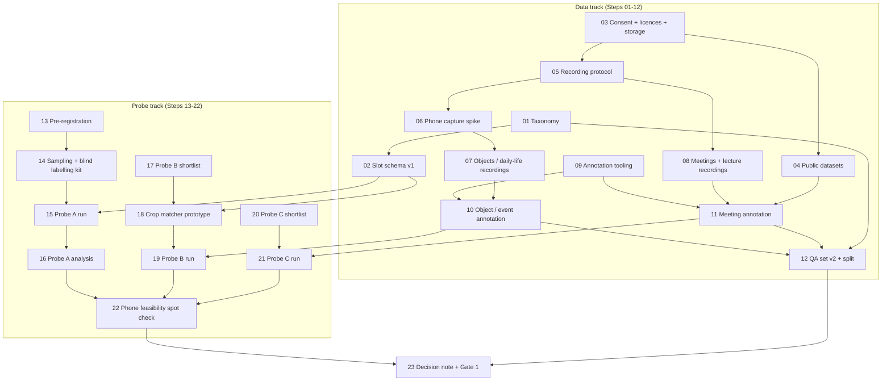

# Phase 3.1 — Scenario Data and Direction Probes

> Source: `docs/new/eykon-roadmap-v2.md` §4 (Phase 3.1) and §6 (Gate 1), and
> `docs/new/handoff-context-for-plan-writer.md` §9. Rules: Mobile Emulation
> Profile (`00-roadmap.md` §4.1), three-layer testing (§5), pessimist rules
> (§5.1). Every step has `## You test this` and `## How this number could be
> lying`. Tier: **must**.
>
> Written 07 October 2026. Phase 4 Step 01 (egocentric dataset) is merged into
> this phase (Steps 05, 07, 09, 10, 12). Phase 4 Step 03 (phone sensor spike)
> is executed here as Step 06, not duplicated.

## Goal

Before we spend months building Phases 4, 4.1, 5, 5.1 and 5.2, do two things:

1. **Collect the data every later phase is measured on.** One dataset with
   all scenario packs in it — objects and daily life, meetings, a lecture —
   with ground truth (what really happened, who really spoke, where each
   object really went) and a question set of at least 30 questions per
   category.
2. **Answer the three riskiest open questions with small, cheap tests
   ("probes")** before we commit to an architecture:
   - **Probe A:** how often does a small vision-language model (VLM) invent
     objects that are not there, or miss objects that are? If that rate is
     too high, a VLM cannot be the only source of "where are my keys".
   - **Probe B:** can a cheap perception stack with no language model at all
     (a hand tracker, a crop around the hand, and an image-text embedding
     matched against a list of object names) detect pick-up and put-down
     events as well as, or better than, the VLM captions?
   - **Probe C:** is on-device speech recognition plus speaker separation good
     enough on 30-minute meetings, in clean and noisy rooms, to support
     "who said what" and summaries?

The phase ends with a written **decision note** and **Gate 1**: the
supervisor and you agree which direction Phases 4.1 and 5.1 take, based on
the probe numbers, not on hope.

## Why this phase exists

- **The panel asked "do you really need an LLM?"** We cannot answer that by
  opinion. Probes A and B are the first measured evidence; Phase 5.2 is the
  full answer.
- **Phase 3 evidence is thin.** 3 short stock clips, 9 questions, laptop only
  (`00-roadmap.md` §9 items 2–4). Nothing after this point is allowed to rest
  on that.
- **Every later phase needs the same data.** Phase 4 needs long egocentric
  video with event boundaries. Phase 4.1 needs annotated object moves.
  Phase 5 needs state changes and temporal questions. Phase 5.1 needs
  meetings with speaker turns. Phase 5.2 needs all question types. Recording
  and annotating once, with one format, is far cheaper than five times.
- **Data collection is the slowest part of the project.** People must agree
  to be recorded, sessions must be scheduled, annotation takes roughly 3–6
  times the length of the recording. Starting now, in parallel with the
  remaining Phase 3 steps, is the only way it does not block everything.
- **Probes before commitments** (roadmap v2 design principle 5). A probe that
  costs one week and says "no" saves a phase that would have cost six.

## What "probe" means in this project

A probe is a small, time-boxed experiment with:

- a question written down before any data is looked at,
- a sample size chosen in advance,
- an **unacceptable result fixed in advance** (pre-registration, Step 13), so
  we cannot move the goalposts after seeing the numbers,
- a decision it feeds (which phase grows, shrinks or is dropped).

A probe is not a finished feature. Its code lives in `src/probes/` and is
allowed to be simple. Anything a probe proves useful is rebuilt properly in
the phase that owns it.

## Architecture of this phase



Two tracks run side by side. The data track is mostly your time (recording,
annotating). The probe track is mostly code and compute. They join at Probe B
(needs the annotated keys recording), Probe C (needs annotated meetings) and
the decision note.

## Folder and file layout (planned)

Feature-based, files under about 300 lines (`docs/invariants/core.md`).

```
src/
├── scenarios/            # NEW: the dataset as a feature
│   ├── manifest.py       #   load + validate data/scenarios_v1/manifest.json
│   ├── annotations.py    #   annotation dataclasses + loaders (events, moves, speech)
│   ├── qa.py             #   QA set loader, validator, tuning/held-out split
│   ├── agreement.py      #   inter-annotator agreement
│   ├── convert_ami.py    #   AMI -> our format
│   └── convert_epic.py   #   EPIC-KITCHENS -> our format
├── memories/
│   └── slots.py          # NEW: slot schema v1 (perception -> memory contract)
├── perception/           # NEW: cheap, LLM-free perception (Probe B, grows in Phase 4.1)
│   ├── hands.py
│   ├── crop_match.py
│   ├── interactions.py   #   in-hand state machine -> pick_up / put_down events
│   └── runner.py
├── speech/               # NEW: VAD, ASR, speaker wrappers (Probe C, grows in Phase 5 / 5.1)
│   ├── vad.py
│   ├── asr.py
│   └── speakers.py       #   embeddings, clustering, "me vs others"
└── probes/               # NEW: probe runners, kept simple
    ├── common.py         #   sampling, Wilson intervals, results writer
    ├── probe_a.py
    ├── probe_b.py
    ├── probe_c.py
    └── label_app.py      #   blind labelling page (Streamlit, separate from src/ui/app.py)

data/scenarios_v1/        # git-ignored: raw media + annotations
├── manifest.json
├── consent/              # signed consent records (never committed)
├── objects/<session>/
├── meetings/<session>/
├── lecture/<session>/
└── public/{ami,epic}/

docs/results/phase-3.1/   # committed: pre-registration, probe reports, decision note
```

## Steps

| # | Step | Track | Type | Key output | Depends on |
|---|---|---|---|---|---|
| 01 | Scenario and question taxonomy v2 | Data | Design | 11 question categories with definitions, answer types, evidence types | — |
| 02 | Slot schema v1 (perception to memory contract) | Data | Design + implement | `src/memories/slots.py`, JSON schema, validator | 01 |
| 03 | Data governance: consent, licences, privacy, storage | Data | Process + infra | Consent form, licence ledger, storage layout, `.gitignore` fix | — |
| 04 | Public dataset sourcing and conversion | Data | Research + implement | AMI (and EPIC subset) converted to our format | 03 |
| 05 | Recording protocol and capture kit | Data | Process | `PROTOCOL.md` per scenario pack, session scripts | 01, 03 |
| 06 | Phone capture spike: video + IMU + audio (executes Phase 4 Step 03) | Data | Phone | Session folder replayable on laptop | 05 |
| 07 | Own recordings: objects and daily life | Data | You record | At least 3 h, at least 6 sessions | 05, 06 |
| 08 | Own recordings: mock meetings and lecture | Data | You record | About 10 meetings of about 30 min, at least 1 lecture | 03, 05 |
| 09 | Annotation tooling and file formats | Data | Implement | Chosen tool, converters, validators | 01, 02 |
| 10 | Annotation pass: objects, events, state changes | Data | You annotate | `annotations.json` per session, agreement report | 07, 09 |
| 11 | Annotation pass: meetings and lecture | Data | You annotate | RTTM speaker turns, transcripts, reference summaries, action items | 04, 08, 09 |
| 12 | QA set v2 and tuning / held-out split | Data | You + agent write | At least 30 questions per category, frozen split | 01, 10, 11 |
| 13 | Probe pre-registration | Probes | Design | Hypotheses, sample sizes, unacceptable rates, decision table | 01, 02 |
| 14 | Probe sampling and blind labelling kit | Probes | Implement | Stratified frame sampler, labelling page | 13 |
| 15 | Probe A run: VLM extraction on probe frames | Probes | Experiment | Raw VLM outputs as slot records | 02, 14 |
| 16 | Probe A analysis: invention and miss rates | Probes | You label + analyse | Rates by object size and lighting, with intervals | 15 |
| 17 | Probe B shortlist: hand, detector, image-text models | Probes | Research | Shortlist with verified phone versions and licences | 03 |
| 18 | Probe B prototype: hand-centred crop matcher | Probes | Implement | `src/perception/` prototype writing slot records | 02, 17 |
| 19 | Probe B run: cheap path vs VLM on the keys recording | Probes | Experiment | Pick-up / put-down precision and recall, both paths | 10, 15, 18 |
| 20 | Probe C shortlist: VAD, ASR, speaker models | Probes | Research | Shortlist with verified phone versions and licences | 03 |
| 21 | Probe C run: ASR and speaker separation on meetings | Probes | Experiment | WER, DER, speaker confusion, clean vs noisy | 11, 20 |
| 22 | Phone feasibility spot check for shortlisted models | Probes | Phone | Latency and RAM of each candidate on Pixel and Infinix | 16, 19, 21 |
| 23 | Decision note and Gate 1 | Both | Decision | Written direction for Phases 4.1 and 5.1, supervisor sign-off | 12, 22 |

Suggested order when working alone: 01 → 02 → 03 → 13 → 05 → 06 → 04 →
(07 and 08 recording sessions spread over time) → 09 → 14 → 15 → 17 → 20 →
10 → 11 → 16 → 18 → 19 → 21 → 12 → 22 → 23. Pre-registration (13) is written
early on purpose, before any probe output exists.

## Exit criteria (the phase is done only if all hold)

- Dataset: at least 3 hours of own objects / daily-life recordings across at
  least 6 sessions; at least 8 own meetings of about 30 minutes (target 10);
  at least 1 lecture or study-group session; AMI subset converted. All with
  consent records and a manifest.
- Annotations validate against the schemas (Step 09 validator passes with
  zero errors). At least one objects session and one meeting are
  double-annotated, and agreement is reported.
- QA set: at least 30 questions in every one of the 11 categories in the
  tuning set; held-out recordings are listed in the manifest but their
  questions are written later (Phase 4 Step 12, Phase 5.1).
- Probe A, B and C each have a results report in `docs/results/phase-3.1/`
  that compares the outcome to the pre-registered threshold, including the
  worst case and the "how this number could be lying" section.
- Every shortlisted model has a verified licence entry and a measured phone
  latency (or a documented reason why it could not run).
- Decision note written and Gate 1 discussed with the supervisor. The
  outcome (including a "no" or "partly") is recorded.

## Decision Gate 1 (what the probes decide)

| Question | Decided by | If yes | If no |
|---|---|---|---|
| Is the VLM's object invention rate acceptable? | Probe A (Step 16) | VLM stays a valid extraction path (L3 in Phase 5.2) | VLM may only write captions with low confidence; state table must rely on another source or on confirmation |
| Is the cheap hand-centred method viable? | Probe B (Step 19) | Phase 4.1 goes ahead at full scope | Phase 4.1 shrinks to the probe result only and is reported as a negative result |
| Is speaker separation usable on our meetings? | Probe C (Step 21) | Phase 5.1 builds "who said what" | Phase 5.1 keeps "me vs others" only, or labels speakers with low confidence and says so |

The exact thresholds are fixed in Step 13, before any probe runs.

## Risks (pessimistic)

| Risk | Likelihood | Mitigation |
|---|---|---|
| Recording sessions slip because people are not available | High | Time cap (Step 05); meetings can start with 2 people; AMI covers meeting probes while own meetings are pending |
| Annotation takes far longer than planned | High | Annotate only what each probe and category needs; tooling that is fast for one person (Step 09); track hours per session |
| Probe thresholds chosen after seeing results | Medium | Step 13 is committed before any probe output exists; the git history proves the order |
| Probe frames chosen to look good | Medium | Stratified random sampling by script with a fixed seed (Step 14); no hand-picking |
| One labeller (you) is both judge and builder | High | Blind labelling (model name hidden, order shuffled); double-labelling of a subset by a second person |
| A shortlisted model has no phone version or an unusable licence | Medium | Licence and phone artifact are hard filters in Steps 17 and 20, checked before any experiment |
| Public dataset licences forbid our use | Low-Medium | Licence ledger (Step 03); only use what is verified; own recordings are enough on their own |
| Meeting audio of people who did not consent | Medium | Consent before recording; any non-consenting person present means the session is not recorded |
| Probes give mixed results that decide nothing | Medium | Decision table written in advance includes a "partly" row with a concrete scope for each phase |
| Data volume (video) fills the laptop disk | Medium | Storage budget in Step 03; originals on an external drive; only derived frames kept locally |

## Open decisions for the whole phase

- **Time cap for data collection.** No defense date yet. Options:
  (a) a fixed cap of 3 weeks for Steps 05–11 — keeps the project moving, may
  produce fewer meetings than planned; (b) a cap expressed as minimum
  quantities (stop as soon as exit criteria are met) — no wasted time, but
  no protection against slow sessions; (c) both: stop at the minimum
  quantities or at 4 weeks, whichever comes first. To be fixed when the
  defense date is known.
- **Second labeller.** Options: (a) a friend or classmate labels 20 % of
  probe frames and one session — real agreement numbers, needs their time;
  (b) you relabel the same subset a week later — weaker (same person) but
  always available; (c) supervisor spot-checks 10 items — little time, but
  adds authority. Decided in Step 14.

## Running list of issues noticed while writing this phase

1. `.gitignore` has `data/` without a leading slash, which also ignores
   `android/app/src/main/java/com/eykon/memory/data/` (the Room database
   package). The Android data layer is missing from this copy of the repo.
   Step 03 changes it to `/data/`. Update 07 October 2026: the user has the
   package locally; after the `.gitignore` fix it is copied back into
   `android/app/src/main/java/com/eykon/memory/data/` and committed.
2. No `.memory/` logs exist in this copy, so Phase 2 status was taken from the
   step docs and the code, not from logs.
3. `src/ui/app.py` (458 lines) and `src/benchmarks/data.py` (1842 lines) are
   over the 300-line rule. Not fixed here; new code in this phase goes into
   new files so it does not grow them.
4. `android/.../capture/WhisperTranscriber.kt` does not run speech
   recognition: `transcribe` returns the placeholder text
   `"Voice memo (N s recorded)"`. Phase 2 Step 05 is ticked as done, but
   on-device transcription is not implemented, and the other voice path
   (`NativeSpeechRecognizer.kt`, `RecognizerIntent`) may be online. Handled in
   Step 20 (annotation on the Phase 2 doc) and Phase 5 Step 04; flagged, not
   silently fixed. Update 07 October 2026: the user downloads the offline
   Whisper model file to the phone; that part is fine. What remains is code:
   `transcribe()` must actually call whisper.cpp (or the chosen runtime) on the
   downloaded file instead of returning the placeholder string.
5. The project has no pytest; checks are Taskfile one-liners. New steps follow
   that pattern (`task <name>-check` / `-validate`) instead of adding a test
   framework.
