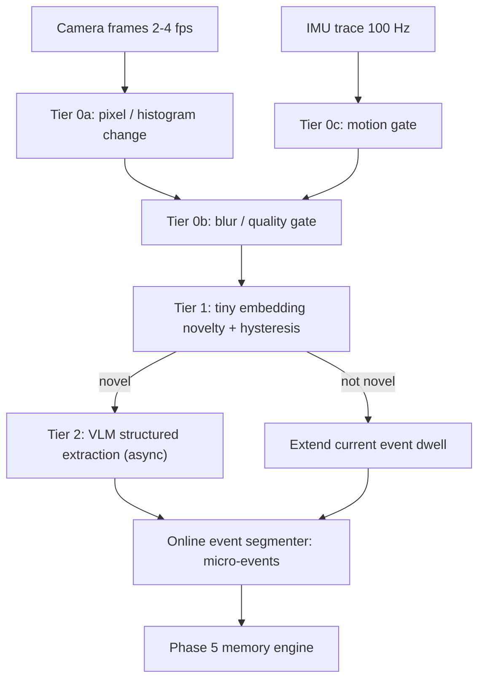

# Phase 4 — Keyframe Intelligence: Online, Budget-Constrained Event Segmentation

> Research problem **P1** in `docs/plans/00-roadmap.md`.
> Rules: Mobile Emulation Profile (roadmap §4.1), three-layer testing (§5),
> pessimist rules (§5.1). Every step ends with `## You test this`.

> [!IMPORTANT]
> **Roadmap v2 annotation — 07 October 2026 (additions only, nothing
> deleted).** Source: `docs/new/eykon-roadmap-v2.md` §4 (Phase 4).
>
> 1. **Step 01 is merged into Phase 3.1** (Steps 05, 07, 09, 10, 12). Phase 4
>    starts from `data/scenarios_v1/` (objects pack + public EPIC subset), the
>    QA set v2 (`qa_v2.json`, at least 30 per category) and the frozen split
>    `split_v1.json`. Every `data/ego_v1/` path below now means
>    `data/scenarios_v1/objects/`.
> 2. **Step 03 is executed early as Phase 3.1 Step 06** (with audio added).
>    Phase 4 reuses its session folders and `src/scenarios/phone_session.py`.
> 3. **New Step 07b — Tier 0d: hand-activity trigger (optional gate).** Uses
>    the hand model chosen in Phase 3.1 Step 17 to force-pass frames where a
>    hand is interacting with an object. Added to the ablation as config B7.
> 4. **Step 09 is planned as two paths that write the same slot record**
>    (`src/memories/slots.py`, Phase 3.1 Step 02): path V (VLM structured
>    extraction, as written) and path C (cheap perception, built in
>    Phase 4.1). Phase 4 builds path V and the shared interface; path C plugs
>    in when Phase 4.1 delivers it. If Gate 1 drops Phase 4.1, path C is the
>    Probe B prototype only.
> 5. **Step 08 encoder**: if the image-text model chosen in Phase 3.1 Step 17
>    has a verified phone artifact, it is the first candidate for Tier 1, so
>    the phone loads one encoder for novelty, crop matching and place
>    recognition (Ponytail: one model instead of two).
> 6. **Ablation (Step 11)** gains B7 (B5 + hand-activity gate) and splits B6
>    into B6-V (VLM extraction) and B6-C (cheap extraction, if Phase 4.1
>    exists). This feeds the L0 vs L3 comparison in Phase 5.2.
> 7. **Held-out (Step 12)** uses the held-out objects sessions recorded in
>    Phase 3.1 Step 07 plus the new recordings this step already asks for.
> 8. **Housekeeping**: the project has no pytest; `tests/test_*.py` entries
>    below follow the cross-phase test-framework decision in
>    `00-roadmap.md` §8. Result reports go to `docs/results/phase-4/`
>    (committed) instead of `docs/additional/`; raw JSON stays in
>    `data/results/` (git-ignored).
> 9. **Gate 2** (roadmap v2 §6) is decided at the end of Step 12: does the
>    cascade beat uniform sampling on the held-out set?
>
> Updated step list (new rows marked NEW):
>
> | # | Step | Status note |
> |---|---|---|
> | 01 | Egocentric evaluation dataset v1 | merged into Phase 3.1 |
> | 02 | Mobile emulation profile + parity harness | unchanged |
> | 03 | Phone sensor-capture spike | done as Phase 3.1 Step 06 |
> | 04–07 | Baseline B0, Tier 0a, 0b, 0c | unchanged |
> | 07b | Tier 0d: hand-activity trigger | NEW |
> | 08 | Tier 1 embedding novelty | encoder candidate note |
> | 09 | Tier 2 structured extraction, two paths | two-path note |
> | 10 | Online event segmenter | unchanged |
> | 11 | Ablation B0–B7 | B6-V / B6-C / B7 added |
> | 12 | Held-out gauntlet + Gate 2 | data source note |
> | 13 | Mobile parity gate 4 | includes Tier 0d |

## Goal
Replace "1 frame every 5 s" with an **online cascade** that decides, frame by
frame and with no look-ahead, whether a moment is worth the cost of the heavy
model — and prove with real egocentric recordings that it (a) calls the heavy
model far less, (b) misses fewer short events, and (c) produces fewer
duplicate memories than uniform sampling. Then prove it runs the same way on
both phones.

## Why this phase exists
- Phase 3's captioner runs at ~13 s/frame on laptop CPU (A4). Uniform sampling
  at 5 s cannot keep up live even on the laptop; on the phone it is worse.
- Uniform sampling misses sub-5 s actions (put keys down, pick passport up)
  and floods static scenes (3 h at a desk = 2,160 near-identical captions).
- This is where the project stops being integration work: no library decides
  *when* an egocentric moment matters under a milliwatt budget.

## Architecture (target)

Every tier logs its decision + reason + cost per frame into a **decision log**
(`data/runs/<run_id>/decisions.jsonl`) so any keyframe — or any miss — can be
explained after the fact.

## Steps

| # | Step | Type | Key output |
|---|---|---|---|
| 01 | Egocentric evaluation dataset v1 | Research + you record | ≥ 3 h annotated video, ≥ 150 QA, event boundaries |
| 02 | Mobile emulation profile + parity harness | Infra | CPU/RAM/thread caps, wall-clock replay, golden fixtures |
| 03 | Phone sensor-capture spike (video + IMU) | Phone, early | Synced video + IMU recordings from the real phone |
| 04 | Baseline B0: uniform sampling, honestly measured | Experiment | Baseline numbers every later tier must beat |
| 05 | Tier 0a: pixel / histogram change gate | Implement + experiment | Drop rate vs. missed events curve |
| 06 | Tier 0b: blur & quality gate | Implement + experiment | Calibrated thresholds per lighting |
| 07 | Tier 0c: IMU motion gate | Implement + experiment | IMU on/off ablation |
| 08 | Tier 1: embedding novelty gate + adaptive hysteresis | Research + implement | Model choice, threshold curves |
| 09 | Tier 2: structured VLM extraction (provisional → refined) | Implement + experiment | JSON slots vs free caption |
| 10 | Online event segmenter (micro-events) | Implement + experiment | Boundary F1 vs annotations |
| 11 | Ablation study (B0–B6) | Experiment | The main P1 results table |
| 12 | Held-out real-world gauntlet | You-in-the-loop | Results on videos never used for tuning |
| 13 | Mobile parity gate 4 | Phone | Same decisions on Pixel + Infinix, measured cost |

## Exit criteria (phase is done only if all hold)
- Cascade beats B0 on **both** heavy-model calls/hour and short-event recall
  on the held-out set (Step 12), not only the tuning set.
- Boundary F1 ≥ 0.55 (minimum) on held-out set.
- Decision agreement Python ↔ Kotlin on golden fixtures ≥ 95 % (Step 13).
- Measured per-tier latency and power on both phones are in the results file.
- You approved the keyframe review sessions (Steps 05–12).

## Risks (pessimistic)
| Risk | Likelihood | Mitigation |
|---|---|---|
| Thresholds overfit to our own few videos | High | Held-out set recorded *after* tuning (Step 12); report both |
| Laptop OpenCV ≠ Android implementation (rounding, colour space, resize) | High | Golden fixtures + tolerance tests (Step 02, 13) |
| CameraX delivers YUV at different resolution than our test videos | Medium | Step 03 records with the same pipeline the app will use |
| Tier 1 model not available as `.tflite` / LiteRT | Medium | Step 08 shortlists only models with a verified mobile artifact |
| Async VLM backlog grows unbounded on phone | High | Bounded queue + drop-oldest policy + backlog metric (Step 09) |
| We beat B0 only because B0 is a strawman | Medium | B0 also tested at 1 s / 2 s / 3 s, plus a "smart" uniform + dedup baseline (current Phase 3 behaviour) |
