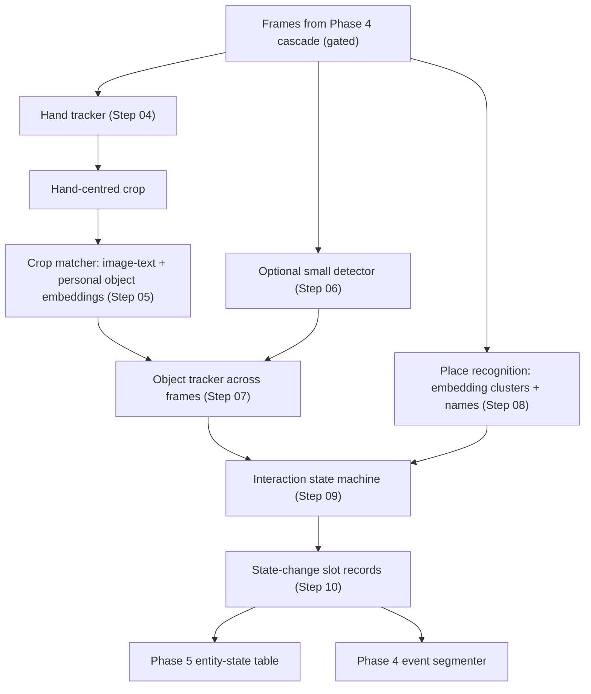

# Phase 4.1 — Object Interaction Tracking (No Language Model)

> Source: `docs/new/eykon-roadmap-v2.md` §4 (Phase 4.1), handoff §9.
> Tier: **should**, and it **depends on Probe B** (Phase 3.1 Step 19) and
> Gate 1 (Phase 3.1 Step 23). Rules: Mobile Emulation Profile (roadmap §4.1),
> three-layer testing (§5), pessimist rules (§5.1). Written 07 October 2026.

## Goal

Detect, with **no generative language model and no VLM**, when the user
handles objects — an object **appears in hand**, is **carried**, is
**released**, is **placed** somewhere, or is **taken** from somewhere — and
turn each change into a state-change record (entity, attribute, new value,
time, confidence, evidence frame) that the Phase 5 entity-state table can
use to answer "where are my keys now?" and "where were they at 10 am?".

Then measure honestly, per object size, how well it works, how it fails, how
it compares with the VLM path, and whether it runs on both phones.

## Why this phase exists

- **The panel and supervisor asked for an LLM-free route** using embeddings,
  detection and tracking. This phase is that route for the most important
  daily-life question (lost objects). Phase 5.2 compares it with the LLM
  routes (L0 vs L3).
- **The VLM path is expensive.** Phase 3's soak test captioned at about 13 s
  per frame on a laptop. A cheap hand-centred path, if accurate enough, can
  run far more often.
- **Probe B gives the go / no-go.** Gate 1 decides the scope:
  - viable → this phase at full scope (all steps),
  - unclear → reduced scope (Steps 01–05, 09, 10, 12, 14, 15),
  - not viable → this phase is reduced to Step 01 (documenting the negative
    result and why) and Step 14 (comparison write-up from Probe B data).

## Architecture



Everything writes slot records (`producer.path: cheap`), so Phase 4's Tier 2
interface (path C) and Phase 5's ledger read them the same way as VLM
records.

## Folder layout (planned)

```
src/perception/            # started in Phase 3.1 (Probe B prototype)
├── hands.py               # Step 04: streaming hand tracking + smoothing
├── crop_match.py          # Step 05: crop matching v2
├── vocab.py               # Step 03: user object list + personal enrolment
├── detector.py            # Step 06: optional detector wrapper
├── tracker.py             # Step 07: IoU / Kalman tracker
├── places.py              # Step 08: place clusters + naming
├── interactions.py        # Step 09: state machine v2
├── records.py             # Step 10: state-change slot records
└── runner.py              # pipeline over a session / live stream
src/benchmarks/interaction_eval.py   # Steps 12-14
android/.../perception/              # Step 15
docs/results/phase-4.1/
```

## Steps

| # | Step | Type | Key output | Depends on |
|---|---|---|---|---|
| 01 | Kickoff: Gate 1 scope decision and Probe B lessons | Decision | Scope (full / reduced / negative result), lessons list | Phase 3.1 Step 23 |
| 02 | Final model selection with phone artifacts and licences | Research | Frozen model set, ledger rows, phone files | 01 |
| 03 | Object vocabulary and personal object enrolment | Implement + UX | User-editable list; few-photo enrolment of personal objects | 02 |
| 04 | Hand tracking for streams: smoothing, handedness, mount regions | Implement | `hands.py` v2 with temporal smoothing | 02 |
| 05 | Crop matcher v2: templates, personal embeddings, unknown objects | Implement + experiment | Identification accuracy per size | 03, 04 |
| 06 | Optional closed-vocabulary detector variant | Implement + experiment | Detector variant results, kept or dropped | 02, 05 |
| 07 | Object tracking across frames | Implement | `tracker.py`, track continuity metrics | 05 (06 optional) |
| 08 | Place recognition and place naming | Research + implement | Place clusters, naming flow, place accuracy | 02 |
| 09 | Interaction state machine v2 (five states) | Implement | `interactions.py` v2, transition log | 07, 08 |
| 10 | State-change records and the ledger interface | Implement | Slot records, interface contract with Phase 5 Step 07 | 09 |
| 11 | Integration as Tier 2 path C in the Phase 4 cascade | Integrate | Wall-clock replay with path C, backlog and cost | 10, Phase 4 Step 09 |
| 12 | Evaluation on annotated moves (main 4.1 results) | Experiment | Precision / recall per object size, visibility | 10 |
| 13 | Failure taxonomy and occlusion analysis | Analysis | Counted failure types with galleries | 12 |
| 14 | Comparison with the VLM path and a hybrid | Experiment | Cheap vs VLM vs hybrid table, cost | 12, Phase 4 Step 11 |
| 15 | Mobile parity gate 4.1 | Phone | Same events on Pixel and Infinix, measured cost | 11, 12 |

## Exit criteria

- Precision and recall of pick-up / put-down / place events reported per
  object size (small / medium / large) and per visibility, on tuning **and**
  held-out sessions, with intervals.
- Place accuracy for put-down events reported.
- Failure taxonomy with counts (occlusion, small objects, look-alikes,
  hand not found, place confusion).
- Comparison with the VLM path on the same events and the same cost
  measures.
- Python ↔ Kotlin event agreement on golden fixtures at least 90 % (exact
  value fixed in Step 15), cost measured on both phones.
- If reduced or negative scope: the written reason and the evidence.

## Risks (pessimistic)

| Risk | Likelihood | Mitigation |
|---|---|---|
| Small and hidden objects (keys inside a closed hand, ring) are not identifiable from a crop | High | Report per size; personal enrolment (Step 03); confidence low → "last seen" wording in Phase 5.2 answers instead of a confident place |
| Look-alike objects (two black wallets, keys vs coins) confused | Medium | Personal enrolment photos; look-alike pairs listed and measured |
| Thresholds overfit to our rooms and objects | High | Held-out sessions in new places; frozen config before held-out run |
| Hand model weak on egocentric, top-down views | Medium | Detection rate per mount and lighting reported (Step 04) |
| A shipping-licence problem appears late | Low | Licences frozen in Step 02 from Phase 3.1 ledger |
| The cheap path is fast on laptop, slow on the Infinix | Medium | Phone cost measured early (Phase 3.1 Step 22) and again in Step 15 |
| Place recognition confuses similar rooms or surfaces | Medium | User names places once; places tied to session clusters; errors reported |

## Open decisions for the whole phase

- **Scope after Gate 1** — decided in Step 01 from the Gate 1 outcome.
- **Detector strategy** (handoff §6): crop matching only, plus a small
  closed-vocabulary detector, or an open-vocabulary detector. Narrowed by
  Probe B; finalised in Steps 02 and 06.
- **Place naming** (handoff §6): text matching vs user labels — Step 08.
