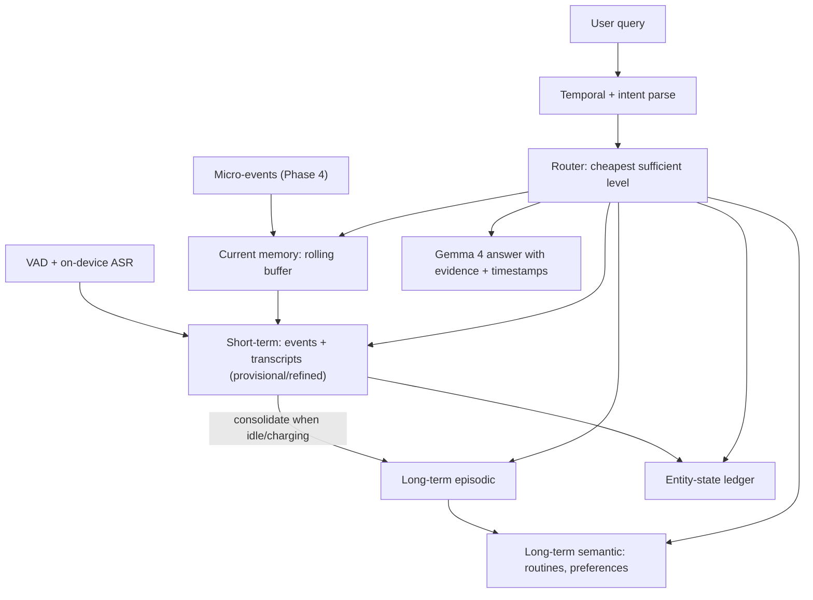

# Phase 5 — Hierarchical Memory & Temporal State Reconciliation

> Research problem **P2** (`docs/plans/00-roadmap.md`). Step docs in this
> folder are written at plan level now; each gets a "Kickoff refinement" note
> appended when the phase starts, using Phase 4 results. Nothing is deleted.

> [!IMPORTANT]
> **Roadmap v2 annotation — 07 October 2026 (additions only, nothing
> deleted).** Source: `docs/new/eykon-roadmap-v2.md` §4 (Phase 5: "keep as
> planned; the entity-state table also accepts interaction events from
> Phase 4.1; the router and time parser stay rules-first").
>
> 1. **Data**: every `ego_v1` reference below now means
>    `data/scenarios_v1/` (Phase 3.1), with `qa_v2.json` (11 categories, at
>    least 30 per category) and the frozen split. Evaluation is per category.
> 2. **Inputs to memory are slot records** (`src/memories/slots.py`, Phase 3.1
>    Step 02) from both perception paths (VLM path V, cheap path C from
>    Phase 4.1) and from speech. Memory never depends on which producer wrote
>    a record.
> 3. **Step 01 schema v2** must also reserve the conversation tables Phase 5.1
>    needs (sessions, speakers, utterances, topics, summaries, action items)
>    and the Phase 4.1 tables (`tracked_objects`, `object_prototypes`,
>    `places`). One schema, designed once.
> 4. **Step 04 audio** overlaps with Phase 3.1 Steps 20–21 and Phase 5.1. The
>    feature folder is `src/speech/` (created in Phase 3.1), not `src/audio/`.
>    It implements the real on-device transcription call: the Whisper model
>    file is downloaded to the phone, but `WhisperTranscriber.transcribe()`
>    currently returns a placeholder string and must be wired to the runtime
>    chosen in Phase 3.1 Step 20. English only (planning default).
> 5. **Step 07 ledger** accepts interaction state-change records from
>    Phase 4.1 (contract: `docs/results/phase-4.1/ledger-interface.md`) and
>    resolves conflicts between producers explicitly.
> 6. **Steps 08 and 09 are rules-first**: rule-based time parser and router
>    are the default; LLM fallbacks are switchable and measured, because
>    Phase 5.2's L0 configuration must work with no generative model at all.
> 7. **Step 11** keeps the M0–M4 comparison (retrieval and memory structure).
>    The answer-level comparison L0–L3 is Phase 5.2; Step 11 uses the
>    Phase 5.2 answer interface if it exists, otherwise the current Gemma
>    prompt, and says which.
> 8. **Step 06 (semantic memory)** stays exploratory and is the last item to
>    cut if time runs short (roadmap v2 §7).
> 9. **Housekeeping**: no pytest in the project (see `00-roadmap.md` §8 test
>    framework decision); result reports go to `docs/results/phase-5/`.
>    Database stays plain `sqlite3` with parameterised queries (planning
>    default, 07 October 2026).

## Goal
Turn micro-events (Phase 4) and speech (this phase) into a memory that:
1. is **hierarchical** — current → short-term → long-term episodic + semantic
   (LightMem-Ego's structure, which we cite as the reference design);
2. stays **consistent when the world changes** — an entity-state ledger with
   explicit invalidation, so "where are my keys *now*?" never returns the 9 AM
   location (the gap LightMem-Ego names in its own limitations);
3. answers **temporal** questions ("after the pharmacy, before lunch") with
   time-window gating instead of hoping embeddings understand time;
4. has a **lifecycle policy** — merge, forget, promote — with bounded storage;
5. runs fully on-device, verified on both phones.

## Architecture (target)

## Steps

| # | Step | Type |
|---|---|---|
| 01 | Memory schema v2 + non-destructive migration | Design + implement |
| 02 | Current memory (working buffer) | Implement |
| 03 | Short-term event store + async refine/backfill | Implement |
| 04 | On-device audio: VAD + ASR aligned to timeline | Implement + phone spike |
| 05 | Long-term episodic consolidation | Research + implement |
| 06 | Semantic memory (routines/preferences) — exploratory | Research |
| 07 | Entity-state ledger & invalidation (P2 core) | Research + implement |
| 08 | Temporal query understanding + time-window gating | Implement + experiment |
| 09 | Query router | Implement + experiment |
| 10 | Lifecycle policy: merge / forget / promote + storage stress | Research + experiment |
| 11 | Retrieval & QA evaluation v2 (main P2 results) | Experiment |
| 12 | Mobile parity gate 5 | Phone |

## Exit criteria
- State-change query accuracy ≥ 70 % (min) on held-out scenarios, and clearly
  above flat RAG (Phase 1 pipeline) on the same queries.
- Temporal-order accuracy reported per category with CIs.
- Human-judged QA accuracy ≥ 50 % (min) fully offline.
- Storage growth per captured hour measured; 7-day replay stays within budget.
- Memory engine runs on both phones with documented latency P50/P90.

## Risks (pessimistic)
| Risk | Mitigation |
|---|---|
| Entity extraction from small VLM is noisy → ledger confidently wrong | Confidence per transition, ledger answers cite evidence frames, fallback to retrieval when confidence low |
| Consolidation summaries hallucinate | Summaries keep pointers to source events; QA can drill down; human audit of 30 summaries |
| Router misroutes → misses answers | Router failure analysis; "fan-out on low confidence" fallback |
| Schema migration loses Phase 1/2 memories | Migration is additive; backup before migrate; row counts verified (core.md: never destructive silently) |
| FTS4 vs FTS5 parity on Android | Decided in Step 01 (roadmap §8) |
