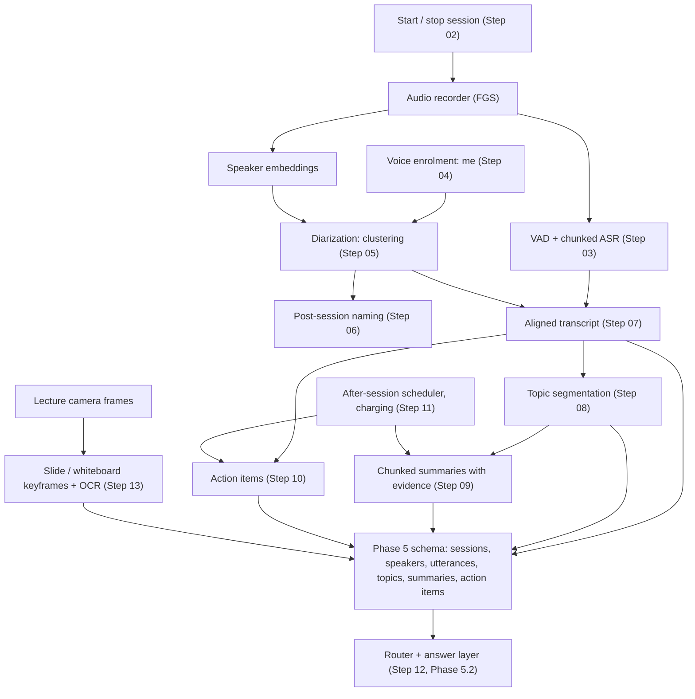

# Phase 5.1 — Conversation Intelligence: Meetings and Classroom

> Source: `docs/new/eykon-roadmap-v2.md` §4 (Phase 5.1), handoff §9.
> Tier: **must** for meetings, **should** for the classroom variant.
> Depth depends on **Probe C** (Phase 3.1 Step 21) and Gate 1. Rules: Mobile
> Emulation Profile, three-layer testing, pessimist rules (roadmap §4–5).
> Written 07 October 2026.

## Goal

Record a conversation of about 30 minutes on the phone, fully offline, and
after it ends give the user:

1. an **aligned transcript**: who spoke (me / speaker 1, 2, 3 — or names the
   user assigned), what they said, and when,
2. **topics**: the meeting split into parts with short titles,
3. a **faithful summary** where every bullet links to the moments that
   support it,
4. **action items** with owner and time,
5. answers to questions such as "who suggested moving the deadline?", "what
   did I agree to do?", "what did the teacher say about normalisation?", with
   quoted evidence and timestamps,
6. for lectures: slide and whiteboard changes captured as keyframes and their
   text read by OCR.

Then measure honestly how faithful the summaries are, how often speakers are
wrong, and how noise and overlapping speech affect everything, on both phones.

## Why this phase exists

- Meetings are the committed new scenario (roadmap v2, handoff §4). They
  turn Eykon from an object finder into a daily-life helper, which is what
  the panel found weak about the original use case.
- Conversations are where an LLM seems most needed (summaries). Building the
  conversation features with **switchable** answer levels lets Phase 5.2
  measure exactly what a generative model adds over extractive and template
  methods.
- Phone-only speech recognition and speaker separation are hard and imperfect.
  Measuring and reporting their failures honestly (noisy rooms, overlapping
  speech) is a stronger thesis than a demo that only works in a quiet room.

## Scope rule from Gate 1 (Probe C)

| Probe C verdict | Phase 5.1 scope |
|---|---|
| usable | full: who-said-what with speaker labels, naming, summaries per speaker |
| partly (DER high, "me vs others" good) | "me vs others" attribution, plus optional post-session manual naming of clusters (Step 06) |
| unusable | transcript, topics, summaries and action items without speaker attribution; `who_said` answered only for "me"; documented as a negative result |

## Architecture



## Folder layout (planned)

```
src/speech/                 # from Phase 3.1 / Phase 5 Step 04: vad.py, asr.py, speakers.py
src/conversations/          # NEW feature folder
├── sessions.py             # Step 02: session lifecycle, storage
├── transcribe.py           # Step 03: VAD + chunked ASR per session
├── enrolment.py            # Step 04
├── diarize.py              # Step 05: clustering, known / unknown speaker count
├── naming.py               # Step 06
├── align.py                # Step 07: words + speakers + times
├── topics.py               # Step 08
├── summarise.py            # Step 09: L0 extractive + L2 generative variants
├── actions.py              # Step 10
├── scheduler.py            # Step 11 (laptop simulation of the Android worker)
├── retrieve.py             # Step 12: session resolver, evidence builders
├── slides.py               # Step 13: slide-change keyframes + OCR
├── lecture.py              # Step 14: slide-topic alignment, lecture notes
└── app_page.py             # Streamlit review page (separate from src/ui/app.py)
src/benchmarks/conversation_eval.py   # Steps 15-17
android/.../conversations/            # Steps 02, 11, 18
docs/results/phase-5.1/
```

## Steps

| # | Step | Type | Key output | Depends on |
|---|---|---|---|---|
| 01 | Kickoff: Gate 1 scope, schema check for conversations | Decision + design | Scope, confirmed tables | Phase 3.1 Step 23, Phase 5 Step 01 |
| 02 | Session lifecycle: start / stop, recording service, storage | Implement (phone + laptop) | Session records, audio files, button | 01 |
| 03 | Session audio pipeline: VAD + chunked ASR | Implement | Utterance drafts with times | 02, Phase 5 Step 04 |
| 04 | Voice enrolment for "me" | Implement + experiment | Voiceprint, "me" accuracy | 03 |
| 05 | Speaker separation for others (diarization) | Implement + experiment | Speaker clusters, DER | 03, 04 |
| 06 | Post-session speaker naming | Implement + UX | Named speakers, re-labelled utterances | 05 |
| 07 | Aligned transcript builder (overlap aware) | Implement | Utterances with speaker, time, confidence | 03, 05 |
| 08 | Topic segmentation by embedding change | Implement + experiment | Topics with titles, boundary F1 | 07 |
| 09 | Chunked summaries with evidence links (extractive and generative) | Implement + experiment | Summary bullets with time ranges | 08 |
| 10 | Action item extraction (rules and generative variants) | Implement + experiment | Action items with owner and time | 07 |
| 11 | After-session processing while charging | Implement (phone) | WorkManager jobs, budget, progress | 03–10 |
| 12 | Conversation retrieval and question answering integration | Integrate | Router routes for conversation questions | 07–10, Phase 5 Step 09 |
| 13 | Slide and whiteboard capture with OCR | Research + implement | Slide keyframes with text | 02, Phase 4 cascade |
| 14 | Classroom variant and lecture questions | Implement + experiment | `lecture_recall` answers | 12, 13 |
| 15 | Human faithfulness audit of summaries and error taxonomy | You audit | Error counts by type | 09, 10 |
| 16 | Noise and overlapping-speech robustness evaluation | Experiment | Results per condition | 07–10 |
| 17 | Conversation evaluation on tuning and held-out meetings (main 5.1 results) | Experiment | Per-category accuracy, at least 10 sessions judged | 12–16 |
| 18 | Mobile parity gate 5.1 | Phone | After-session processing on both phones, measured | 11, 17 |

## Exit criteria

- At least 10 meetings or lectures processed end to end and judged by humans
  (roadmap v2), including at least 2 held-out meetings never used for tuning.
- Per-category results for `who_said`, `conversation_recall`,
  `action_items`, `meeting_summary`, `lecture_recall` (and `negative` on
  conversation sessions), at least 30 questions per category, with intervals.
- Summary faithfulness audit: counts of unsupported bullets, wrong speakers,
  missing key items, per answer level (extractive / generative).
- WER and DER per condition (clean, noisy, overlap, phone placement).
- After-session processing time and battery cost measured on both phones.
- Zero network calls during capture and processing (airplane-mode runs).

## Risks (pessimistic)

| Risk | Likelihood | Mitigation |
|---|---|---|
| Noisy audio makes transcripts unusable | High | Condition-split results; advise phone placement; honest reporting |
| Overlapping speech breaks speaker labels | High | Overlap-aware alignment; overlap DER reported; low-confidence labels shown |
| Small generative model summaries invent content | High | Evidence links required per bullet; extractive variant; human audit (Step 15) |
| 30-minute processing too slow or hot on the Infinix | Medium | Process while charging; chunking; low-end mode with smaller ASR |
| Participants' consent limits recordings | Medium | Phase 3.1 consent process; AMI as second data source |
| Speaker naming burdens the user | Medium | Naming is optional; "me vs others" works without it |
| Lecture OCR poor on photographed slides | Medium | Slide-change detection is still useful; OCR quality reported separately |

## Open decisions for the whole phase

- **Streaming vs after-session processing.** Options: (a) everything after
  the session — simplest, best accuracy, no live transcript; (b) live
  transcript, summaries after — nicer UX, more battery during the meeting;
  (c) after-session by default, live transcript as an option measured in
  Phase 6. Draft: (c).
- **Default answer level for conversations** (handoff §6 lean: templates and
  quotes by default, generative as a toggle). Confirmed in Phase 5.2.
