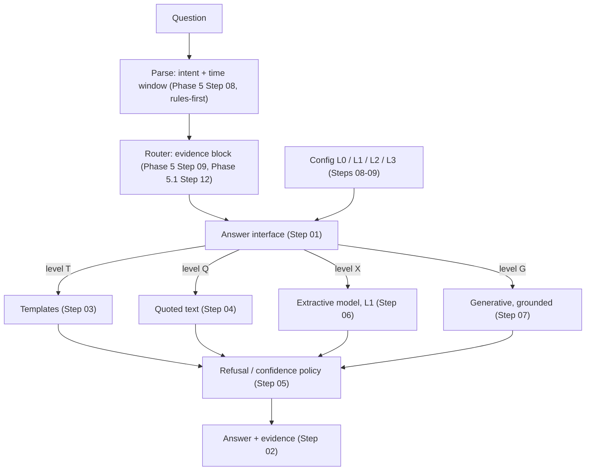

# Phase 5.2 — Answer Layer and LLM-Optional Evaluation (L0–L3)

> Source: `docs/new/eykon-roadmap-v2.md` §3 (the LLM question as an
> experiment) and §4 (Phase 5.2), handoff §9. Tier: **must**. Ends with
> **Gate 3**: is the LLM needed, and for which question types? Rules:
> Mobile Emulation Profile, three-layer testing, pessimist rules. Written
> 07 October 2026.

## Goal

Build **one answer interface** with switchable levels, and use it to measure
**exactly where a generative model helps** — per question type, with
accuracy, faithfulness, latency, memory, battery and heat on both phones —
then write the conclusion whichever way the data points.

Configurations compared on the same data and the same questions (roadmap v2
§3):

| Config | Perception | Answering | Generative model used? |
|---|---|---|---|
| **L0** | Cheap perception (path C if Phase 4.1 delivered; otherwise cascade + image-text retrieval of keyframes), ASR, OCR, rules | Templates from the state table and events; quoted text for conversations; extractive summaries | No |
| **L1** | As L0 | L0 + a small **extractive** answer model (picks the answer span from evidence; does not write new text) | No (small extractive model only) |
| **L2** | As L0 | **Generative** model (Gemma 4 E2B) writes answers and summaries from L0 evidence | Yes, for answers only |
| **L3** | **VLM extraction** (path V) + ASR, OCR | Generative answers and summaries (the original plan) | Yes, for perception and answers |

Speech recognition (a neural recogniser) is present in every configuration;
it is a recogniser, not a reasoning assistant (roadmap v2 §3 honest note).

## Why this phase exists

- The panel asked "do you really need an LLM?" and the supervisor asked to
  explore doing the project without one. A measured comparison is a stronger
  answer than either "yes" or "no".
- If L0 or L1 is close to L2 / L3 for most question types at a fraction of the
  cost, the project can claim a practical LLM-free (or LLM-light) design. If
  not, it can show exactly which question types need the LLM and what it
  costs. Both outcomes are publishable results.
- An answer interface with evidence is also what makes every answer
  checkable by the user (roadmap v2 design principle 4: evidence first).

## Architecture



## Folder layout (planned)

```
src/answers/                 # NEW feature folder
├── interface.py             # Step 01: AnswerRequest, Answer, answer(...)
├── evidence.py              # Step 02: evidence items, rendering
├── templates.py             # Step 03
├── quotes.py                # Step 04
├── refusal.py               # Step 05
├── extractive.py            # Step 06 (L1)
├── generative.py            # Step 07 (L2 / L3), reuses src/assistant/
└── configs.py               # Step 08: L0-L3 definitions
src/benchmarks/llm_optional_eval.py   # Steps 09-12
android/.../answers/                  # Steps 13-14
docs/results/phase-5.2/
```

`src/assistant/` (Phase 1 prompt and LLM code) is reused by `generative.py`,
not duplicated.

## Steps

| # | Step | Type | Key output | Depends on |
|---|---|---|---|---|
| 01 | Answer interface contract | Design + implement | `answer(request) -> Answer` with levels | Phase 5 Step 09 |
| 02 | Evidence model and citation rendering | Implement | Evidence items (time, frame, quote), renderers | 01 |
| 03 | Level T: template answers from the state table, events and action items | Implement | Templates per intent | 01, 02, Phase 5 Step 07 |
| 04 | Level Q: quoted-text answers for conversations and text memories | Implement | Quote selection per intent | 01, 02, Phase 5.1 Step 12 |
| 05 | Refusal and confidence policy ("I don't know") | Implement + experiment | Thresholds per level, `negative` accuracy | 03, 04 |
| 06 | L1: small extractive answer model | Research + implement | Shortlisted model, integration, phone artifact | 01, 02 |
| 07 | L2: grounded generative answers with citation enforcement | Implement | Prompt, parser, citation validation | 01, 02 |
| 08 | Configuration definitions L0–L3 and the perception switch | Implement | One setting selects a whole configuration | 03–07, Phase 4 Step 09, Phase 4.1 Step 11 |
| 09 | Configuration matrix runner on all scenario questions | Experiment | Answers for every question × config | 08 |
| 10 | Scoring: automatic, human, optional external judge | Experiment | Scores with agreement numbers | 09 |
| 11 | Cost measurement: latency, RAM, battery, heat on both phones | Phone experiment | Cost table per config | 08 |
| 12 | Per-question-type analysis and failure taxonomy | Analysis | Tables, failure counts, examples | 10, 11 |
| 13 | Answer UI in the app: level toggle, evidence display | Implement (phone + laptop) | Ask screen with evidence | 02–08 |
| 14 | Mobile parity gate 5.2 | Phone | Same answers on both phones at measured cost | 11, 13 |
| 15 | Conclusion and Gate 3 | Decision | Written conclusion, default level chosen | 12, 14 |

## Exit criteria

- Every question in the QA set (all 11 categories, tuning and held-out
  reported separately, at least 30 per category) answered in L0, L1, L2 and
  L3, scored, with intervals.
- Cost table per configuration on both phones: P50 / P90 latency, peak
  memory, battery per hour of capture and per 100 questions, thermal events,
  model calls per hour.
- Faithfulness per configuration (unsupported content rate) from human
  checks.
- A written conclusion that names, per question type, whether a generative
  model is needed, using the numbers — including the case where it is not.
- Gate 3 recorded: the final system claim and the default answer level.

## Risks (pessimistic)

| Risk | Likelihood | Mitigation |
|---|---|---|
| L0 looks weak only because templates were built quickly | Medium | Templates designed per intent with the same care as prompts; template coverage reported |
| L2 / L3 look good because the judge favours fluent text | High | Human scoring primary; any external judge is a different model family, labelled, cross-checked |
| Configs differ in more than the intended variable | Medium | One setting switches a whole config; everything else frozen and hashed |
| Phase 4.1 cut, so L0 objects are weak | Medium | L0 falls back to image-text keyframe retrieval; stated clearly in results |
| Phone costs dominate and are noisy | Medium | Repeated runs, cool-down protocol, both phones same day |
| Conclusion drifts toward the hoped-for answer | Medium | Conclusion template written before results (Step 15 structure fixed in Step 09) |

## Open decisions for the whole phase

- **Default answer level in the app** (handoff §6 lean: templates and quotes
  by default, generative as a toggle). Decided at Gate 3 from the numbers.
- **L1 model choice** — Step 06.
