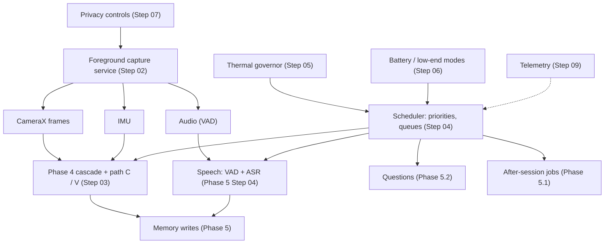

# Phase 6 — Live Capture and Real-World Stress

> Source: `docs/plans/00-roadmap.md` §2 (research problem **P3**: asymmetric
> scheduling under a phone thermal / RAM envelope), §6–7 (KPIs), and
> `docs/new/eykon-roadmap-v2.md` §4 (Phase 6: "moved after the above; add a
> full 30-minute live meeting run, a full-day run, thermal and battery on
> Pixel and Infinix"). Tier: **must**. Feeds **Gate 4** (do results hold on
> both phones?). Written 07 October 2026.

## Goal

Run the complete system **live** on the phone — camera, microphone and
sensors continuously, the gating cascade, extraction, memory, conversations
and answers — in the configuration chosen at Gate 3, and show with real
measurements that it:

1. keeps working for a 30-minute objects session, a 30-minute live meeting
   and full days, on the Pixel 9 Pro XL and the Infinix Note 12,
2. stays within thermal and battery limits by **scheduling** work (perception
   vs questions vs after-session processing) and **degrading gracefully** when
   the phone gets hot,
3. makes **zero network calls**,
4. gives the user privacy controls that work while recording,
5. survives crashes, reboots and full storage without losing memory.

## Why this phase exists

- Everything before this phase was replayed recordings. Live capture adds
  the camera sensor and image processor power, real foreground-service
  limits, the user's pocket and real heat. Roadmap §5.1: "only phone runs
  count for thermal / battery claims".
- Research problem P3 (asymmetric scheduling on one phone chip) can only be
  studied live: perception must not starve a question, and a question must
  not stall perception.
- The panel named "performance and thermal management across image, audio,
  video and text" as a complex-computing component; this phase is where it is
  demonstrated.

## Architecture

## Steps

| # | Step | Type | Key output | Depends on |
|---|---|---|---|---|
| 01 | Kickoff: Gate 3 configuration, live targets, field-study plan | Decision | Frozen live configuration, targets, schedule | Phase 5.2 Step 15 |
| 02 | Foreground capture service: camera, microphone, sensors | Implement (phone) | Continuous capture service with permissions and notification | 01 |
| 03 | Live pipeline wiring end to end | Implement (phone) | Live cascade → extraction → memory, queryable | 02 |
| 04 | Asymmetric scheduler (P3) | Research + implement | Priority rules, queues, preemption, measured | 03 |
| 05 | Thermal governor and operating modes | Research + implement | Mode table driven by thermal status / headroom | 04 |
| 06 | Battery-aware and low-end modes | Implement + experiment | Modes for battery levels and the Infinix | 05 |
| 07 | Privacy controls in the loop | Implement | Pause, exclusion times / places, retention, delete | 03 |
| 08 | Network-zero verification | Experiment | Network logs with zero calls, airplane tests | 03 |
| 09 | On-device telemetry and field logging | Implement | Low-overhead telemetry, export | 03 |
| 10 | Robustness: crash, kill, reboot, storage full | Experiment | Recovery behaviour verified, no data loss | 03, 09 |
| 11 | Live 30-minute objects stress run on both phones | Experiment | KPIs vs roadmap §7 | 04–10 |
| 12 | Live 30-minute meeting run on both phones | Experiment | Live meeting KPIs | 04–10, Phase 5.1 |
| 13 | Multi-day field study with full-day runs | Experiment + you live with it | At least 5 days, daily KPIs, QA on real days | 11, 12 |
| 14 | Usability study with a few users | User study | Task success, SUS-style score, feedback | 13 |
| 15 | Phase 6 results and Gate 4 contribution | Analysis + decision | Results document, phone comparison | 11–14 |

## Exit criteria (targets from roadmap §7, minimum acceptable values)

- 30-minute live objects run on the Pixel: at most 1 brief thermal
  throttling event, battery drain at most 15 %; Infinix results reported with
  the mode it needed.
- 30-minute live meeting on both phones completes without recording gaps;
  after-session processing results available.
- At least 5 days of field use with daily KPIs: storage growth per hour,
  battery per day, heavy-model calls per hour (at most 300), answer latency
  P50 / P90 (Pixel at most 10 s / 20 s).
- Zero runtime network calls (airplane-mode runs and network logging).
- Recovery tests pass with no memory loss.
- Results written for both phones; gaps explained (Gate 4 input).

## Risks (pessimistic)

| Risk | Likelihood | Mitigation |
|---|---|---|
| Android kills or throttles the capture service | High | Correct foreground service types, battery-optimisation exemption, watchdog and restart, measured |
| Infinix overheats under continuous capture | High | Low-end mode (lower fps, no live VLM, cheap path only), measured |
| Camera + mic + models exceed memory on the Infinix | Medium | Sequential model loading, scheduler limits, measured peak memory |
| Pocket covers the camera | High | Mount required for field days; pocket periods detected (dark frames) and skipped |
| Field days reveal privacy issues with bystanders | Medium | Privacy controls (Step 07), exclusion places, no faces stored (until Phase 6.5 opt-in) |
| Telemetry itself costs power | Low | Low-rate sampling; telemetry cost measured |
| Usability study participants hard to find | Medium | 3–5 classmates; short tasks |

## Open decisions for the whole phase

- **Primary phone** if time forces a choice: Pixel (planning default,
  07 October 2026); the Infinix stays the low-end check.
- **Live configuration**: decided at Gate 3 (Phase 5.2 Step 15); Step 01
  freezes it.
