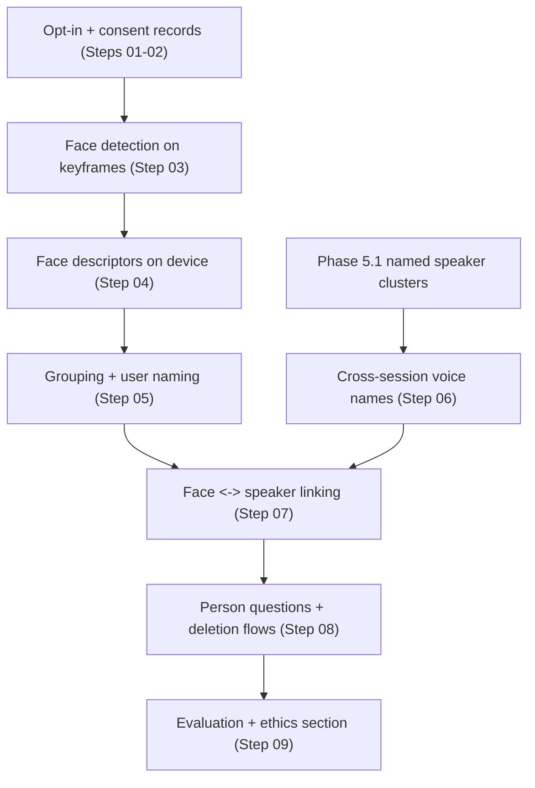

# Phase 6.5 — People Layer: Faces and Voices the User Names (Opt-In)

> Source: `docs/new/eykon-roadmap-v2.md` §4 (Phase 6.5), handoff §9 ("privacy
> and ethics first, then technical steps, then a hard scope limit because it
> is a stretch"). Tier: **stretch** — first in the cut order (roadmap v2 §7).
> Written 07 October 2026.

## Goal

Let the user, **only if they switch it on**, attach names to people they meet
so the assistant can answer "what did Alex say?" and "when did I last see
Alex?":

- voices: named speaker clusters from meetings (Phase 5.1 Step 06) remembered
  across sessions, with the person's consent;
- faces: face detection and numeric face descriptors computed on the phone,
  grouped, and named by the user;
- linking a face to the current speaker where possible, reported with its
  failures (hard from a chest or head camera).

All data local, only user-confirmed names, deletion supported, no automatic
naming of strangers, off by default.

## Why this phase exists

- "Who said what" and "when did I last see someone" are natural daily-life
  questions (Pack D in roadmap v2).
- It is also the most privacy-sensitive feature in the project. Doing it with
  an explicit ethics design is a chance to show the panel responsible design,
  even if the technical scope stays small.
- It is stretch: if time is short, this phase is cut first and the thesis
  includes only the ethics design (Step 01) as future work.

## Hard scope limit

Written now so the phase cannot grow:

- At most **4 weeks** of work (or the equivalent once the defense date is
  known); stop at the limit and report what exists.
- Only people who gave consent are ever named; never public places with
  strangers in the evaluation data.
- No identification of anyone the user has not named themselves; no import of
  photos from other sources (contacts, social media).
- No cloud services of any kind.
- Faces are never stored as images beyond the short enrolment thumbnails the
  user chooses; only numeric descriptors, encrypted at rest.

## Architecture

## Steps

| # | Step | Type | Key output | Depends on |
|---|---|---|---|---|
| 01 | Ethics and privacy design, supervisor and ethics sign-off | Design + approval | Ethics document, consent forms, data-flow diagram | Phase 6 Step 07 |
| 02 | Go / no-go and scope freeze | Decision | Go / no-go with time box | 01, Phase 6 Step 15 |
| 03 | Face detection model shortlist and integration | Research + implement | On-device face detector with licence verified | 02 |
| 04 | Face descriptors on device, encrypted storage | Implement | Descriptor model, encrypted table | 03 |
| 05 | Grouping faces and user naming | Implement + UX | Clusters, naming screen, confirmations | 04 |
| 06 | Cross-session voice names (consented) | Implement | Remembered voiceprints for named people | 02, Phase 5.1 Step 06 |
| 07 | Face–speaker linking with honest failure reporting | Research + experiment | Linking rule, accuracy, failure list | 05, 06 |
| 08 | Person questions and deletion flows | Implement | "What did Alex say", "forget Alex" | 05–07 |
| 09 | Evaluation and the ethics section for the panel | Experiment + writing | Results with consented participants, ethics chapter | 08 |

## Exit criteria

- Ethics document approved by the supervisor (and ethics process if
  required) before any face data is processed.
- With consenting participants only: face grouping purity, naming
  confirmations needed, voice-name accuracy across sessions, linking accuracy
  and failures, all with sample sizes.
- Deletion of a person removes every descriptor, name and link (tested).
- Feature off by default; on-switch shows a clear explanation.

## Risks (pessimistic)

| Risk | Likelihood | Mitigation |
|---|---|---|
| Ethics approval takes longer than the time box | High | Step 02 no-go; ethics design still goes into the thesis |
| Bystanders captured in keyframes | High | Faces of unnamed people never grouped persistently (discarded after N days), never named |
| Face models with unusable licences or no phone version | Medium | Licence and phone filters (Step 03) |
| Linking faces to speakers unreliable | High | Reported as a limitation with numbers; answers say "probably" |
| Feature distracts from must-tier work | Medium | Hard time box; starts only after Phase 6 results |

## Open decisions

- **Whether to do faces at all, or voices only.** Options: (a) voices only
  (lowest risk, builds on Phase 5.1); (b) faces and voices (full Pack D);
  (c) ethics design only, no implementation. Decided at Step 02.
