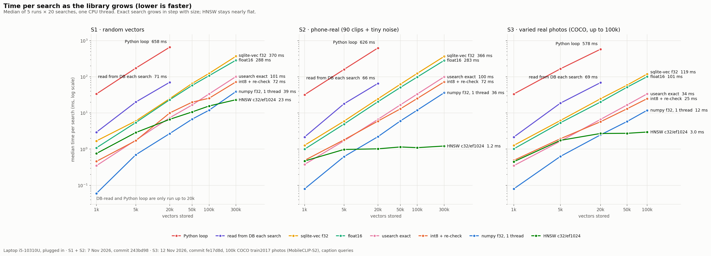
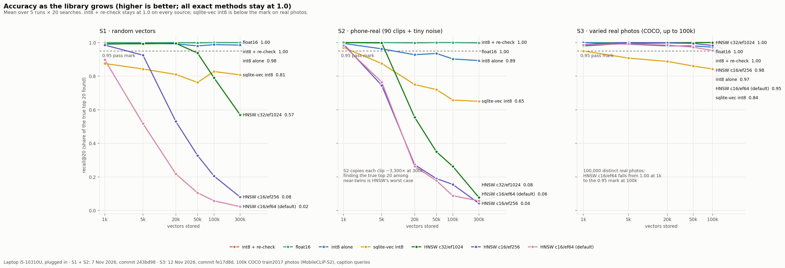
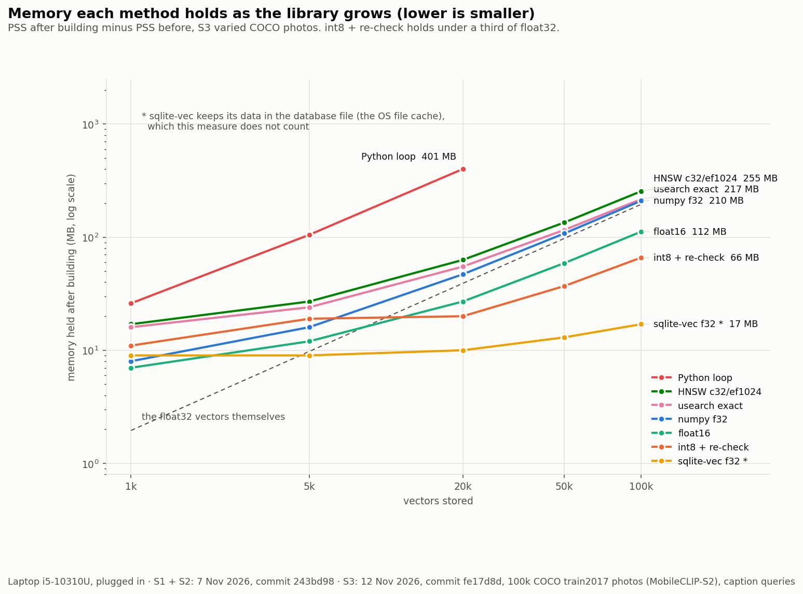
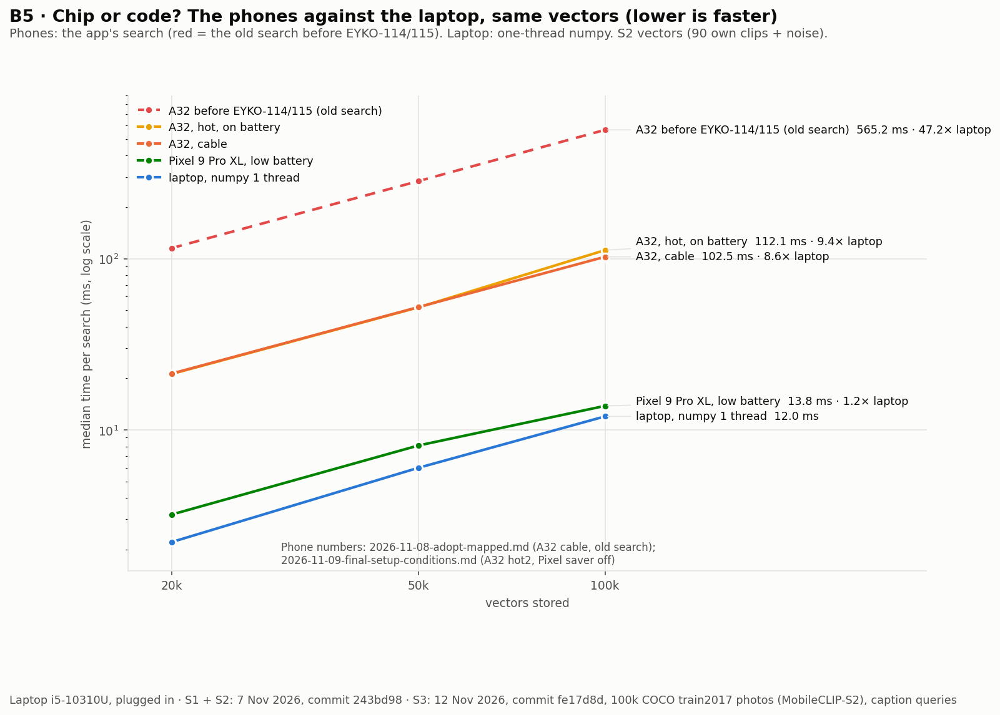

# Laptop vector benchmark v2: 13 methods, three kinds of vectors, recall checked (EYKO-91)

**Date:** 7–13 November 2026 · **By:** Taha Ahmed (lead) · **Card:** EYKO-91 · **Machine:** laptop i5-10310U (4 cores,
8 threads), plugged in · **Plan and decisions:** [`eyko-91-vectors-laptop-v2/`](eyko-91-vectors-laptop-v2/README.md) ·
**Supervisor questions:** A5, B1, B2, B3, B5, B7

## Verdict

1. **Same results, not just faster (A5).** Every exact method (numpy, the Python loop, BLOBs read from SQLite, sqlite-vec
   float32, usearch exact) found the same top 20 as exact numpy at every size and on all three kinds of vectors:
   recall@20 = 1.000, ties counted. They differ only in time and memory.
2. **The approximate index passes the card's mark at one setting.** On 100,000 varied real photos (S3) with real caption
   queries, usearch HNSW **c16 / ef256** found **0.98–0.99** of the true top 20 over six builds, in **0.73 ms** against
   **11.8 ms** for one-thread numpy: **16× faster**. The mark is recall ≥ 0.95 and ≥ 5× faster (D3: judged on S3 at its
   largest size). The default c16 / ef64 sits **on** the mark (0.950–0.955 over six builds, 37× faster), so it has no
   margin. c32 / ef1024 is exact (1.000) but only **4.0×** faster, so it fails on speed.
3. **Random and near-copy vectors cannot judge an index.** On S1 (random) and S2 (90 phone clips copied with tiny noise)
   every HNSW setting collapses as the table grows (0.02–0.57 at 300k). On real, varied photos it does not. This is why
   D3 moved the index verdict to S3.
4. **float16 and int8 (laptop half of EYKO-109, mark recall ≥ 0.99):** float16 and **int8 with a float32 re-check pass**
   (1.000 on S3 at every size; the re-check holds 66 MB against 210 MB at 100k). int8 alone fails past 5k (0.97 at 100k).
   sqlite-vec int8 fails at every size (0.84 at 100k).
5. **B5, chip or code:** the "about 50×" was our code. On the same vectors at 100k the A32's old search was **47×** the
   laptop; the app's search today is **8.6×** (A32, cable) and the Pixel is **1.15×**. The rest of the A32 gap is the chip.

**What it means for ADR 0001:** nothing changes now. Exact search stays (11.8 ms here, 102–112 ms on the A32 at 100k).
If trigger 3 fires (a table past 300k), HNSW c16 / ef256 is the setting to port and test on a phone first.

## Method

- Script `src/benchmarks/vector_storage_v2.py` (`task vectors-laptop-v2`), 13 methods in `_vector_methods.py`, vector sources
  and the recall check in `_vector_sources.py`, tests in `tests/test_vector_recall.py`.
- Each method and size runs in a **fresh process**: build, 1 warm-up, then **5 runs × 20 queries**; median, p95 and worst
  per run. Table cells are the median of the 5 run medians.
- **Recall@20** of every method against exact float32 numpy, **ties counted** (a hit tied on score with the 20th counts).
- **Memory** = PSS after building minus PSS before, in that process.
- Vectors, 512-d, unit length:
  - **S1 random** (seeded), 1k–300k: comparable with v1 and the 3 Nov phone sweep.
  - **S2 phone-real**: the phones' own 90 clip vectors plus tiny noise, 1k–300k: the same set the phone runs use.
  - **S3 varied real**: the first 100,000 COCO train2017 photos embedded with our model (MobileCLIP-S2, datacompdr), queries
    = the first caption of 21 val2017 photos through the text encoder (seed 90). Each size takes a seeded (91) spread of rows.
    The vectors stay in `data/eyko91_coco/` (git-ignored); `task coco-vectors` remakes them.
- Versions: Python 3.10.12, numpy 2.2.6, SQLite 3.37.2, sqlite-vec 0.1.9, usearch 2.26.5. Runs: S1 + S2 on 7 Nov (commit
  243bd98, about 1 h 45 min), S3 on 12 Nov (commit fe17d8d, about 5 min). Every row says `charger=in`.
- Raw data: [`laptop-2026-11-07-sweep.csv`](vectors/laptop-2026-11-07-sweep.csv),
  [`laptop-2026-11-07-sweep-real.csv`](vectors/laptop-2026-11-07-sweep-real.csv),
  [`laptop-2026-11-12-sweep-varied.csv`](vectors/laptop-2026-11-12-sweep-varied.csv). Logs, graphs and the rebuild check:
  [`evidence/full-2026-11-07/`](eyko-91-vectors-laptop-v2/evidence/full-2026-11-07/README.md),
  [`evidence/varied-2026-11-12/`](eyko-91-vectors-laptop-v2/evidence/varied-2026-11-12/README.md).

## Every number

Quick-look graphs (drawn by [`graphs.py`](eyko-91-vectors-laptop-v2/evidence/varied-2026-11-12/graphs.py); the official
Head 2 figures are EYKO-97):

*Exact search grows in step with size on every source. HNSW stays nearly flat, but on S1 and S2 that speed comes with
wrong answers (next graph).*

*On random (S1) and near-copy (S2) vectors every HNSW setting falls far below the 0.95 mark as the table grows. On 100k real
photos (S3) all three stay at or above it. int8 + re-check stays at 1.00 everywhere; sqlite-vec int8 is below its own
0.99 mark at every size and source.*

*The HNSW graph holds a little more than the plain float32 vectors (255 against 210 MB at 100k); int8 + re-check holds under a
third (66 MB).*

Methods 1 and 4 stop at 20k (too slow past it). The full CSVs also hold p95, worst, temperature and memory per row.

**S1 · random (7 Nov)**: median ms (recall@20; exact methods are 1.00 unless shown)

| Method | 1k | 5k | 20k | 50k | 100k | 300k |
|---|---|---|---|---|---|---|
| 1 BLOB read from SQLite each search | 2.94 | 20.1 | 70.7 | — | — | — |
| 2 numpy f32, all threads | 0.04 | 0.59 | 4.33 | 6.67 | 13.1 | 39.4 |
| 3 numpy f32, 1 thread | 0.06 | 0.70 | 2.70 | 6.75 | 11.9 | 39.1 |
| 4 plain Python loop | 33.6 | 174 | 658 | — | — | — |
| 5 numpy float16 | 1.09 | 5.44 (0.998) | 23.2 | 57.8 (0.998) | 107 | 288 |
| 6 numpy int8 | 0.18 (0.990) | 1.92 (0.995) | 9.11 (0.993) | 24.1 (0.980) | 25.3 (0.988) | 71.1 (0.985) |
| 7 int8 + re-check in f32 | 0.46 | 1.72 | 10.0 | 19.9 | 25.6 | 72.5 |
| 8 sqlite-vec f32 | 1.69 | 6.02 | 24.9 | 65.6 | 124 | 370 |
| 9 sqlite-vec int8 | 1.30 (0.875) | 5.41 (0.843) | 22.6 (0.810) | 55.6 (0.762) | 105 (0.828) | 311 (0.807) |
| 10 HNSW c16/ef64 (default) | 0.22 (0.897) | 0.61 (0.517) | 0.68 (0.217) | 0.69 (0.105) | 0.77 (0.058) | 0.90 (0.022) |
| 11 HNSW c16/ef256 | 0.31 (0.985) | 1.17 (0.925) | 2.18 (0.530) | 2.34 (0.328) | 2.75 (0.205) | 3.25 (0.080) |
| 12 HNSW c32/ef1024 | 0.76 (0.993) | 2.88 (0.993) | 6.67 (0.995) | 10.7 (0.938) | 15.6 (0.790) | 23.2 (0.570) |
| 13 usearch exact | 0.35 | 1.78 | 7.37 | 16.6 | 33.7 | 101 |

**S2 · phone-real, 90 own clips + noise (7 Nov)**: median ms (recall@20; exact methods are 1.00 unless shown)

| Method | 1k | 5k | 20k | 50k | 100k | 300k |
|---|---|---|---|---|---|---|
| 1 BLOB read from SQLite each search | 2.17 | 17.9 | 65.5 | — | — | — |
| 2 numpy f32, all threads | 0.04 | 0.40 | 2.36 | 6.05 | 13.1 | 39.2 |
| 3 numpy f32, 1 thread | 0.08 | 0.62 | 2.21 | 6.00 | 12.0 | 36.2 |
| 4 plain Python loop | 32.0 | 159 | 626 | — | — | — |
| 5 numpy float16 | 1.00 | 4.92 | 20.4 (0.998) | 50.6 | 98.5 | 283 (0.998) |
| 6 numpy int8 | 0.16 (0.995) | 1.26 (0.963) | 4.82 (0.927) | 12.1 (0.935) | 23.9 (0.902) | 71.3 (0.892) |
| 7 int8 + re-check in f32 | 0.49 | 1.81 | 5.95 | 13.0 | 25.2 | 72.5 |
| 8 sqlite-vec f32 | 1.28 | 5.93 | 24.6 | 62.1 | 124 | 366 |
| 9 sqlite-vec int8 | 1.01 (0.970) | 5.45 (0.875) | 21.6 (0.750) | 52.6 (0.720) | 105 (0.657) | 308 (0.650) |
| 10 HNSW c16/ef64 (default) | 0.09 (0.983) | 0.13 (0.765) | 0.12 (0.263) | 0.11 (0.177) | 0.15 (0.087) | 0.12 (0.058) |
| 11 HNSW c16/ef256 | 0.27 (0.990) | 0.35 (0.745) | 0.24 (0.273) | 0.39 (0.190) | 0.32 (0.155) | 0.28 (0.043) |
| 12 HNSW c32/ef1024 | 0.47 | 0.98 (0.998) | 1.02 (0.555) | 1.15 (0.350) | 1.10 (0.263) | 1.22 (0.077) |
| 13 usearch exact | 0.38 | 1.70 | 6.64 | 16.7 | 33.4 | 99.7 |

**S3 · varied real, 100k COCO photos, caption queries (12 Nov)**: median ms (recall@20; exact methods are 1.00 unless shown)

| Method | 1k | 5k | 20k | 50k | 100k |
|---|---|---|---|---|---|
| 1 BLOB read from SQLite each search | 2.16 | 18.7 | 69.0 | — | — |
| 2 numpy f32, all threads | 0.04 | 0.43 | 2.47 | 6.02 | 12.9 |
| 3 numpy f32, 1 thread | 0.08 | 0.63 | 2.48 | 5.81 | 11.8 |
| 4 plain Python loop | 33.5 | 166 | 578 | — | — |
| 5 numpy float16 | 1.02 | 5.35 | 20.1 | 51.4 | 101 |
| 6 numpy int8 | 0.18 | 1.32 (0.990) | 4.85 (0.980) | 13.6 (0.980) | 24.1 (0.973) |
| 7 int8 + re-check in f32 | 0.49 | 1.94 | 5.72 | 13.1 | 24.8 |
| 8 sqlite-vec f32 | 1.27 | 6.19 | 24.7 | 58.8 | 119 |
| 9 sqlite-vec int8 | 1.02 (0.950) | 5.54 (0.907) | 21.8 (0.887) | 52.9 (0.860) | 105 (0.843) |
| 10 HNSW c16/ef64 (default) | 0.15 (0.985) | 0.19 (0.993) | 0.36 (0.985) | 0.30 (0.973) | 0.32 (0.953) |
| 11 HNSW c16/ef256 | 0.43 (0.988) | 0.81 | 0.95 (0.998) | 0.59 (0.995) | 0.73 (0.983) |
| 12 HNSW c32/ef1024 | 0.45 (0.980) | 1.75 (0.995) | 2.71 (0.998) | 2.74 | 2.97 |
| 13 usearch exact | 0.35 | 1.66 | 6.64 | 16.6 | 33.7 |

**Memory held after building, S3** (PSS after − before, MB; index build time at 100k)

| Method | 1k | 5k | 20k | 50k | 100k | build at 100k |
|---|---|---|---|---|---|---|
| 1 BLOB read from SQLite each search | 8 | 9 | 10 | — | — | — |
| 2 numpy f32, all threads | 9 | 19 | 49 | 110 | 212 | 0.0 s |
| 3 numpy f32, 1 thread | 8 | 16 | 47 | 108 | 210 | 0.0 s |
| 4 plain Python loop | 26 | 105 | 401 | — | — | — |
| 5 numpy float16 | 7 | 12 | 27 | 59 | 112 | 0.2 s |
| 6 numpy int8 | 9 | 17 | 18 | 35 | 64 | 0.2 s |
| 7 int8 + re-check in f32 | 11 | 19 | 20 | 37 | 66 | 1.0 s |
| 8 sqlite-vec f32 | 9 | 9 | 10 | 13 | 17 | 2.8 s |
| 9 sqlite-vec int8 | 7 | 9 | 10 | 13 | 17 | 1.3 s |
| 10 HNSW c16/ef64 (default) | 16 | 26 | 60 | 128 | 242 | 16.4 s |
| 11 HNSW c16/ef256 | 16 | 26 | 60 | 128 | 242 | 17.7 s |
| 12 HNSW c32/ef1024 | 17 | 27 | 63 | 135 | 255 | 70.3 s |
| 13 usearch exact | 16 | 24 | 55 | 116 | 217 | 0.1 s |

## The index, rebuilt (risk 11)

The sweep builds each index once and reuses it for the 5 runs. A graph built on several threads is not the same twice, so
each HNSW setting was built again **five more times** on S3 at 100k (`--one varied 100000 <method> --runs 1`, 12–13 Nov).

| Setting | Sweep build: recall · ms | 5 rebuilds: recall | 5 rebuilds: ms | Build (s) | Speed-up vs 11.8 ms | Card mark (≥ 0.95, ≥ 5×) |
|---|---|---|---|---|---|---|
| c16 / ef64 (default) | 0.9525 · 0.32 | 0.9525, 0.9500, 0.9550, 0.9550, 0.9525 | 0.39–0.83 | 17 | 37× (14× slowest) | **on the mark**: 0.950–0.955, no margin |
| c16 / ef256 | 0.9825 · 0.73 | 0.9850, 0.9850, 0.9850, 0.9875, 0.9850 | 0.80–1.14 | 17 | 16× (10× slowest) | **passes** |
| c32 / ef1024 | 1.0000 · 2.97 | 1.0000 × 5 | 2.74–4.11 | 72–80 | 4.0× (2.9× slowest) | **fails on speed** |

Recall moved by at most 0.005 (two hits in 400) between builds. The rebuild times are one run each, with the CPU at
38–67 °C and other downloads running; quote the sweep's times. Raw output:
[`hnsw-rebuilds.txt`](eyko-91-vectors-laptop-v2/evidence/varied-2026-11-12/hnsw-rebuilds.txt).

## B5: the phone against the laptop, same vectors

Laptop: `blob_memory_numpy_1t` on S2 (the phones' own 90 clips + noise), one thread, the fair match for the one-thread phone
loop. Phone: `MAPPED_NATIVE`, the app's search since EYKO-115, the whole `VideoVectors.scores()` call. Ratio = phone / laptop.

| Rows | Laptop 1 thread (ms) | A32 cable, 8 Nov | A32 hot, battery, 9 Nov | Pixel low battery, 9 Nov |
|---|---|---|---|---|
| 20,000 | 2.21 | 21.3 ms · **9.6×** | 21.2 ms · **9.6×** | 3.2 ms · **1.4×** |
| 50,000 | 6.00 | 52.1 ms · **8.7×** | 51.9 ms · **8.7×** | 8.1 ms · **1.35×** |
| 100,000 | 11.98 | 102.5 ms · **8.6×** | 112.1 ms · **9.4×** | 13.8 ms · **1.15×** |
| 100,000, before EYKO-114/115 | 11.98 | 565.2 ms · **47×** | | |

Phone sources: [`2026-11-08-adopt-mapped.md`](2026-11-08-adopt-mapped.md) (A32 cable, and the "before" row: `HEAP_F32` with
`COUNT(*)`), [`2026-11-09-final-setup-conditions.md`](2026-11-09-final-setup-conditions.md) (hot2 and saver-off rows).

*The A32's old search (red, dashed) was 115.2 / 283.7 / 565.2 ms at 20k / 50k / 100k: 52 / 47 / 47× the laptop. The app's
search today runs parallel to the laptop's line, about 9× above it on the A32 and just above it on the Pixel.*

**Answer:** mostly our code. Our own fixes (mapped file, NEON scoring, no `COUNT(*)`) took the A32 from 47× to 8.6× the
laptop, a 5.5× gain with identical answers. What is left is the A32's chip (Helio G80, budget memory): the Pixel 9 Pro XL
(Tensor G4), running the same code, is within 1.15–1.4× of the laptop. Code matters on the laptop too: a plain Python loop
is 283× slower than numpy on the same 20k vectors (626 against 2.21 ms).

## How these numbers could lie

1. **One laptop.** A 4-core i5, not v1's 12-thread machine. Same-machine comparisons are fair; laptop/phone ratios
   depend on which laptop.
2. **Different code on each side of B5.** The phone time is the app's whole search call (with its `MAX(id)` change check);
   the laptop time is numpy's dot product and top-20 alone. The laptop is the one-thread row: with all threads it is about
   the same (13.1 against 12.0 ms at 100k), so threads do not flatter it here.
3. **S3 is not our users' data.** COCO photos are varied real scenes embedded with our model, and the queries are real
   captions, but they are not frames from a user's day. Recall on our own clips could differ.
4. **S3 stops at 100k.** The card's index mark says "at 300k"; D3 moved it to S3's largest size. HNSW recall on S3 fell
   slowly from 1k to 100k (ef64: 0.985 → 0.95); at 300k it would likely be lower. Not measured.
5. **20 queries.** One missed hit moves recall by 0.0025. c16 / ef64's 0.950–0.955 is two hits either side of the mark.
6. **Build time and memory are outside the query time.** At 100k the HNSW graph took 17 s (c16) and 72 s (c32) to build on
   8 laptop threads and holds 242–255 MB against 210 MB for the plain vectors. A phone would build it far slower.
7. **The index was built several times, but the timing was not.** The rebuild check ran one timed run per build, partly
   while other downloads ran, so its times (c16 0.4–1.1 ms, c32 2.7–4.1 ms) are looser than the sweep's; use the sweep's times.
8. **numpy's float16 is slow, not float16 itself.** numpy widens float16 in software (101 ms at 100k against 12 ms for
   float32). Its recall and memory count here, not its time.
9. **Warm caches.** Every timed query finds the data in memory, the best case. The phone's first search after a restart
   (162 ms at 100k on the A32) is not modelled.
10. **sqlite-vec's memory is in the OS file cache,** which PSS does not count, so its 17 MB is not the whole cost.
11. **S2 noise is numpy's, not Java's.** S2 matches the phone vectors in kind, not bit for bit.

## Not done here

- **The index on a phone.** usearch's Android build (2.26.6, 4 KB pages, EYKO-89) is not tested. Only worth doing if
  trigger 3 fires.
- **C5 (test inventory):** in [`2026-11-13-test-inventory.md`](2026-11-13-test-inventory.md).
