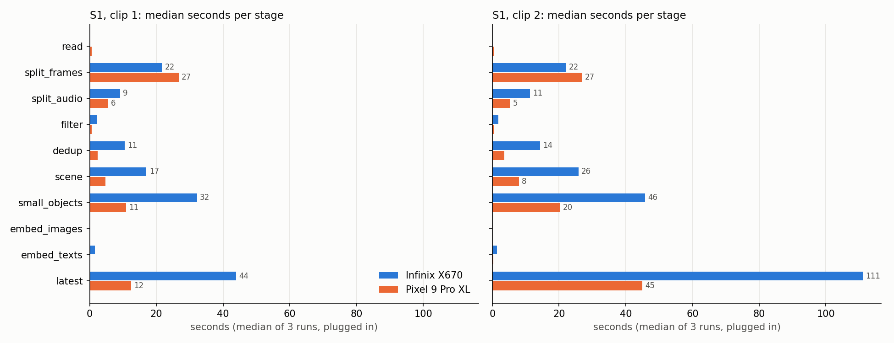

# EYKO-123: Head 3 intake on the Pixel 9 Pro XL, next to the Infinix X670 (15 Nov 2026)

**Phones.** Pixel 9 Pro XL (Tensor G4, 16 GB RAM, Android 17), run by Rafique today. Infinix X670 (MT6781V, Android 13), Zara's EYKO-117 run of 14 Nov (`2026-11-14-head3-intake-infinix.md`). The card also names the Samsung A32. It was not run: the Infinix already gives the modest phone (B2), the same decision as on EYKO-128.
**Build on the Pixel.** `feature/video-memory` at a915c8d, installed with `adb install -r`. The CSV `commit` column says 1228dc3, the repo HEAD when the runs were made; it differs from a915c8d only by a test log file. This build reads a picked video in place (EYKO-126), so there is no copy step. The Infinix build (5a192c7) still copied the file, so its `copy` row and the Pixel's `read` row are the same step: getting the file into the app.
**How.** Harness `docs/phone-kit/run-head3.ps1`, one command per run, with the phone serial. Clips were added through the app's Video tab and the system file picker, driven over adb (Rafique approved this). Each run used a byte-different copy of a kit clip (the clip plus empty `free` atoms), because the app refuses bytes it already has. The app's data was backed up first and restored afterwards; the restored database is byte-identical to the backup.
**Files.** `head3/stage_times.csv`, `head3/run_summary.csv`, `head3/raw/2026-11-15-Pixel_9_Pro_XL-*` (log, battery, device sheet per run), chart `head3/stage_medians_S1_two_phones.png` (made by `src/benchmarks/head3_compare.py`, command in its header). Bad inputs: `head3/bad-inputs/pixel-2026-11-15/` (screenshots, full log).

## S1: one kit clip at a time, app in front

| Clip | Run | Plugged | Stage time added up | Work per video second | Read | Battery | Highest temp |
|---|---|---|---|---|---|---|---|
| 1 (74.5 s) | 1 | yes | 63.1 s | 0.85 | 595 ms | 46 to 46 % | 30.6 C |
| 1 | 2 | yes | 67.2 s | 0.90 | 448 ms | 46 to 46 % | 31.8 C |
| 1 | 3 | yes | 63.3 s | 0.85 | 603 ms | 46 to 45 % | 33.5 C |
| 2 (74.9 s) | 4 | yes | 92.2 s | 1.23 | 653 ms | 45 to 45 % | 35.4 C |
| 2 | 5 | yes | 117.7 s | 1.57 | 603 ms | 45 to 45 % | 35.4 C |
| 2 | 6 | yes | 110.4 s | 1.47 | 549 ms | 45 to 45 % | 34.9 C |
| 1 | 7 | **no** | 64.2 s | 0.86 | 589 ms | 45 to 44 % | 34.9 C |
| 1 | 8 | **no** | 63.7 s | 0.85 | 577 ms | 44 to 43 % | 35.8 C |
| 1 | 9 | **no** | 67.1 s | 0.90 | 586 ms | 43 to 43 % | 36.3 C |

Clip 1 is steady (63-67 s, plugged or not). Clip 2 spreads more (92-118 s, 28 %); the Infinix's clip 2 spread was 7 %. The cause was not looked into.

### Median seconds per stage (S1, plugged, 3 runs each)

| Stage | Clip 1 Infinix | Clip 1 Pixel | Clip 2 Infinix | Clip 2 Pixel |
|---|---|---|---|---|
| copy (Infinix) / read in place (Pixel) | 0.8 | 0.6 | 0.9 | 0.6 |
| split_frames | 21.7 | **26.7** | 22.0 | **26.8** |
| split_audio | 9.1 | 5.5 | 11.3 | 5.3 |
| filter | 2.1 | 0.6 | 1.8 | 0.6 |
| dedup | 10.5 | 2.4 | 14.3 | 3.5 |
| scene | 17.0 | 4.7 | 25.8 | 8.0 |
| small_objects | 32.1 | 10.9 | 45.7 | 20.3 |
| embed_images | 0.0 | 0.0 | 0.0 | 0.0 |
| embed_texts | 1.6 | 0.1 | 1.4 | 0.2 |
| latest | 44.0 | 12.4 | 111.1 | 44.9 |
| **added up (without copy/read)** | **138.1** | **63.9** | **233.5** | **110.2** |

**B1, which stage takes the time.** On the Pixel the order changes. For clip 1, `split_frames` is now the largest stage (27 s of 64 s, 42 %), then `latest` (12 s) and `small_objects` (11 s). For clip 2 `latest` still leads (45 s of 110 s), then `split_frames` (27 s) and `small_objects` (20 s).
**The Pixel is 2-4x faster on every model stage, but slower at splitting frames** (26.7 s against 21.7 s, both clips). The other stages run neural nets, where the Tensor G4 wins. Frame splitting is video decoding plus writing 224 frames, and there the 2022 MediaTek phone is faster. Not explained yet. It is now the biggest single cost on the fast phone, so it is the stage to look at for speed.
**B2, the modest phone.** The Infinix needs 2.2x the Pixel's time on clip 1 and 2.1x on clip 2. Both finish a 75 s clip in under 4 minutes with the app in front.

## B3: battery per minute of video (Pixel, unplugged)

Runs 7-9 were made unplugged, over Wi-Fi adb, with the screen kept on and the app in front. The whole-percent reading is too coarse (45 to 43 % over three runs), so this uses the battery's charge counter (`dumpsys battery`, at the start and end of each run):

| Run | Charge used | Per minute of video |
|---|---|---|
| 7 | 30.0 mAh | 24.2 mAh |
| 8 | 25.0 mAh | 20.1 mAh |
| 9 | 22.5 mAh | 18.1 mAh |

**About 18-24 mAh per minute of video, screen on**, roughly 0.4-0.5 % of the Pixel's battery (about 5,000 mAh) per minute of video. One hour of footage would cost on the order of 25 % of a full charge. The screen's own share is inside this figure and was not measured apart. The Infinix has no figure (it charged throughout).
**Heat.** The Pixel stayed between 30.6 and 36.3 C (battery temperature) over all runs today. The Infinix reached 38.6 C.

## S2: a queue (9 videos)

The card asks for 10. The 10th file (`..._094359202-s2-1`, clip 1 plus one atom, 186,496,588 bytes) had exactly the same bytes as a test copy added before the runs (same recipe), so the app made no job for it. That is my set-up mistake, not an app fault. S2 is reported as 9 videos (4 of clip 1, 5 of clip 2). The harness was stopped by hand at about 2,000 s, and the log was then parsed the way the harness does it.
Eight files were added one after another in about a minute. The two original clips followed about 4 minutes later, while the queue was still busy.

| | Pixel (9 videos) | Infinix (10 videos) |
|---|---|---|
| Video in the queue | 672.5 s | 747.0 s |
| Stage time added up | 908.8 s | 1,918.0 s |
| Work per video second | 1.35 | 2.57 |
| Wall time, first read to last finish | 931 s (13:45:38 to 14:01:09) | 1,920 s |
| Read / copy per video | 615-1,036 ms | 704-1,780 ms |
| Unfinished | 0 | 0 |
| Highest temp | 36.0 C | 38.6 C |

The queue ran one video after another with no failures and no idle gap: wall time is within 3 % of the stage time. Work per video second (1.35) is above the S1 mean of the two clips (about 1.15). That may be the warmer phone, but it was not tested.

## S3: getting the largest clip in

Clip 2 (187,772,606 bytes) was **read in place in 718 ms**; it then took 91.6 s to process. Across all Pixel runs the read took 448-1,036 ms. With EYKO-126 nothing is copied. These figures are the "after" for Zara's "before" (966 ms copy on the Infinix). The read is no faster, but there is no second copy of the file on the phone.

## S4: back-fill

| Saved stage set to | Stages that ran again | As expected |
|---|---|---|
| `latest` (run 1) | finish | yes, the same as the Infinix |
| `link` (run 2) | latest, finish (30.6 s) | yes |

Both on video `d1edb888...` (from S3), with the database checkpointed first. The harness keeps database copies in `raw/` for S4. They hold the phone owner's own notes, so they were moved out of the repo to `D:\eykon-cache\backups\eyko123-2026-11-15\s4-db\` (Zara's S4 folder has no database either).

## Bad-input set (EYKO-118 files) on the Pixel

The same 14 files, made again today by `make_bad_inputs.py` from kit clip 1 (`D:\eykon-cache\bad-inputs`, not in git). This build differs from Zara's in two ways: no copy and no 500 MB limit (EYKO-126), and the system file picker plus the media-location permission (EYKO-127).

| File | Infinix (12 Nov) | Pixel (today) | Frames kept (Pixel) |
|---|---|---|---|
| B1 h264 control | OK, no GPS | OK, no GPS | 3 of 5 |
| B2 HEVC 8-bit | OK | OK | 2 of 5 |
| B3 HEVC 10-bit HDR | OK | OK | 3 of 5 |
| B4 portrait | OK | OK | 2 of 5 |
| B5 VFR | OK | OK | 2 of 4 |
| B6 no metadata | OK, add time used | OK, says "(the file carries no recording time)" | 3 of 5 |
| B7 truncated | refused, "does not contain a video that can be read" | refused, **"This video is damaged or in a format this phone cannot read."** | none |
| B8 audio-only | not offered by the photo picker | **still not offered** by the system file picker | none |
| B9 no audio | OK | OK | 3 of 5 |
| B10a .mov | OK, no GPS | OK, **location stored: 33.6562, 73.0172** | 3 of 5 |
| B10b .m4v | OK | OK | 3 of 5 |
| B10c .avi | refused (bug 2) | refused, the new "damaged or ... cannot read" message | none |
| B11 .mkv | refused, clear | refused, the same clear message | none |
| B12 528 MB | refused (500 MB limit) | **accepted**, 212 s of video processed in 129 s, read in 1,958 ms | 12 of 65 |

Changes since Zara's run: B12 now works, and B6, B7 and B10c have clearer messages. The location bug (Zara's bug 1) is **only partly fixed**. The `.mov` kept its location, but for every `.mp4` / `.m4v` the app logs `no original location for content://... (RuntimeException: setDataSource failed: status = 0xFFFFFFEA)`, so no location is stored. That includes the kit clips themselves. The files have a location tag (ffprobe at make time). The cause was not looked into.
Not checked (as on the Infinix): whether B3's HDR frames have sensible colour and B4's portrait frames are the right way up.

## Other things seen today (not fixed)

1. **Android 17 warns that the app is not 16 KB page-size compatible** every time it starts: onnxruntime, onnxruntime4j_jni, androidx.graphics.path, litertlm_jni and our own libeykonvec. Debug builds only show a warning, but a release build will need 16 KB-aligned libraries.
2. **Native memory is about 340 MB at the first video's `dedup` and about 1,080-1,090 MB for every later video in the same process.** That holds in S1, S2, S3 and the bad-input set alike (20 later videos, +4 MB over 9 S1 runs). The first video's `dedup` runs before the later stages have loaded their models. After it, every model session (MobileCLIP image and text, BGE, YOLOX, D-FINE) stays loaded. So this is the models kept in memory between videos, not HEVC and not a leak. An earlier draft of this line blamed the HEVC file; that was wrong.
3. **A refused duplicate leaves no log line.** The app read the duplicate in S2 and then wrote nothing about refusing it; refusals B7, B10c and B11 are also missing from `EykonVideo`. Only the screen says why, which makes refusals hard to count from logs.
4. **The Video tab says "Saved videos (20)" while the database has 22 rows** (before the tests). Not looked into.
**Fixed later the same day** (Pixel, after this run): (1) onnxruntime-android 1.18.0 to 1.31.1. Every arm64 library is now 16 KB-aligned (llvm-readelf) and the warning no longer shows at start; the on-device suite still passes (OK, 110 tests). (3) Every refusal now logs `refused <file name>: <message>` under `EykonVideo`. (4) The heading counts all videos ("Saved videos (22), newest 20 shown"): the list loads only the newest 20.
5. The harness's `chart` command took the median over every phone in `stage_times.csv`, so once two phones are in the file it mixes them. It now has a `--phone` filter, and `head3_compare.py` draws two phones side by side.
