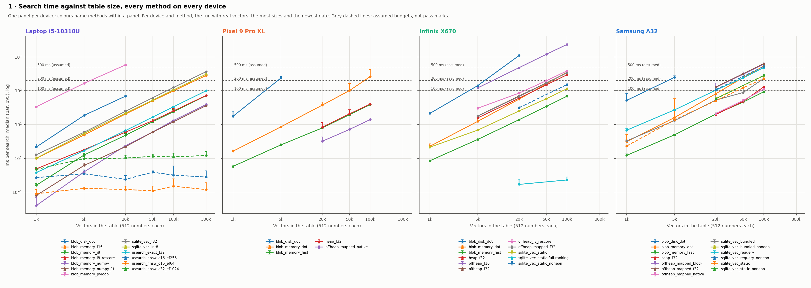
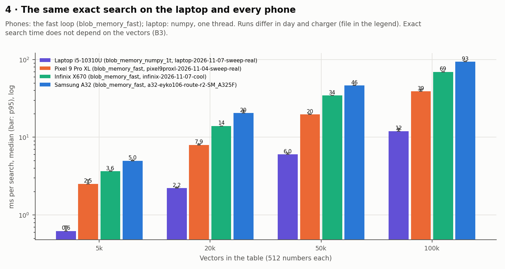
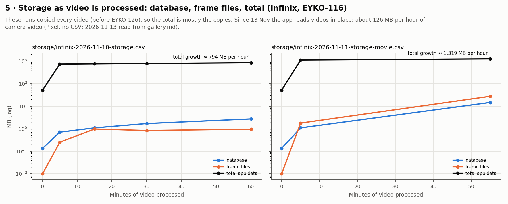
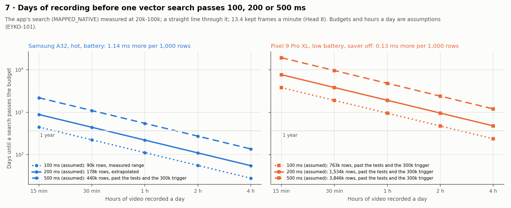
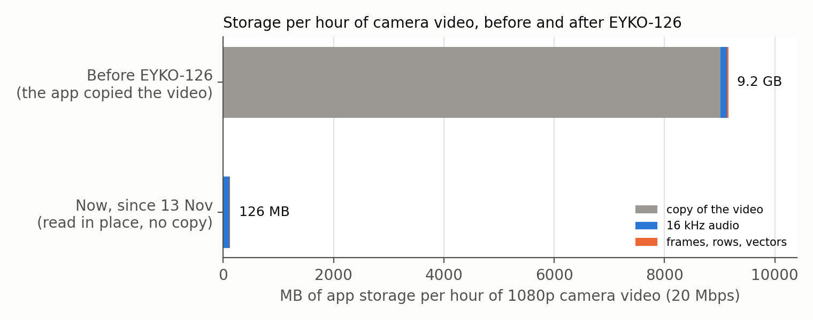
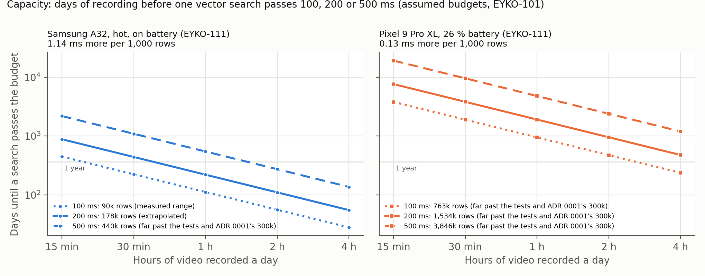

# Head 2 graphs and the "days until too slow" capacity model (EYKO-97)

**Date:** 15 November 2026 · **By:** Taha Ahmed (lead) · **Card:** EYKO-97 · **Builds on:** EYKO-91 (laptop), EYKO-95 / 100 / 111 (phones),
EYKO-116 / 126 (storage) · **Supervisor questions:** B2 ("when does a real user hit the limit?"), B4, B7, C2, and "show me graphs,
especially for mobile"

## Scope

The card (written 3 Nov) asks for a script, `src/benchmarks/plot_vector_storage.py` (`task vectors-plots`), that reads every
CSV in `docs/results/vectors/` and writes the seven graphs as PNG + SVG to `docs/results/vectors/plots/`, redrawing everything
after new data. Two changes, decided by the lead on 15 Nov:

1. **No 200 ms pass line.** The target was dropped on 8 Nov (no source, EYKO-101). Graphs 1 and 7 mark **100, 200 and 500 ms as
   labelled assumptions** instead.
2. **Rafique's Head 2 figures stay as they are** (`docs/documents/source/figures/vector_sweep.py`, now `task head2-figures`). This card
   added four figures to it for the Head 2 document (file size, devices, storage per hour, capacity; section "Head 2 figures" below).

A first version of this card (PR #20, e08611f) only added those four to Rafique's script. Checked against the card, that missed the
script, the SVGs, the p95 bars, the main graph and the heat graph; this version does all seven.

## The seven graphs (`task vectors-plots`)

**How the script reads the data.** Every `*.csv` under `docs/results/vectors/` (63 files today). Files in the shared format feed graphs
1–4 and 6–7, the storage logs feed graph 5, and anything else is printed as skipped (today: `crash/infinix-2026-11-10-link-check.csv`).
The device comes from the `device` column, so a new phone shows up as its own panel or bar. Per device and method, the script uses
one **run**: the one with real vectors, then the most sizes, then the newest date. Files that differ only in a trailing timestamp count
as one run, because some phone tests write one file per size. Points are the median over runs of each run's median; bars go up to the
median p95. Colour follows the device (A32 blue, Pixel orange, Infinix green, laptop violet), as in the Head 2 figures. Where one
graph needs many methods, each device gets its own panel and colours name the methods within it.

**What still needs names.** The CSV columns do not say whether a run was cool, hot or on low battery, nor which version of the code it
timed. Graph 6 takes the condition from the file name (`CONDITIONS` in the script), and graph 7 uses the named clean runs of the app's
current search (`CAPACITY_RUNS`). EYKO-114's mapped run is excluded on purpose: it still had the `COUNT(*)` check (565 ms at 100k).
A new run is picked up when its file follows the same naming.



**1 · Search time.** Every exact method grows in step with the rows on every device. The laptop's HNSW lines stay flat (0.1–1 ms),
but on these near-copy vectors they return wrong answers (EYKO-91). On the phones the fast loop is the quickest exact method (A32 91 ms,
Infinix 69 ms, Pixel 39 ms at 100k). The app's search today (mapped file + NEON) is drawn where it was measured (Pixel 14 ms; the A32
run picked here is the hot one, about 112 ms). The Infinix's float16 is the slowest method (about 2.3 s at 100k): Java has no fast
float16. **Does not show:** one chart per method across devices; that is graph 4 for the exact search.


**2 · Memory (PSS).** With Java arrays, three tables fit at 20k rows on all three phones; at 50k only 2 of 3 and at 100k only 1 of 3
loaded before the 268 MB Java heap ran out. The app's mapped setup (A32) loads all three at 100k with 3–5 MB of Java heap; its PSS is
higher (594 MB at 100k) because the mapped pages count there, and Android can drop them. **Does not show:** exactly two tables (never
measured on its own) or the mapped setup on the Pixel or the Infinix (no memory run).


**3 · File size.** On every device the BLOB table is about **twice the vectors** (411 MB at 100k), and sqlite-vec float32 sits on the
vectors line (208 MB). Cause: SQLite's 4 KB page holds one 512-number row (card EYKO-167). **Does not show:** the mapped `.vec` search
copy (205 MB at 100k), which no CSV records.



**4 · Same test.** At 100k: laptop 12 ms, Pixel 39, Infinix 69, A32 93. Same order at every size. **Does not show:** the app's search
today on all phones (the Infinix never timed it). Runs differ in day and charger; the legend names each run.



**5 · Storage.** Database, frame files and total app data against minutes of video, from the two Infinix storage logs (EYKO-116).
Total growth: about 794 MB an hour of screen recording and 1,319 MB an hour of the movie, almost all of it the copied video files.
**Does not show:** the app since 13 Nov, which reads videos in place (about 126 MB an hour of camera video, Pixel, no CSV:
`2026-11-13-read-from-gallery.md`; the Head 2 figure below draws it).


**6 · Heat and battery.** Infinix: cool, hot and low battery all 69 ms at 100k. A32, fast loop: 91 ms on the cable, **126 ms cool on
battery** (1.4× slower unplugged, EYKO-112). A32, mapped search: 102 ms on the cable, 112–114 ms warm or hot on battery. Pixel, mapped
search: 14–15 ms at low battery, power saver on or off. **Does not show:** a cool run of the mapped search on any phone, or a hot Pixel.



**7 · Capacity.** See "The capacity model" below.

## Head 2 figures (in `docs/documents/source/figures/`, `task head2-figures`)


**What it shows:** the app's BLOB table takes **4,107 bytes for every 2,048-byte image vector**: 411 MB at 100k rows on the A32,
twice the vectors. With SQLite's default 4 KB page, one 512-number row plus its header does not fit twice in a page, so each row gets
a page of its own. sqlite-vec (208 MB) and the mapped `.vec` search copy (205 MB) pack tightly. With 16 KB pages the same table would
take 2,349 bytes a row (8 KB pages: 2,738), measured by the script itself on the laptop.
**What it does not show:** the text table (384 numbers, 1,536 bytes) packs two rows a page (1.34×), so the waste is the image table's.
Database page size was not tested on a phone, and changing it means rebuilding the database.


**What it shows:** the same exact search (the phones' fast loop, the laptop's one-thread numpy) at 5k–100k. At 100k: laptop 12 ms,
Pixel 39 ms, Infinix 69 ms, A32 91 ms. The order never changes across sizes, and every device grows in step with the rows.
**What it does not show:** the app's search today (`MAPPED_NATIVE`, EYKO-115). It was timed on the A32 and Pixel only (B5 chart in
`2026-11-13-vectors-laptop-v2.md`), never on the Infinix. Runs differ in day and charger (the legend says which); the Infinix used random
vectors, which take the same time as real ones in an exact search (Head 2 B3).



**What it shows:** one hour of 1080p camera video cost about **9.2 GB** while the app copied each video (EYKO-116, calculated; the copy
was 98 %). Since EYKO-126 (13 Nov) the app reads the gallery file in place: about **126 MB** an hour (measured on the Pixel), 91 % of it
the 16 kHz audio.
**What it does not show:** the database's own growth per hour is a few MB (kept frames' rows and vectors) and is inside "frames, rows,
vectors". The 9.2 GB is calculated, not measured on an hour of camera video.



**What it shows:** how many days of recording before one vector search takes longer than 100, 200 or 500 ms, by hours of video a day,
on the A32 (hot, on battery: the worst measured case) and the Pixel (26 % battery).
**What it does not show:** the budgets are assumptions; the Pixel's crossings are far past every test (see below).

## The capacity model

**Inputs**

| Input | Value | Source |
|---|---|---|
| Kept frames per hour of video | **804** (13.4 a minute) | Ego4D Pixel run: 372 kept in 27.8 min (Head 8). Newer kit-clip runs kept fewer, 483–768 an hour (EYKO-116 Part 3), so 804 is the cautious end |
| Vectors searched per kept frame | **1** (the image table) | The app's search scores only `image_vec` (`VideoSearch.kt`, `VideoVectors.scores(db, "image_vec", …)`) |
| Search time against rows | a straight line through the medians at 20k, 50k and 100k | `MAPPED_NATIVE`, the app's search: A32 hot2 21.2 / 51.9 / 112.1 ms; Pixel saver-off 3.2 / 8.1 / 13.8 ms (EYKO-111) |
| Fitted line | A32: −3.1 ms + **1.14 ms per 1,000 rows**; Pixel: 1.0 ms + **0.13 ms per 1,000 rows** | least squares, in the script |
| Budgets | 100, 200, 500 ms | **assumptions** (EYKO-101 is to source one) |

**Formula:** rows at a budget = (budget − a) ÷ b; days = rows ÷ (hours a day × 804).

**Result** (days until one search passes the budget)

| Phone | Budget | Rows at the budget | 30 min a day | 1 h a day | 2 h a day | How far from the tests |
|---|---|---|---|---|---|---|
| A32 (hot, battery) | 100 ms | 90k | 224 | 112 | 56 | inside the measured 20k–100k |
| A32 | 200 ms | 178k | 442 | 221 | 110 | extrapolated past 100k |
| A32 | 500 ms | 440k | 1,094 | 547 | 274 | far past the tests and ADR 0001's 300k trigger |
| Pixel (26 % battery) | 100 ms | 763k | 1,898 | 949 | 475 | far past the tests and the 300k trigger |
| Pixel | 200 ms | 1,534k | 3,816 | 1,908 | 954 | same |
| Pixel | 500 ms | 3,846k | 9,568 | 4,784 | 2,392 | same |

**Reading:** on the cheap phone, a user recording an hour a day reaches 100 ms after about **4 months** and 200 ms after about
**7 months**. On the Pixel the search stays under 100 ms for years, so the limit there is not search time: ADR 0001 reopens at 300k
rows (trigger 3), which one hour a day reaches after about **a year** (300,000 ÷ 804 = 373 days), and the background-kill limit on the
Infinix (between 30k and 40k rows × 3 tables, EYKO-116) comes far earlier.

## How these numbers could lie

1. **The budgets are not sourced.** 100 / 200 / 500 ms are three marked guesses, not a requirement (EYKO-101).
2. **Straight-line extrapolation.** Only 20k–100k were measured with the app's search. Exact search grows in step with the rows on every
   device we measured (graph 4), but past 100k memory and the OS page cache may change that.
3. **One table, one search.** The model counts only the image-table scoring. The app's whole search also embeds the text and ranks,
   which Head 7 times (302 ms on the A32 at 20k before EYKO-115; not re-timed since).
4. **Usage is an assumption.** Hours a day has no source (EYKO-101); the graph shows 15 min to 4 h instead of one value.
5. **Kept-frame rate.** 13.4 a minute comes from Ego4D clips. Our own kit clips kept 8.1–12.8 a minute; fewer kept frames means more days.
6. **A32 fit.** The line's negative start (−3.1 ms) is a fitting artefact of three points; it moves the 100 ms row count by about 3 % (90k against 88k with a zero start).
7. **Mixed runs in graph 4.** Different days and chargers per device, stated in its legend.

## Things noticed (flagged, not changed here)

- **The image table wastes half its space** (graph 3): 4,107 bytes a row for 2,048 bytes of vector, so 100k image vectors take about
  411 MB in the database plus 205 MB in the mapped `.vec` file. A 16 KB page size would bring the table to about 235 MB. Changing it needs
  a rebuild of existing databases (`PRAGMA page_size` + `VACUUM`) and a phone test: card **EYKO-167** (created 15 Nov).
- **Head 2 C2 and B2 updated** in `head2-defense.js` (15 Nov, lead's request): C2 now leads with about 126 MB an hour since EYKO-126
  (9.2 GB before) and names the page-size waste; B2 cites this capacity model.
- **The Infinix has no timing of the app's current search** (`MAPPED_NATIVE`); EYKO-129's on-device run does not add one either.

## Reproduce

```
task vectors-plots    # the seven graphs: PNG + SVG in docs/results/vectors/plots/ (Python 3.10 + matplotlib 3.10.9)
task head2-figures    # the Head 2 document's figures, Rafique's seven + the four above (Python 3.11+, matplotlib 3.9.2)
```

The first prints every file it read or skipped and which run each graph used.
