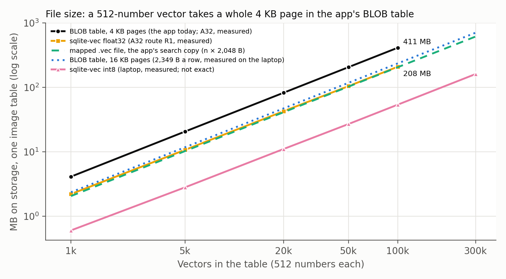
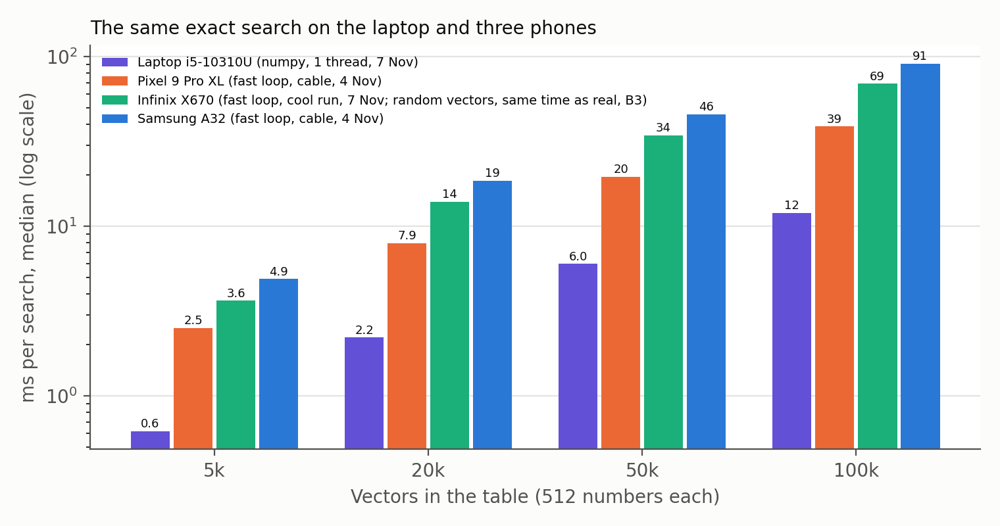

# Head 2 graphs and the "days until too slow" capacity model (EYKO-97)

**Date:** 15 November 2026 · **By:** Taha Ahmed (lead) · **Card:** EYKO-97 · **Builds on:** EYKO-91 (laptop), EYKO-95 / 100 / 111 (phones),
EYKO-116 / 126 (storage) · **Supervisor questions:** B2 ("when does a real user hit the limit?"), B4, B7, C2, and "show me graphs,
especially for mobile"

## Scope (lead's decision, 15 Nov)

The card (written 3 Nov) asked for seven graphs and a capacity model with a 200 ms line. Since then Head 2 got seven figures from
Rafique (`docs/documents/source/figures/vector_sweep.py`), and the 200 ms target was dropped on 8 Nov because it has no source
(EYKO-101). So this card:

1. **keeps Rafique's seven figures** and adds only the graphs Head 2 did not have, **in the same script**, so one command redraws
   everything: `task vectors-plots` (`uv run docs/documents/source/figures/vector_sweep.py`);
2. draws the capacity model against **three budgets, 100, 200 and 500 ms, each marked as an assumption**. EYKO-101 picks the sourced one.

| Card graph | Where it is now |
|---|---|
| 1 Search time vs vector count | Rafique's Figures 2–3 (`head2-vector-memory-speed`, `-fast-loop`) and 7 (`-conditions`) |
| 2 Memory vs vector count | Rafique's Figures 4–6 (`-heap`, `-all-tables`, `-variants`) |
| 3 Database file size | **new: `head2-vector-file-size.png`** |
| 4 Laptop vs the phones, same test | **new: `head2-vector-devices.png`** |
| 5 Storage per hour of video | **new: `head2-storage-per-hour.png`** |
| 6 Heat and battery | Rafique's Figure 7 (`-conditions`) |
| 7 Days until too slow | **new: `head2-capacity.png`** |

## The four new graphs



**What it shows:** the app's BLOB table takes **4,107 bytes for every 2,048-byte image vector**: 411 MB at 100k rows on the A32,
twice the vectors. With SQLite's default 4 KB page, one 512-number row plus its header does not fit twice in a page, so each row gets
a page of its own. sqlite-vec (208 MB) and the mapped `.vec` search copy (205 MB) pack tightly. With 16 KB pages the same table would
take 2,349 bytes a row (8 KB pages: 2,738), measured by the script itself on the laptop.
**What it does not show:** the text table (384 numbers, 1,536 bytes) packs two rows a page (1.34×), so the waste is the image table's.
Database page size was not tested on a phone, and changing it means rebuilding the database.



**What it shows:** the same exact search (the phones' fast loop, the laptop's one-thread numpy) at 5k–100k. At 100k: laptop 12 ms,
Pixel 39 ms, Infinix 69 ms, A32 91 ms. The order never changes across sizes, and every device grows in step with the rows.
**What it does not show:** the app's search today (`MAPPED_NATIVE`, EYKO-115). It was timed on the A32 and Pixel only (B5 chart in
`2026-11-13-vectors-laptop-v2.md`), never on the Infinix. Runs differ in day and charger (the legend says which); the Infinix used random
vectors, which take the same time as real ones in an exact search (Head 2 B3).


**What it shows:** one hour of 1080p camera video cost about **9.2 GB** while the app copied each video (EYKO-116, calculated; the copy
was 98 %). Since EYKO-126 (13 Nov) the app reads the gallery file in place: about **126 MB** an hour (measured on the Pixel), 91 % of it
the 16 kHz audio.
**What it does not show:** the database's own growth per hour is a few MB (kept frames' rows and vectors) and is inside "frames, rows,
vectors". The 9.2 GB is calculated, not measured on an hour of camera video.


**What it shows:** how many days of recording before one vector search takes longer than 100, 200 or 500 ms, by hours of video a day,
on the A32 (hot, on battery: the worst measured case) and the Pixel (26 % battery).
**What it does not show:** the budgets are assumptions; the Pixel's crossings are far past every test (see below).

## The capacity model

**Inputs**

| Input | Value | Source |
|---|---|---|
| Kept frames per hour of video | **804** (13.4 a minute) | Ego4D Pixel run: 372 kept in 27.8 min (Head 8). Newer kit-clip runs kept fewer, 483–768 an hour (EYKO-116 Part 3), so 804 is the cautious end |
| Vectors searched per kept frame | **1** (the image table) | The app's search scores only `image_vec` (`VideoSearch.kt`, `VideoVectors.scores(db, "image_vec", …)`) |
| Search time against rows | a straight line through the medians at 20k, 50k and 100k | `MAPPED_NATIVE`, the app's search: A32 hot2 21.2 / 51.9 / 112.1 ms; Pixel saver-off 3.2 / 8.1 / 13.8 ms (EYKO-111) |
| Fitted line | A32: −3.1 ms + **1.14 ms per 1,000 rows**; Pixel: 1.0 ms + **0.13 ms per 1,000 rows** | least squares, in the script |
| Budgets | 100, 200, 500 ms | **assumptions** (EYKO-101 is to source one) |

**Formula:** rows at a budget = (budget − a) ÷ b; days = rows ÷ (hours a day × 804).

**Result** (days until one search passes the budget)

| Phone | Budget | Rows at the budget | 30 min a day | 1 h a day | 2 h a day | How far from the tests |
|---|---|---|---|---|---|---|
| A32 (hot, battery) | 100 ms | 90k | 224 | 112 | 56 | inside the measured 20k–100k |
| A32 | 200 ms | 178k | 442 | 221 | 110 | extrapolated past 100k |
| A32 | 500 ms | 440k | 1,094 | 547 | 274 | far past the tests and ADR 0001's 300k trigger |
| Pixel (26 % battery) | 100 ms | 763k | 1,898 | 949 | 475 | far past the tests and the 300k trigger |
| Pixel | 200 ms | 1,534k | 3,816 | 1,908 | 954 | same |
| Pixel | 500 ms | 3,846k | 9,568 | 4,784 | 2,392 | same |

**Reading:** on the cheap phone, a user recording an hour a day reaches 100 ms after about **4 months** and 200 ms after about
**7 months**. On the Pixel the search stays under 100 ms for years, so the limit there is not search time: ADR 0001 reopens at 300k
rows (trigger 3), which one hour a day reaches after about **a year** (300,000 ÷ 804 = 373 days), and the background-kill limit on the
Infinix (between 30k and 40k rows × 3 tables, EYKO-116) comes far earlier.

## How these numbers could lie

1. **The budgets are not sourced.** 100 / 200 / 500 ms are three marked guesses, not a requirement (EYKO-101).
2. **Straight-line extrapolation.** Only 20k–100k were measured with the app's search. Exact search grows in step with the rows on every
   device we measured (graph 4), but past 100k memory and the OS page cache may change that.
3. **One table, one search.** The model counts only the image-table scoring. The app's whole search also embeds the text and ranks,
   which Head 7 times (302 ms on the A32 at 20k before EYKO-115; not re-timed since).
4. **Usage is an assumption.** Hours a day has no source (EYKO-101); the graph shows 15 min to 4 h instead of one value.
5. **Kept-frame rate.** 13.4 a minute comes from Ego4D clips. Our own kit clips kept 8.1–12.8 a minute; fewer kept frames means more days.
6. **A32 fit.** The line's negative start (−3.1 ms) is a fitting artefact of three points; it moves the 100 ms row count by about 3 % (90k against 88k with a zero start).
7. **Mixed runs in graph 4.** Different days and chargers per device, stated in its legend.

## Things noticed (flagged, not changed here)

- **The image table wastes half its space** (graph 3): 4,107 bytes a row for 2,048 bytes of vector, so 100k image vectors take about
  411 MB in the database plus 205 MB in the mapped `.vec` file. A 16 KB page size would bring the table to about 235 MB. Changing it needs
  a rebuild of existing databases (`PRAGMA page_size` + `VACUUM`) and a phone test, so it is a separate card for the lead to decide.
- **Head 2 C2** quotes 9.2 GB an hour; since EYKO-126 it is about 126 MB. B2 ("when does a user reach the limit?") can now cite this
  model. Both are Head 2 source edits for after this card's review.
- **The Infinix has no timing of the app's current search** (`MAPPED_NATIVE`); EYKO-129's on-device run does not add one either.

## Reproduce

```
task vectors-plots
```

Python 3.11+ with matplotlib 3.9.2 (the script's inline metadata). Rafique's seven PNGs are redrawn too; on another machine they can
differ in font only.
