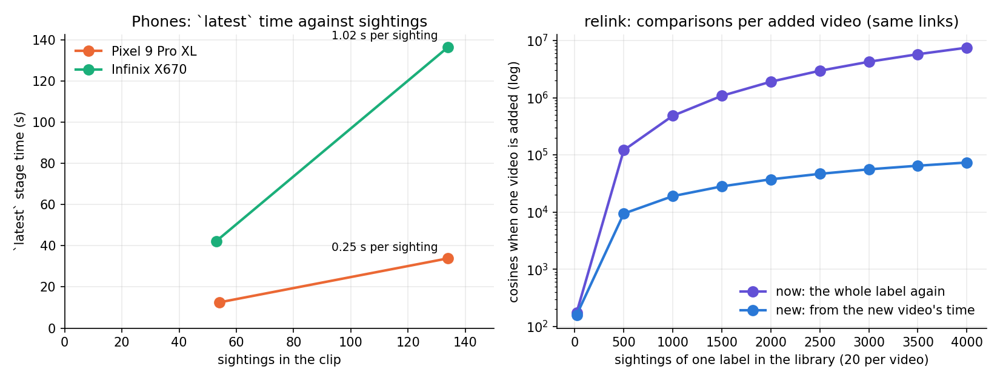

# EYKO-120: where `latest` spends its time, and faster versions with the same output (17 Nov 2026)

Head 3 question E1: "why is `latest` the slowest stage, and can it be faster with the same output?". Laptop work (no phone run):
the phone code (`VideoLatest.kt`) was ported line by line next to each faster version, and both were run on real data.
Run: `task latest-profile` (`src/benchmarks/latest_profile.py`). Numbers: `latest-profile/latest-profile.json`. Graph:
`latest-profile/latest-time-vs-sightings.png`.

**Short answer.** `latest` is slow because it runs MobileCLIP once per sighting (0.25 s each on the Pixel, 1.02 s on the
Infinix, [EYKO-64](2026-11-11-pixel-kit-clips-timing.md)); nothing in this card makes that model faster without changing the
output. Two things do not change the output and are now in the phone code: the frame picture is decoded once per frame instead of
once per object, and `relink` compares only from the new video's time onward and writes only the rows that changed. The second one
is what grows: with 4,000 sightings of one label in the library, adding a video took **7.5 million** comparisons and 4,000 row
writes; now **73 thousand** and 0 to 3 writes, with the same links on every check.

## Data used (all real)

| Part | Data |
|---|---|
| Crop cut, crop vector | `detector_golden.jpg`: a real 640 × 360 frame (the phone's frame size, `VideoSplit.FRAME_MAX_SIDE`) with its 12 D-FINE boxes; 9 are big enough to crop. Plus the 6 test pictures for the vector check. |
| Relink, links | the **90 object crops the Pixel saved for EYKO-15** (`latest/pixel9proxl-object-crops-2026-10-13.json`): label, clip, frame, and the phone's own MobileCLIP vector |
| Relink, library growth | 4,000 real MobileCLIP-S2 vectors (COCO, EYKO-91, `data/`, not in git), as 200 videos × 20 sightings of one label, 4 per frame |

## Where the time goes, and what each change gives

| Part | Now | Faster version | Same output? | Laptop result |
|---|---|---|---|---|
| Crop cut | the frame JPEG is decoded once **per object** (`cropVector`) | decode once **per frame**, cut every box from it | **yes**: every crop the same pixels | 15.9 ms → 1.2 ms per frame of 12 boxes |
| Crop vector | MobileCLIP-S2, one crop per run, 4 threads | the frame's crops in one batch | yes: vectors identical (largest change 0) | **slower**: 0.71× to 0.83× (83 ms per crop alone, 107 to 117 ms per crop in batches of 4 to 9) |
| Relink, per pair | each row makes a new list of candidates and works out the best cosine twice | one cosine per pair, no list | **yes** (90 real crops, thresholds 0.80, 0.85, 0.87, 0.90) | about the same; it was never the cost |
| Relink, rows written | every row of the label is written for every video | only rows whose answer changed | **yes** | 4,000 → 0 to 3 writes per added video |
| Relink, rows compared | the whole label again, from its first sighting | from the earliest time this video adds or removes a sighting of that label | **yes** (4 orders of adding the 6 clips, including out of order and re-runs; and every growth step) | see the next table |

What it costs per object on the laptop: crop cut 0.1 ms (now 1.3 ms), crop vector 83 ms (laptop, nothing else running; a first run with a download going was about 3× slower in every part, same ratios). So the decode-once change saves about
1 % of `latest` today. It is in because it is free and shrinks the memory churn of decoding the same picture 8 times (clip 2: 134
sightings from 16 kept frames).

### Relink as the library grows (one label, 20 new sightings per video, real vectors)

| Sightings of the label | Cosines now | Cosines new | Rows written now / new | Same links |
|---|---|---|---|---|
| 20 | 176 | 160 | 20 / 0 | yes |
| 500 | 120,659 | 9,404 | 500 / 1 | yes |
| 1,000 | 482,264 | 18,980 | 1,000 / 0 | yes |
| 2,000 | 1,900,987 | 37,366 | 2,000 / 1 | yes |
| 3,000 | 4,241,834 | 55,840 | 3,000 / 0 | yes |
| 4,000 | 7,484,821 | 73,494 | 4,000 / 3 | yes |

Complexity: now, adding a video costs about n² / 2 cosines for a label with n sightings in the whole library (each sighting against
the ones still latest before it). New: about m × L, where m is the new video's sightings of the label and L is how many are latest.
COCO pictures are all different things, so almost nothing links and L grows with n: the worst case. The real Pixel crops link more
(33 links in 90), which makes both numbers smaller. Python times are in the JSON but they are not phone times; the counts are the
result. On the 90 real crops added clip by clip in time order: 1,136 cosines → 574.

Why it gives the same answer: a row's answer depends only on the rows before it in time. When a video adds or removes sightings of a
label from time t on, every row before t keeps its answer, and the rows still latest at t are the earlier rows not replaced by an
earlier row. So `link` keeps those, and works out the rows from t on exactly as before. Re-running a video counts its old rows'
times too (they are removed). A new split deletes the video's frames, which would remove its sightings by cascade without
any relink, so `VideoSplit` first calls `VideoLatest.forget`, which removes them and relinks from their earliest time (follow-up,
on-device test `whenASplitAgainRemovesAMiddleVideosSightingsTheAnswersAroundItAreFixed`). This holds as long as the stored answers were written by the same rule and threshold, which is how
every row is made. A full relink is still there (`relink` without a time).

## What changed in the phone code

`android/.../video/VideoLatest.kt`:
- `cropVectors(file, boxes)` decodes the frame once for all its boxes; `cropVector` (used by `ObjectCropBenchmarkTest`) calls it.
  `run(db, id, minCosine, embedCrop)` keeps its form, so the existing tests pass their own crop function as before.
- `relink(db, label, minCosine, fromSeenAt)` reads the stored answers, calls the new `link(rows, minCosine, from)`, and writes only
  changed rows. `run` passes, per label, the earliest time of the rows it removed or added.

`android/.../test/.../VideoLatestLinkTest.kt` (JVM): the old loop, kept word for word in the test, against `link` on the 90 real
crops at four thresholds; adding the clips in four orders (with re-runs), `link` from the earliest time against `link` from row 0;
and a tie case.

**Not compiled on this laptop**: it has no Gradle cache or Android SDK, and the link is too slow to fetch them. The Python port
in `latest_profile.py` runs the same steps and passes. Before merging, on a machine with the SDK:
`./gradlew :app:testDebugUnitTest --tests '*VideoLatest*'`, then the on-device `VideoLatestTest` and `VideoRerunSafetyTest` with
`adb install -r` and `adb shell am instrument` (never `connectedDebugAndroidTest`, it wipes app data).

## What to port, and what this card does not do

- **Port both changes** (they are already written): same output, less work, and `relink` no longer grows with the square of the
  library. Phone timing before/after on a large library is not measured; a phone run needs a database with many videos.
- **Do not batch MobileCLIP**: slower on CPU here, and the phone's model file has a fixed batch of 1 (`export_clip.py`), so it
  would also need a new model file.
- **The real time is one MobileCLIP run per sighting.** Making that cheaper changes the output: fewer crops (only objects on the
  personal list, skip a box that barely moved, skip scene-sized boxes, EYKO-136). Those are Rafique's options on this card
  (14 Nov comment) and each needs a before/after score on the Set 2 pairs, not only a time. Not done here.
- `small_objects` (YOLOE gate) was not profiled: the laptop has no YOLOE model and the card says no new downloads.
