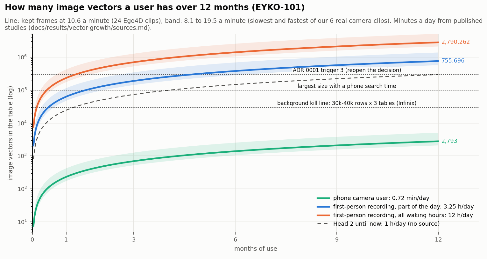
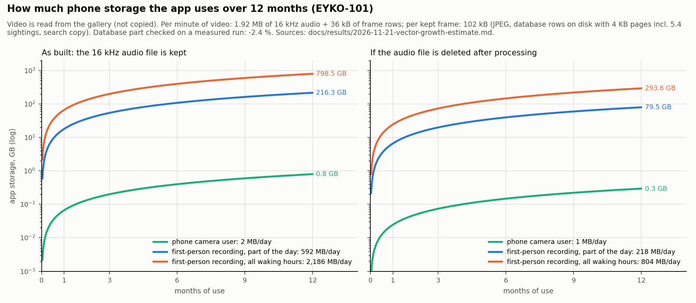

# EYKO-101: how many vectors a user has after 1, 3, 6 and 12 months (21 Nov 2026)

Head 2 question B2 ("when does a real user reach 20k, 100k, 300k vectors?"). Until now Head 2 answered it with **one
assumption with no source: one hour of video a day**. This file replaces it with our own measured kept-frame rate and
published studies of how much people record. Run: `task vector-growth` (`src/benchmarks/vector_growth.py`). Numbers:
[`vector-growth/vector-growth.json`](vector-growth/vector-growth.json), month by month:
[`vector-growth/vector-growth.csv`](vector-growth/vector-growth.csv). Every source, quote and dead end:
[`vector-growth/sources.md`](vector-growth/sources.md).

**Verdict.** **Storage (added 24 Nov, corrected 25 Nov): the typical user's app data reaches about 18 GB after one month and 216 GB after a year, 63 % of it the kept 16 kHz audio; this limit comes before search speed.** A person who records first-person video for part of the day (**3.25 h, typical**) reaches **100k image
vectors after about 7 weeks (48 days) and 300k after about 5 months**; at the fastest kept rate we measured, 26 and 79
days. Recording all waking hours (**12 h, heavy**) reaches 100k in **13 days**. A person who only uses the phone camera
the usual way (**0.72 min a day, light**) has **about 2,800 after a year** and never comes near any limit. So the
one-hour assumption was neither cautious nor generous: it sits between the two kinds of user, and **for the
first-person use Eykon is evaluated on (Ego4D), the limits come 3× sooner than Head 2 said.**

## The formula

```
image vectors after d days = minutes recorded per day × kept frames per minute × d
```

One kept frame gives exactly **one `image_vec` row and one `text_vec` row** (its caption); `audio_vec` stays empty
because no stage writes speech windows yet (`VideoEmbedTexts.kt`: captions, plus transcript chunks "once speech is" built;
no `INSERT INTO audio_windows` anywhere). The app's search scores and maps **only `image_vec`** (`VideoSearch.kt:51`), so
that is the table counted here. A month is 365.25 / 12 = 30.44 days.

## Step 1: kept frames per minute, from our own runs

| Video | Kept | Length | Per minute | Source |
|---|---|---|---|---|
| Kit clip 1, Pixel camera, walking | 10 | 74.5 s | **8.1** | `head3/stage_times.csv` (dedup `frames_out`; same on all 3 phones, 21 runs) |
| Kit clip 2, Pixel camera, walking | 16 | 74.9 s | **12.8** | `head3/stage_times.csv` (21 runs) |
| Ego4D 57c09157, head-worn | 156 | 8 min | **19.5** | `2026-10-20-ego4d-baseline.md`, On the phone (Pixel) |
| Ego4D f21ba0cf, head-worn | 69 | 8 min | **8.6** | same |
| Ego4D c7873f07, head-worn | 113 | 8 min | **14.1** | same |
| Ego4D ffc52dc7, head-worn | 34 | 3.8 min | **8.9** | same |
| **6 camera clips** | | | **min 8.1 · median 10.9 · max 19.5** | |
| Ego4D, the 4 clips together (Pixel) | 372 | 27.8 min | 13.4 | `2026-10-20-ego4d-baseline.md` line 99 (the rate Head 2 used) |
| **Ego4D, 24 clips (laptop copy of the pipeline)** | **1,878** | **177 min** | **10.6** | `2026-10-20-ego4d-baseline.md` line 15 |

**Used:** 10.6 a minute, the largest first-person sample (24 clips; the laptop copy kept 375 where the phone kept 372 on
the same 4 clips, so it counts the same way). The graph's band is the slowest and fastest of the 6 real camera clips
(8.1 to 19.5).

Not camera video, shown for range only: a feature film 15.1 a minute (831 kept in 55 min) and a 5-minute piece of it
10.2 (EYKO-44); a screen recording 0.35 (21 kept in 60.1 min) (`2026-11-09-storage-and-crash.md`,
`2026-11-12-eyko44-workmanager-phone-checks.md`). Left out: EYKO-85's 8-minute clip (14 kept, 1.75 a minute), because it
is kit clip 1 looped, so dedup drops the repeats.

## Step 2: minutes recorded per day, from published studies

| Scenario | Minutes a day | From | Checked |
|---|---|---|---|
| **Light**: phone camera, used as people do | **0.72** | 28 videos a month × 47 s (IJHCI 2026 smartphone video study, S2) | search text (page refused) |
| **Typical**: first-person recording for part of the day | **195 (3.25 h)** | median of three measured daily wear times of personal cameras: 2.8 h and 3.25 h (dementia caregivers, S4), 5.9 h (SenseCam at home, S3) | opened (25 Nov) |
| **Heavy**: first-person recording, all waking hours | **720 (12 h)** | NTCIR lifeloggers wore the camera 12–14 h a day, breakfast to sleep (S5); lower end taken | search text |
| Head 2 until now | 60 (1 h) | assumption, no source | — |

Ego4D (S1, **opened**) supports the first-person scale: camera wearers recorded "for 1 to 10 hours at a time", 3,670 h
from 931 people (3.9 h each in total). Pew 2015 (S6) adds that 40 % of smartphone owners took no picture or video at all
in a week, which fits the light scenario. Source details and the quotes: [`vector-growth/sources.md`](vector-growth/sources.md).

## Step 3: image vectors after 1, 3, 6 and 12 months

| Scenario | Per day | 1 month | 3 months | 6 months | 12 months | Band at 12 months (8.1–19.5 kept/min) |
|---|---|---|---|---|---|---|
| Light (0.72 min) | 8 | 233 | 698 | 1,396 | **2,793** | 2,120 – 5,130 |
| Typical (3.25 h) | 2,069 | 62,975 | 188,924 | 377,848 | **755,696** | 573,000 – 1,389,000 |
| Heavy (12 h) | 7,639 | 232,522 | 697,566 | 1,395,131 | **2,790,262** | 2,117,000 – 5,128,000 |
| Head 2 until now (1 h, 13.4/min) | 804 | 24,472 | 73,415 | 146,830 | 293,661 | — |



## Step 3b: storage on the phone (asked for on 24 Nov, corrected 25 Nov)

Since EYKO-126 the video is read from the gallery, not copied, so the app's own storage is:

```
storage a day = minutes × (1.92 MB audio + 36 kB frame rows)
              + kept frames × (70.7 kB files in the video folder + 6.8 kB database rows + sightings × 4.12 kB + 2.06 kB search copy)
```

| Part | Size | Where it comes from |
|---|---|---|
| 16 kHz mono WAV, kept after processing | 32,000 B a second = **1.92 MB per minute of video** | EYKO-116: "exactly 16,000 Hz x 2 bytes" |
| `frames` rows (every sampled frame, kept or not) | 202 B on disk × 3 a second = **36 kB a minute** | EYKO-167 (`dbstat`, 4 KB pages) |
| Kept frame's files in the video folder (its JPEG and its share of the dedup vector file) | **70.7 kB** on camera video (35.4 kB on the movie) | EYKO-126 camera clip t4: folder 10,448,896 B minus its 9,529,600 B WAV, over 13 kept frames; the two saved camera kept frames are 58.9 kB each |
| Database rows per kept frame: image vector, text vector, caption with its keyword index, scene record | **6.8 kB** on disk (4,106 + 2,053 + 168 + 457 B) | EYKO-167 (`dbstat`, 4 KB pages) |
| Each object sighting (its 2 KB crop vector fills a 4 KB page) | **4.12 kB** on disk, × **5.4** per kept frame (1.93 on the movie, 8.4 on kit clip 2) | EYKO-167; head3 runs |
| Search copy of the image vector (`.vec` + id) | **2,056 B** per kept frame | ADR 0001 (about 205 MB per 100k) |

Per kept frame that is **102 kB** (52 kB on the movie's mix, 114 kB at 8.4 sightings).

**Check (database part):** rebuilt with EYKO-116's measured movie run (831 kept frames, 1,604 sightings, 9,904 frame
rows) the database rows give 14.24 MB; measured 14.6 MB (**−2.4 %**). There is no measured run of the whole app data for
camera video yet.

**Correction (25 Nov).** The first version (24 Nov) used 63 kB per kept frame and 18 kB of frame rows a minute, and
claimed a "+0.15 %" match with the EYKO-126 clip. Both were wrong: (1) EYKO-116's formula counted each sighting at its
2.07 kB of data, but with 4 KB pages it takes 4.12 kB on disk, and a `frames` row takes 202 B, not 100 B (EYKO-167);
(2) the 10,448,896 B "measurement" is the clip's **video folder only** (WAV + JPEGs), while the database lives in
`memories.db` outside it, so comparing it with a formula that included database rows proved nothing. Totals rose by
about 15 %.

| Scenario | Per day | 1 month | 3 months | 6 months | **12 months** | 12 months, range | 12 months if the audio file is deleted |
|---|---|---|---|---|---|---|---|
| Light (0.72 min) | 2.2 MB | 0.07 GB | 0.20 GB | 0.40 GB | **0.80 GB** | 0.63 – 1.10 GB | 0.29 GB |
| Typical (3.25 h) | 592 MB | 18.0 GB | 54.1 GB | 108 GB | **216 GB** | 169 – 298 GB | 80 GB |
| Heavy (12 h) | 2,186 MB | 66.5 GB | 200 GB | 399 GB | **799 GB** | 625 – 1,100 GB | 294 GB |

Range: slowest kept rate with the movie's per-frame sizes, to the fastest kept rate with 8.4 sightings per frame.



**Reading:**
- **Storage runs out long before search gets slow.** A typical first-person user has 216 GB of app data after a year,
  and 18 GB after the first month. Search at that point (about 63k vectors) still takes about 67 ms on the hot A32
  (estimated from the measured 50k–100k).
- **The audio file is 63 % of it.** Deleting the 16 kHz WAV once speech has been processed (already noted as the next
  saving in `2026-11-13-read-from-gallery.md`) cuts the typical year to 80 GB. Of the rest, the kept frames' JPEGs are
  the largest part (146 MB a day), then the database rows (60 MB a day, most of it sightings).
- **16 KB database pages (EYKO-167) would save about 8.8 GB a year** for the typical user (database rows 29 → 17 kB per
  kept frame).
- **Per hour of first-person video: about 182 MB** (143 – 251 MB). Head 2 C2's "126 MB an hour" was measured on kit
  clip 1 looped four times, where dedup kept only 13 frames in 5 minutes (2.6 a minute), and it counted only the video
  folder, so it is low for real use.
- Light users stay around 1 GB a year.

## Step 4: against what the phones can do

Days until each line is reached (central rate; in brackets at the fastest measured rate, 19.5 a minute):

| Line | What it is | Light | Typical | Heavy |
|---|---|---|---|---|
| 30k | Background kill, Infinix: 3 tables of 30k survived, 40k killed (EYKO-116) | 10.7 years | **14.5 days** (7.9) | 3.9 days (2.1) |
| 100k | Largest size with a measured phone search time (EYKO-111) | 36 years | **48 days** (26) | 13 days (7) |
| 300k | ADR 0001 trigger 3: reopen the storage decision | 107 years | **145 days** (79) | 39 days (21) |

Search time of the app's setup (memory-mapped file + NEON, image table), measured on battery (EYKO-111): **hot A32
21.2 / 51.9 / 112.1 ms** and **low-battery Pixel 3.2 / 8.1 / 13.8 ms** at 20k / 50k / 100k
(`vectors/offheap/*eyko111-hot2*`, `*eyko111-lowbat-nosaver*`). It grows in step with the rows, so at 12 months
(estimated linearly from 20k–100k, **not measured**): typical about **0.8 s on the hot A32** and 0.12 s on the Pixel;
heavy about **3.0 s** and 0.45 s.

**The background-kill line, read carefully.** The 30k–40k line was measured with **three** tables mapped (image 512 +
text 384 + audio 512 numbers a row). The app maps only the **image** table when it searches (`VideoSearch.kt:51`), which
is 512 / 1,408 = 36 % of the test's bytes per row. So the app's own line is probably higher (by bytes, around 80k–110k
image rows), but **that is an estimate, not a measurement**; a hold test with the app's real tables would settle it. Even
at 110k, a typical first-person user crosses it in under two months.

## Step 5: response time, for context only (not a pass mark)

Nielsen's three limits (NN/g, S7): **0.1 s** feels instantaneous, **1 s** keeps the user's flow of thought, **10 s**
keeps attention. Google's RAIL (web.dev, S8): show a response to input within **100 ms**; past 1 s users lose focus
(the page now recommends Core Web Vitals over RAIL). On those terms: everything measured so far (up to 100k) is under
0.12 s on both phones; a typical user's year (about 0.8 s, estimated) stays under 1 s on the slow A32 but loses the
"instant" feel; a heavy user's year (about 3 s on the A32) passes the 1 s limit. The 200 ms figure stays dropped as a
pass mark (EYKO-101's own title asked for a source; none of S7, S8 names 200 ms).

## Limits (read before using the numbers)

1. **Minutes a day: small and mixed samples.** The light figure is one 2026 study of 32–40 people. The typical figure
   comes from camera wear studies (caregivers, home environment) where people were asked to wear a camera, not from
   people choosing to record video for a memory app; no study of the latter exists that we found. On 21 Nov seven of
   the eight sources were checked only through search-tool text; on 25 Nov five of them were opened in a browser and
   the quotes found (S3, S4, S6, S7, S8). The light (S2) and heavy (S5) figures are still search text (`sources.md`).
2. **Kept frames per minute in a whole day.** The Ego4D clips (8 min) were cut from longer recordings for benchmark
   questions, so they are busy moments. A full day has long still stretches (desk, sofa), where the cheap filters and
   dedup keep far fewer frames (the screen recording kept 0.35 a minute). So the typical and heavy rows are **upper
   bounds**; the true day-long rate is probably lower. This needs one real day-long recording to settle.
3. **Search times past 100k are extrapolated**, linearly from three measured sizes; the A32 on battery also slows its
   fast cores after about 90 s (EYKO-111).
4. **Storage assumes nothing is ever deleted** (no "delete a video" yet, EYKO-66) and that the WAV stays (as built). The
   The kept frame's folder size (70.7 kB) comes from one camera clip of 13 kept frames; the database part is checked on
   one measured run (−2.4 %), but no whole-app measurement on camera video exists yet. Sightings per kept frame vary 1.9–8.4.
5. **Only the image table is counted**, because only it is searched. `text_vec` grows at the same rate; it costs storage
   (1.5 KB a row) but no search time today. `audio_vec` would add rows once speech windows exist.

## What changes

- **Head 2, B2** (`docs/documents/source/head2-defense.js`) cites this file instead of the one-hour assumption; B7's
  "300k after about a year" becomes "about 5 months (typical) to about 6 weeks (heavy)".
- **ADR 0001** "Not decided here": the user-library line now points here. Trigger 3 (300k) is reached in about 5 months
  by a typical first-person user, so the approximate-index fallback (usearch, EYKO-91) is a near-term question, not a
  far one.
- **Open follow-ups (not done here):** (a) a background hold test with the app's real tables (image mapped only) to
  replace the byte estimate above; (b) one real day-long first-person recording through the pipeline, for a day-long
  kept-frame rate; (c) open S2 and S5 (the two left as search text) and confirm the quotes.
