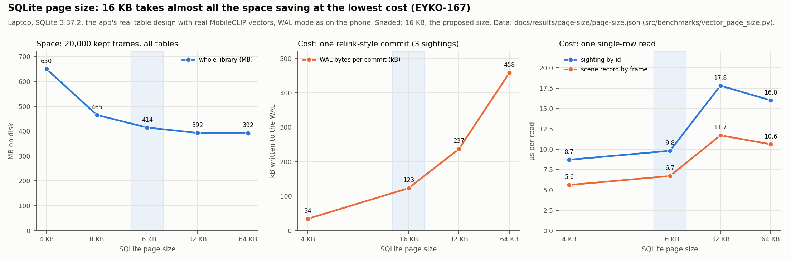

# EYKO-167: a larger SQLite page size for the vector tables (24 Nov 2026)

Head 2 storage. EYKO-97 found that a 512-number vector row (2,048 B) takes 4,107 B on disk, because SQLite's default
4 KB page holds only one. This card measures the options on the laptop (done here) and on one phone (pending: needs the
Pixel, `VectorPageSizeTest`). Run: `task page-size` (`src/benchmarks/vector_page_size.py`); numbers:
[`page-size/page-size.json`](page-size/page-size.json). **No schema change is made on this card** (the lead decides).

**Short answer (laptop).** With 16 KB pages a realistic library is **36 % smaller** (20,000 kept frames: 650 MB →
414 MB), inserts are faster and the vectors read back bit for bit. The biggest waste is not `image_vec` but
**`object_sightings`**: each sighting also stores a 2 KB crop vector, and there are 5.4 per kept frame. **But a database
in WAL mode keeps its page size**, and Android switches WAL on when it opens the app's database. So the page size can
only be changed by leaving WAL for a moment: on the laptop that works (`VACUUM` of 100k image rows in 1.9 s, data
identical). Whether Android's own database layer allows it is what the phone test answers.

## Setup

- SQLite 3.37.2 (laptop). The real table design: the `DDL` of `src/video_memory/schema.py`, which the parity test keeps
  equal to the phone's `VideoSchema.kt`.
- Real vectors: 100,000 MobileCLIP-S2 image vectors (COCO, EYKO-91, `data/eyko91_coco/images_512.f32`) for `image_vec`
  and the sightings' crop vectors; 90 real BGE caption vectors (`androidTest/assets/vectors/own_text_384.f32`); real
  short captions (COCO val captions) for `scene_records` and `video_texts`.
- Per kept frame, from our runs: **17 `frames` rows** (3 sampled a second, 10.6 kept a minute), 1 scene record, 1
  caption, 1 text vector, **5.4 object sightings** (kit clip 1: 54 from 10 kept frames). One transaction per 5-minute
  video (53 kept frames), as the stages write.
- Bytes per table from `dbstat` (table + its indexes; the keyword index with its shadow tables).

**Check that the made-up library is realistic:** rebuilt with the mix of EYKO-116's measured movie run (831 kept
frames, 1,604 sightings, 9,904 frame rows), these per-row sizes give **17.1 kB per kept frame; measured: 17.5 kB**
(`2026-11-09-storage-and-crash.md`). −2 %.

## E1: bytes a row, every table, 20,000 kept frames

| Page size | Library file | `image_vec` | `object_sightings` | `text_vec` | `frames` | `scene_records` | `video_texts` | Per kept frame |
|---|---|---|---|---|---|---|---|---|
| **4 KB (today)** | **650 MB** | 4,106 | **4,119** | 2,053 | 202 | 457 | 123 | **32.5 kB** |
| 8 KB | 465 MB | 2,735 | 2,747 | 1,641 | 200 | 454 | 122 | 23.2 kB |
| **16 KB** | **414 MB** | **2,344** | **2,356** | 1,639 | 199 | 443 | 122 | **20.7 kB** |
| 32 KB | 392 MB | 2,187 | 2,199 | 1,563 | 198 | 441 | 123 | 19.6 kB |
| 64 KB | 392 MB | 2,120 | 2,199 | 1,566 | 198 | 442 | 125 | 19.6 kB |

Where the 650 MB is at 4 KB: `object_sightings` **445 MB (68 %)**, `image_vec` 82 MB, `frames` 69 MB, `text_vec` 41 MB,
the rest 13 MB. At 16 KB: sightings 254, image 47, frames 68, text 33. Only the tables with a vector column change; the
others stay within 2 %. Past 16 KB the gain is small (5 % more at 32 KB, none at 64 KB).

Same full read of `image_vec` (the search copy rebuild): 0.040 s at 4 KB, 0.023 s at 16 KB. `MAX(frame_id)` (checked on
every search): 0.008 ms at both, nothing. Insert time for the whole library: 12.1 s and 10.0 s.

## E2: option (a), a new database made at 16 KB: 100,000 image vectors, WAL on

| Page size | File | Bytes a row | Insert 100k | Full read | `MAX(id)` | Read back bit for bit |
|---|---|---|---|---|---|---|
| 4 KB | **410.6 MB** | 4,106 | 7.7 s | 0.21 s | 0.008 ms | yes |
| 16 KB | **234.2 MB** | 2,342 | 5.0 s | 0.12 s | 0.004 ms | yes |

## E3: option (b), convert an existing 4 KB database in WAL mode (the app's case), 100k rows

| Step | Result |
|---|---|
| `PRAGMA page_size=16384` + `VACUUM` **while in WAL** | VACUUM ran (2.2 s) but the page size **stayed 4,096**: WAL databases keep their page size |
| `journal_mode=DELETE`, `page_size=16384`, `VACUUM`, `journal_mode=WAL` | **page size 16,384**, back in WAL, 410.6 → 234.2 MB, **VACUUM 1.9 s**, `integrity_check` ok, every vector identical, `MAX(frame_id)` still 100,000 |

`MAX(id)` unchanged means the app's search copy (`.vec`, EYKO-115) stays valid after the conversion, and its own rebuild
check is not fooled. VACUUM needs about the database's size again in free space while it runs.

## E4: where the page size has to be set on a new database

| Order on an empty file | Page size after the first table |
|---|---|
| `page_size=16384`, then WAL on | **16,384** |
| WAL on, then `page_size=16384` | **4,096** (ignored) |

Android's database layer turns WAL on while opening the file, before the app's own `onConfigure` / `onCreate` run (Room
uses WAL by default; the app sets no journal mode). So setting the page size in the app's usual callbacks would likely
be ignored, as in the second row. **Not checked on a phone yet**: `VectorPageSizeTest.whereTheAppCanSetThePageSizeOfANewDatabase`
tries the default, a PRAGMA in `onConfigure`, and WAL off / PRAGMA / WAL on in `onConfigure`.

## E5: what bigger pages cost (added 25 Nov)

Each page size gets the same 20,000-kept-frame library in **WAL mode** (as on the phone), then: 300 commits that each
change 3 random sightings (what `relink` writes per video: 0–3 rows), with automatic checkpoints off so the WAL bytes
each commit writes can be counted; and 3,000 random single-row reads of each kind, on a fresh connection (SQLite's
default cache of 2,000 KiB; the OS file cache stays warm).

| Page size | WAL bytes a commit | Pages a commit | Commit time | Sighting by id | Scene record by frame | Latest sightings of a label | Pages in SQLite's cache |
|---|---|---|---|---|---|---|---|
| 4 KB | 34 KB | 8.3 | 4.1 ms | 8.7 µs | 5.6 µs | 0.27 ms | 500 |
| **16 KB** | **123 KB** (3.6×) | 7.5 | 4.5 ms | **9.8 µs** | **6.7 µs** | **0.19 ms** | 125 |
| 32 KB | 237 KB (7.0×) | 7.2 | 4.4 ms | 17.8 µs | 11.7 µs | 0.21 ms | 62 |
| 64 KB | 458 KB (13.5×) | 7.0 | 5.3 ms | 16.0 µs | 10.6 µs | 0.24 ms | 31 |

**Reading.** A small commit touches about 7–8 pages whatever their size, so the bytes it writes grow in step with the
page: 3.6× the 4 KB case at 16 KB, 7× at 32 KB, 13.5× at 64 KB. Single-row reads stay within 20 % of 4 KB at 16 KB but
take about **1.8× as long at 32–64 KB** (a whole bigger page per read, and a cache of 62 or 31 pages instead of 125).
The index query is fastest at 16 KB. Commit time hardly moves on this laptop's NVMe disk (fsync dominates); on a
phone's flash the extra bytes may matter more (not measured).



(Drawn from `page-size.json` by `src/benchmarks/plot_page_size.py`, `task page-size-plot`.)

**Why 16 KB and not 32 or 64 KB, measured:** past 16 KB the space saving is 5 % (32 KB, about 0.8 GB a year for the
typical user) or nothing (64 KB), while every small commit writes 2× (32 KB) or 3.7× (64 KB) the bytes of 16 KB and point
reads take 1.8× as long. In absolute terms all of it is small (microseconds; a few hundred KB a video), so the choice
rests on the space numbers: 16 KB takes almost all the saving at the lowest cost.

## What it saves the user (with EYKO-101's numbers)

Per kept frame the database drops from 32.5 kB to 20.7 kB (−11.8 kB) at our sighting rate. For the part-day first-person
user of EYKO-101 (755,696 kept frames a year) that is **about 24.5 GB → 15.6 GB of database a year, 8.9 GB less**; for
the all-day user about 33 GB less a year. Next to the 16 kHz audio (73 % of storage, EYKO-101) it is the second-largest
saving available, and the largest one that keeps every byte the app uses.

**Correction for EYKO-101 (PR #25):** its storage counted each sighting at 2.07 kB (the row's size); on disk with 4 KB
pages a sighting takes 4.12 kB. At clip 1's 5.4 sightings per kept frame the per-kept-frame figure is closer to 74 kB
than the 63 kB used there, so EYKO-101's storage totals are about 10–15 % low until the page size changes.

## Options

| Option | What it takes | Saves | Risk |
|---|---|---|---|
| (a) 16 KB for new databases only | Set the page size before WAL is on (E4): needs a way into Android's open path, if any (phone test) | new installs only | none for data; may not be possible without leaving WAL at create time |
| (b) convert existing databases once | WAL off, `PRAGMA page_size=16384`, `VACUUM`, WAL on, once at startup | every install, about 36 % of the database | a one-off VACUUM: time on a phone and free space equal to the database (phone test) |
| (c) leave it | nothing | nothing | the cost stays as accepted in ADR 0001 |

**Proposed (laptop evidence, to confirm on the phone):** (b), run once when the app opens and finds a 4 KB database,
with (a) for new databases if the phone shows it can be set. 16 KB, not larger: 32 KB saves 5 % more and 64 KB nothing,
while small commits write 2–3.7× more and point reads take 1.8× as long (E5).

## Limits

1. **Laptop only so far.** Android's SQLite version, its default page size, and whether its open helper lets the app
   leave WAL and VACUUM are not measured. Laptop times are not phone times.
2. The library is synthetic in its proportions (checked within 2 % against a measured run), with real vectors and real
   caption text. Sightings per kept frame vary (5.4 on clip 1, 8.4 on clip 2, 1.9 on the movie); more sightings mean a
   bigger saving.
3. E5's timings are laptop (NVMe) timings with a warm OS file cache; a phone's flash and a cold cache could widen the
   gaps. The WAL bytes per commit do not depend on the disk.

## Phone check (pending)

`android/app/src/androidTest/java/com/eykon/memory/video/VectorPageSizeTest.kt`, one phone (the Pixel, by the team's
rule), on its own test database (`eyko167_pagesize.db`, deleted at the end), never `memories.db`:

```
adb shell am instrument -w -e class com.eykon.memory.video.VectorPageSizeTest com.eykon.memory.test/androidx.test.runner.AndroidJUnitRunner
adb logcat -d -s EYKO167
```

Install with `adb install -r` first (never `connectedDebugAndroidTest`). Not compiled on this laptop (no Android SDK
platform).
