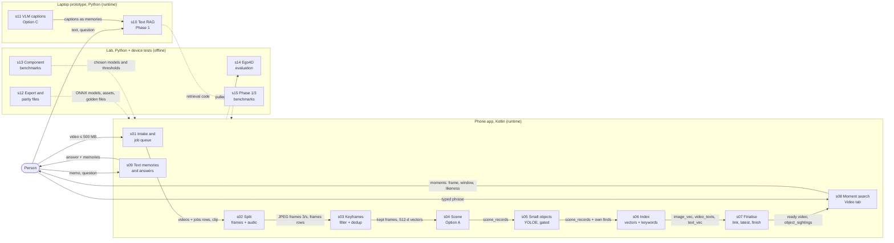

# Eykon technical walkthrough: overview

> Phase 0 of `ANALYSIS.md`: inventory and stage decomposition.
> Written 22 October 2026 against commit `89b4da8` on branch
> `feature/video-memory` (working tree clean apart from the untracked
> `ANALYSIS.md`). **Status: waiting for the owner's go-ahead before Phase 1.**
> Progress is tracked in [`PROGRESS.md`](PROGRESS.md).

Every *why* below is tagged **[DOCUMENTED]** (a doc, comment or commit says
so, cited), **[INFERRED]** (my reading of the code, evidence given) or
**[UNKNOWN]** (open question). Phase 0 read the build files, the orchestration
code of every pipeline and the header comments of every source file. Function
bodies are read in Phase 1, so some Phase 0 statements are marked *to
confirm*.

---

## 1. What the project does

**Eykon** (final-year project F26-220) is a *second brain*: a local-first
memory on a phone. It reads video and its sound, keeps the moments worth
remembering in SQLite, and answers questions with proof (the frame, the
time). Nothing leaves the device at runtime. Its priorities are finding
objects ("where are my keys?"), then speech and actions, then sounds,
meetings and lectures. [DOCUMENTED] `docs/domain/eykon/index.md:14-25`.

The repository holds two generations of the system:

1. **Text memories with retrieval-augmented answers.** Phase 1 on the laptop
   (5 September 2026) and Phase 2 on the phone (9 and 10 September): type or
   speak a memory, store it, ask a question, retrieve memories, answer with
   Gemma 4 E2B. Code: `src/memories/`, `src/assistant/`, `src/ui/app.py`;
   `android/.../{data,capture,retrieval,assistant}/`.
2. **Video memories.** Phase 3 (15 September, laptop) captioned frames with
   a vision-language model (VLM). On 12 October the project pivoted to
   cheap specialised models, built **only on the phone**. The laptop became
   a lab that measures models and exports them. [DOCUMENTED]
   `docs/domain/eykon/index.md:27-34` (VLM about 13 s per frame on the
   laptop; Infinix Note 12 averaged 4.68 W) and `:62-77`.

**What the phone does today** (from the code): every picked video goes
through ten stages (`android/app/src/main/java/com/eykon/memory/video/VideoPipeline.kt:16-27`):
`split → filter → dedup → scene → small_objects → embed_images → embed_texts
→ link → latest → finish`. The Video tab then searches the stored frame
vectors by a typed phrase (`VideoSearch.frames`). The audio track is
extracted but nothing reads it yet. The captions' keyword index and text
vectors are built but the search does not use them. No LLM answer is made
over video memories (*to confirm* in s08/s09).

## 2. How to run it

### 2.1 Laptop (the Phase 1 prototype and the lab)

```bash
uv sync                                      # task install; Python 3.10 (.python-version)
uv run streamlit run src/ui/app.py           # task run, or: uv run python main.py
uv run pytest -q                             # task test: 14 tests, temporary databases only
uv run python -m src.video_memory.schema     # task check-video-db: create video tables, print row counts
task pull-model                              # Gemma 4 E2B .litertlm from Hugging Face (needed for answers)
```

`Taskfile.yml` needs [go-task](https://taskfile.dev); each task is a thin
`uv run` wrapper, so the `cmd:` lines can be run directly. The text embedder
(`BAAI/bge-small-en-v1.5`) and the laptop's cross-encoder download on first
use (`README.md:189`).

### 2.2 Phone (the product)

```bash
cd android
./gradlew assembleDebug                  # Gradle 8.9 wrapper, JDK 17, Android 12+ (minSdk 31)
./gradlew test                           # 109 JVM unit tests in 21 files
./gradlew connectedDebugAndroidTest      # 104 on-device tests in 22 files (phone attached)
```

The `Taskfile.yml` Android tasks (`test-android`, `build-android`,
`spike-android-vectors`) only run on Windows: they call `cmd.exe /c
gradlew.bat` with a hard-coded `JAVA_HOME` (`Taskfile.yml:75-87`).

Models are **not** in the app package. They are pushed by hand into the
app's external files folder, `/sdcard/Android/data/com.eykon.memory/files/models/`
(`ModelManager.getPreferredDirectory`,
`android/app/src/main/java/com/eykon/memory/assistant/ModelManager.kt:22-28`;
`README.md:170-181`):

| File in the models folder | Made by | Used by stage |
|---|---|---|
| `mobileclip_s2_image.onnx` | `task export-clip` (`src/benchmarks/export_clip.py`) | s03, s05 (flags), s06, s07 |
| `mobileclip_s2_text.onnx` | `task export-clip-text` | s08 |
| `bge_small_en_v1.5.onnx` | `task export-bge` | s06 |
| `yolox_tiny.onnx` | `task pull-detector` (official YOLOX release, `src/config.py:59-60`) | s04 |
| `dfine_s_obj365.onnx` | `task hybrid-phone -- inputs` (`onnx-community/dfine_s_obj365-ONNX`, `src/benchmarks/hybrid_phone.py:26`) | s04 |
| `yoloe_11l_own.onnx` | `task yoloe-phone -- inputs` (yoloe-11l-seg with six phrases, `src/benchmarks/phone_detector_assets.py:12-14`) | s05 |
| `gemma-4-E2B-it.litertlm` | `task pull-model` (`src/config.py:21-22`) | s09 (and s10 on the laptop) |
| `whisper-tiny.en.tflite` / `ggml-tiny.en.bin` | no script makes it; the transcriber is a stub (flag F4) | s09 |

### 2.3 Offline lab scripts

`task <name> -- <args>`: exports (`export-*`, `golden-*`,
`phone-detector-assets`), component benchmarks (`eval-keyframes*`,
`detector-*`, `vlm-bench`, `crop-pairs`, ...) and Ego4D (`ego4d-*`). Most
read datasets and models under `D:/eykon-cache/` on the author's Windows PC
(10 scripts hard-code it). Neither `data/` nor `models/` exists on this
machine, so they cannot be re-run here (flag F27).

## 3. Inventory

### 3.1 Directory tree (tracked files only; 700 in git)

```
.
├── AGENTS.md, INSTRUCTIONS.md (history), PROJECT_SPEC.md, README.md, new_Dev.md (brainstorm transcript)
├── pyproject.toml, uv.lock, .python-version, .env.example, Taskfile.yml, .mcp.json, .gitignore
├── main.py, check_vlm_env.py, test_litert_vision.py       # laptop entry + two manual checks
├── Phase3_Vision_Pipeline_Report{,_v2}.docx               # reports (binary)
├── .streamlit/config.toml                                 # upload cap 500 MB
├── .claude/skills/explain-pipeline/SKILL.md               # repo skill (rules for explaining the pipeline)
├── .agents/ (178 files)                                   # vendored agent skills: skipped
├── src/                                    (67 .py, 9,468 lines)
│   ├── config.py                           # Pydantic Settings, MEMORY_ prefix
│   ├── memories/ (9)                       # Phase 1 text RAG: storage, embedder, chunking, search, rerank
│   ├── assistant/ (4)                      # prompt + Gemma 4 E2B via LiteRT-LM
│   ├── ui/ (3)                             # Streamlit app + video upload page
│   ├── video_memory/ (6)                   # the shared table design (schema.py) + laptop upload
│   ├── vision/ (4)                         # Phase 3 VLM captioning (Option C reference)
│   └── benchmarks/ (39)                    # lab: exports, golden files, benchmarks, Ego4D
├── tests/ (4 .py, 229 lines)               # pytest: smoke, video schema, video upload
├── android/                                # Gradle project "EykonMemory", module :app
│   └── app/src/
│       ├── main/java/com/eykon/memory/     (68 .kt, 6,768 lines)
│       │   ├── MainActivity.kt, MemoryApp.kt
│       │   ├── video/ (25)                 # the 10-stage video pipeline, queue, search
│       │   ├── ml/vision/ (7), ml/embedder/ (4), ml/reranker/ (1)
│       │   ├── data/ (4), capture/ (4), retrieval/ (2), assistant/ (4)
│       │   └── ui/ (15)                    # Compose screens, view models, theme
│       ├── main/assets/ (5)                # prompt vectors, tokenizer files, label lists
│       ├── test/ (22 .kt, 1,570 lines; 9 resource files)
│       └── androidTest/ (22 .kt, 3,344 lines; 10 asset files)
├── scratch/ (7 .py, 1,303 lines + binaries) # adb/report scripts, LiteRT-LM AAR extract, a database
└── docs/
    ├── docs/index.md, domain/eykon/index.md, invariants/ (6)
    ├── plans/ (171)                        # phase plans and steps (background, not the active plan)
    ├── results/ (49)                       # measured results: 14 .md, 26 .json, 7 .csv
    ├── report/, new/, additional/          # mid-report answers, roadmap v2, architecture, literature
    └── walkthrough/                        # this documentation
```

### 3.2 Languages

| Language | Where | Files | Lines |
|---|---|---|---|
| Kotlin | `android/app/src/{main,test,androidTest}` | 112 | 11,682 |
| Python | `src/`, `tests/`, `scratch/`, repo root | 81 | 11,061 |
| Gradle Kotlin DSL | `android/*.gradle.kts` | 3 | 141 |
| XML | `android/app/src/main` manifest and resources | 5 | 55 |
| Markdown | docs, rules | 307 | not counted |

`src/benchmarks/data.py` (1,842 lines) is mostly a hand-written test corpus.

### 3.3 Build system

- **Python:** `uv` with `pyproject.toml` + `uv.lock` (115 locked packages).
  `llama-cpp-python` comes from a CPU-only wheel index
  (`pyproject.toml:21-27`). Tasks through `Taskfile.yml` (go-task v3).
  There is no packaging: code runs as `src.*` modules from the repo root.
- **Android:** Gradle 8.9 wrapper (`android/gradle/wrapper/gradle-wrapper.properties`),
  Android Gradle Plugin 8.5.2, Kotlin 2.0.21 with the Compose and
  serialization plugins, KSP 2.0.21-1.0.28 (`android/build.gradle.kts`).
  `compileSdk 35`, `minSdk 31`, `targetSdk 35`, Java 17,
  `isMinifyEnabled = false` (`android/app/build.gradle.kts`).
  `src/test/resources` is also an `androidTest` asset folder, so JVM and
  device tests read the same pictures.

### 3.4 Dependencies with versions

**Python** (constraint in `pyproject.toml` → version locked in `uv.lock`):

| Package | Constraint | Locked | Used by |
|---|---|---|---|
| streamlit | ≥ 1.35.0 | 1.63.0 | s10, s11, s01 laptop page |
| sentence-transformers | ≥ 3.0.0 | 6.0.1 | s10 embedder + cross-encoder |
| numpy | ≥ 1.26.0 | 2.2.6 | everywhere |
| ollama | ≥ 0.2.0 | 0.6.2 | nothing (flag F7) |
| pydantic-settings | ≥ 2.2.0 | 2.15.0 (pydantic 2.13.5) | `src/config.py` |
| litert-lm-api | ≥ 0.17.0 | 0.17.0 | s10 answers, s11 shared Gemma |
| opencv-python | ≥ 5.0.0.93 | 5.0.0.93 | s11, s12, s13 |
| llama-cpp-python | ≥ 0.3.35 | 0.3.35 (CPU wheels) | s11, s15 |
| pillow | ≥ 12.3.0 | 12.3.0 | s11, lab |
| psutil | ≥ 7.2.2 | 7.2.2 | s15 |
| imageio-ffmpeg | ≥ 0.6.0 | 0.6.0 | s01 laptop upload (bundled ffmpeg) |
| pytest (dev) | ≥ 9.1.1 | 9.1.1 | `tests/` |
| *transitive:* torch 2.14.0, transformers 5.16.1, tokenizers 0.23.2, huggingface-hub 1.30.0, pandas 2.3.3, scikit-learn 1.7.2 | | | |

**Fetched per task, not locked** (`uv run --with`, flag F11): `onnxruntime`
(17 tasks), `open_clip_torch` (16), `ultralytics` (4), `scenedetect` (3),
`rfdetr` (3), `onnx` (3), `onnxscript` (2), `sqlite-vec`, `onnxslim`,
`mediapipe` (1 each). `scratch/generate_report.py` and
`scratch/generate_comparison_graphs.py` also import `matplotlib` and
`python-docx`, which are in neither file.

**Android** (`android/app/build.gradle.kts`):

| Library | Version | Used by |
|---|---|---|
| androidx.core:core-ktx | 1.13.1 | app |
| androidx.lifecycle runtime-ktx / viewmodel-compose | 2.8.6 | view models |
| androidx.activity:activity-compose | 1.9.3 | `MainActivity` |
| Compose BOM (ui, material3, tooling) | 2024.10.00 | UI |
| Room runtime / ktx / compiler (KSP) / testing | 2.6.1 | `data/`, and the video tables via `openHelper` |
| kotlinx-serialization-json | 1.7.1 | assets, objects JSON |
| kotlinx-coroutines-android / -test | 1.9.0 | worker, view models |
| com.google.ai.edge.litertlm:litertlm-android | 0.16.1 | s09 Gemma answers |
| com.microsoft.onnxruntime:onnxruntime-android | 1.18.0 | every ONNX model (s03–s08) |
| junit 4.13.2, androidx.test.ext:junit 1.2.1, espresso-core 3.6.1, compose ui-test-junit4 | | tests |

### 3.5 Entry points

| Entry point | Kind | What it starts |
|---|---|---|
| `android/app/src/main/java/com/eykon/memory/MemoryApp.kt:30` (`onCreate`) | Android `Application` | re-queues interrupted / outdated jobs, starts the video worker |
| `android/app/src/main/java/com/eykon/memory/MainActivity.kt` (`onCreate`) | launcher activity | Compose UI with three tabs (Capture, Ask, Video; `ui/navigation/AppNavigation.kt`) and their view models |
| `android/app/src/main/java/com/eykon/memory/video/VideoCapture.kt:22` (`save`) | user picks a video | copy, metadata, `videos` + `jobs` rows (s01) |
| `android/app/src/main/java/com/eykon/memory/video/VideoWorker.kt:21` (`runOnce`) | background coroutine | runs the ten stages of one job |
| `android/app/src/main/java/com/eykon/memory/video/VideoSearch.kt:42` (`frames`) | user types a phrase | moment search (s08) |
| `main.py` → `src/ui/app.py` | Streamlit | laptop UI: Add Memory, Ask Question, Process Video, Video memory |
| `python -m src.video_memory.schema` | CLI | create video tables, print row counts |
| `src/benchmarks/*.py` via `Taskfile.yml` | CLI | exports and measurements (s12–s15) |
| `tests/`, `android/app/src/test`, `android/app/src/androidTest` | test runners | pytest, JUnit on the JVM, instrumented tests on a phone |
| `check_vlm_env.py`, `test_litert_vision.py` | manual scripts | import check; one LiteRT-LM vision call (not a pytest test, flag F21) |

### 3.6 Configuration

| File | What it configures |
|---|---|
| `src/config.py` | `Settings` (Pydantic, `MEMORY_` prefix, `.env`): DB path, RAG constants (`TOP_K` 5, `POOL_K` 20, `EXPAND_QUERY`, `RERANK`), LiteRT/Ollama/VLM models, frame interval 5 s, video limits (500 MB; mp4, mov, m4v, avi), vector sizes (512/384/512), perception lists (`scene_places`, `scene_actions`, `small_object_flags`) and cut-offs |
| `.env.example` | override examples for the Phase 1 settings only (flag F25) |
| `.streamlit/config.toml` | `maxUploadSize = 500`, kept equal to `video_max_mb` |
| `pyproject.toml`, `.python-version` | dependencies, CPU wheel index, pytest `testpaths`, Python 3.10 |
| `Taskfile.yml` | 48 tasks: run, test, model pulls, exports, benchmarks |
| `.mcp.json` | the `synverk` MCP server (the project's task board) |
| `android/app/build.gradle.kts`, `android/build.gradle.kts`, `android/settings.gradle.kts`, `android/gradle.properties` | SDK levels, plugins, libraries, JVM args (`-Xmx2048m`) |
| `android/app/src/main/AndroidManifest.xml` | `RECORD_AUDIO` permission, speech-service queries, `allowBackup="true"` (flag F19) |
| Kotlin constants | the phone holds its thresholds as `const val` in each stage (for example `VideoDedup.HASH_MAX`). `OptionA.kt` mirrors `src/config.py` by hand (`README.md:95`) |
| SharedPreferences `video_pipeline` / `version` | which pipeline version finished videos were made with (`MemoryApp.kt:35-40`) |

### 3.7 Scripts

- **Tasks** (`Taskfile.yml`): app (`run`, `install`, `check-config`,
  `check-video-db`), tests (`test`, `smoke`, `test-e2e`, `test-android`),
  models (`pull-model`, `pull-vlm`, `check-vlm`, `pull-detector`,
  `export-clip`, `export-clip-text`, `export-bge`), golden files
  (`golden-filters`, `golden-perception`, `phone-detector-assets`),
  benchmarks (`benchmark`, `benchmark-vision`, `experiment*`,
  `eval-keyframes*`, `tune-keyframes`, `detector-*`, `vlm-bench`,
  `hybrid-phone`, `yoloe-phone`, `crop-pairs`, `eval-perception`,
  `probe-frame-search`, `eval-small-objects`, `spike-*-vectors`), Ego4D
  (`ego4d-select`, `-pipeline`, `-eval`, `-actions`, `-hybrid`,
  `-lastseen`, `-gate`, `-phone-compare`).
- **`scratch/*.py`**: one-off adb tools for device energy, endurance and
  UI checks, chart and report generators. They hard-code a Windows adb
  path and device addresses (flag F15).

### 3.8 Tests

| Suite | Size | What it covers |
|---|---|---|
| pytest `tests/` | 14 tests in 3 files | settings path, `init_db` idempotent, video schema, vectors, FTS, cascade delete, upload checks |
| JVM `android/app/src/test` | 109 tests in 21 files (+ `TestPictures.kt` helper) | tokenizers, filters, hash, Option A maths, captions, windows, metadata, split maths, prompt builder, search service, view models |
| Device `android/app/src/androidTest` | 104 tests in 22 files | each pipeline stage on real clips, golden parity with the laptop, phone benchmarks, the vector-storage spike |
| Golden files | `android/app/src/test/resources/`, `android/app/src/androidTest/assets/` | numbers the Kotlin code must reproduce, written by the s12 scripts |

### 3.9 Datasets

| Dataset | Where | Used by |
|---|---|---|
| Synthetic Phase 1 corpus: 500 memories of a fictional student + 30 QA pairs | `src/benchmarks/data.py` (in git) | s15 `run.py` |
| Own recorded clips (six evaluation clips, 44 kept frames, "own50" frames) and hand labels | clips outside git; labels in `docs/results/perception/*.csv`; protocol in `docs/plans/dataset-recording/` | s13, s14 (`ego4d_gate.py`) |
| EPIC-KITCHENS-100 subset (eight videos, 11 min) | outside git | s13 (`keyframe_public.py`, `small_objects_eval.py`) |
| Ego4D episodic-memory validation subset: set A and held-out set B, 24 clips each | `D:/eykon-cache/ego4d` (outside git); described in `docs/results/2026-10-19-ego4d-subset.md` | s14 |
| Test clips and pictures | `android/app/src/androidTest/assets/test_clip*.mp4`, `android/app/src/test/resources/{filters,perception}/` | device and JVM tests |

### 3.10 Model and weight files

No weights are tracked in git (`/models/` is ignored, `.gitignore`). The
phone models are in the table in §2.2. The laptop also loads, by name, from
Hugging Face: `BAAI/bge-small-en-v1.5` (`src/config.py:24`),
`cross-encoder/ms-marco-MiniLM-L-6-v2` (`src/memories/reranker.py:6`),
`ggml-org/SmolVLM-500M-Instruct-GGUF` with its mmproj (`src/config.py:34-36`),
and in the lab MobileCLIP-S2 (`open_clip`), D-FINE, OWLv2, YOLOE, RF-DETR
and several small VLMs (`src/benchmarks/vlm_models.py`). Licences recorded by
the project: MobileCLIP weights are research-only (Apple ML Research Model
License; `export_clip.py` docstring); YOLOE is AGPL-3.0, allowed while the
project is academic (`docs/invariants/tooling.md`); YOLOX, D-FINE and
bge-small are Apache-2.0 / MIT (`docs/domain/eykon/index.md:92-95`).

### 3.11 Skipped (not documented as source)

| What | Why skipped |
|---|---|
| `uv.lock` | lockfile (versions read for §3.4 only) |
| `android/gradlew`, `android/gradlew.bat`, `android/gradle/wrapper/gradle-wrapper.jar` | generated Gradle wrapper |
| `.agents/` (178 files) | vendored agent skills (design, UI, Ponytail rules), not part of the product |
| `.claude/skills/explain-pipeline/SKILL.md` | agent instructions (its rules are followed here, it is not code) |
| `scratch/litertlm/`, `scratch/litertlm.zip` | vendored LiteRT-LM AAR extract (`.so`, `.jar`, notices); whether anything uses it is checked in s09 (flag F13) |
| `scratch/memories.db*`, `scratch/*.png`, `scratch/charts/*.png` | data and generated charts |
| `Phase3_Vision_Pipeline_Report{,_v2}.docx` | generated reports |
| `android/app/src/main/assets/bge_vocab.txt`, `clip_bpe_merges.txt` | generated tokenizer data (described as data in s06, s08, s12) |
| `android/app/src/main/assets/*.json`, test golden JSON, test pictures and clips | generated or fixture data (described as data, not as code) |
| `docs/results/**/*.json`, `*.csv` | generated measurement data (cited as evidence) |
| `new_Dev.md`, `INSTRUCTIONS.md`, `PROJECT_SPEC.md`, `docs/plans/**` | background documents, cited as decision sources only |

## 4. Stage list

Fifteen stages: nine runtime stages in the phone app, two runtime stages in
the laptop prototype, four offline lab stages. s03 joins the `filter` and
`dedup` pipeline stages because the project treats them as one keyframe
step: `keyframe_tune.py` copies "the phone's three layers" together
[DOCUMENTED, `src/benchmarks/keyframe_tune.py` docstring]. s07 joins
`link`, `latest` and `finish`, the three stages that close a video.

| # | Id | Name | Flow | Runs on | One-line purpose | Entry files |
|---|---|---|---|---|---|---|
| 1 | `s01-intake` | Video intake, schema & job queue | runtime | phone (+ laptop twin) | Copy a picked clip into app storage, read recording time, length and GPS, add the `videos` and `jobs` rows, and run the resumable ten-stage worker | `video/VideoCapture.kt` (`save`), `MemoryApp.kt` (`onCreate`), `video/VideoWorker.kt` (`runOnce`), `video/VideoPipeline.kt` (`STAGES`); laptop `src/video_memory/capture.py` (`save_upload`), `src/video_memory/schema.py` |
| 2 | `s02-split` | Split into frames and audio | runtime | phone | Decode 3 frames a second as JPEGs (longer side ≤ 640 px, turned upright) and the sound as a 16 kHz mono 16-bit WAV | `video/VideoSplit.kt` (`run`) |
| 3 | `s03-keyframes` | Keyframe selection (filter + dedup) | runtime | phone | Keep at most the sharpest usable frame of each 9-frame slot (dark, bright, blurry, unchanged checks), then drop near-duplicates by 64-bit dHash and MobileCLIP-S2 cosine | `video/VideoFilter.kt`, `video/VideoDedup.kt` |
| 4 | `s04-scene` | Scene description (perception Option A) | runtime | phone | Describe each kept frame with YOLOX-Tiny and D-FINE objects, a people count and MobileCLIP place / action phrases, and write a `scene_records` row with a caption built from those fields | `video/VideoScene.kt`, `video/OptionA.kt` |
| 5 | `s05-small-objects` | Personal small objects (YOLOE-11L, gated) | runtime | phone | On frames MobileCLIP flags as maybe showing keys or earbuds, run YOLOE-11L and add its finds to the scene record and caption | `video/VideoSmallObjects.kt` |
| 6 | `s06-index` | Vector & keyword indexing | runtime | phone | Store a 512-number MobileCLIP vector per kept frame, and per caption a `video_texts` row (fts4 keywords) with a 384-number bge-small vector | `video/VideoEmbedImages.kt`, `video/VideoEmbedTexts.kt` |
| 7 | `s07-finalise` | Integrity check, latest sightings, finish | runtime | phone | Prove every row links to a real video and moment, record each object sighting and mark the latest one per object, then mark the video ready and delete dropped frame files | `video/VideoLink.kt`, `video/VideoLatest.kt`, `video/VideoPipeline.kt` (`VideoFinish`) |
| 8 | `s08-video-search` | Moment search & the Video tab | runtime | phone | Turn a typed phrase into a MobileCLIP text vector, rank the frame vectors of ready videos, grow each hit into a time window, show it | `video/VideoSearch.kt` (`frames`), `video/SearchWindows.kt`, `ui/viewmodels/VideoViewModel.kt` |
| 9 | `s09-phone-text-memory` | Phone text memories & answers | runtime | phone | The Phase 2 app: type or speak a memory into Room SQLite, ask a question, retrieve by fts4 keywords (the dense and re-rank steps exist but are switched off), answer with Gemma 4 E2B through LiteRT-LM | `ui/viewmodels/AddMemoryViewModel.kt`, `ui/viewmodels/AskQuestionViewModel.kt`, `retrieval/SearchService.kt`, `assistant/LiteRTGenerator.kt` |
| 10 | `s10-laptop-text-rag` | Laptop text RAG (Phase 1) | runtime | laptop | Chunk, embed (bge-small) and store text memories; dense + FTS5 BM25 search fused by RRF, cross-encoder re-rank, Gemma answer; Streamlit UI | `src/ui/app.py`, `src/memories/service.py`, `src/memories/search.py`, `src/assistant/llm.py` |
| 11 | `s11-laptop-vlm-video` | Laptop VLM video captions (Option C reference) | runtime | laptop | Sample a frame every 5 s with OpenCV, caption it with a VLM (by default the shared Gemma 4 E2B LiteRT-LM engine, `VLM_USE_SHARED_GEMMA = True`; otherwise SmolVLM-500M GGUF through llama.cpp), store the captions as text memories | `src/vision/processor.py` (`process_video`), `src/vision/captioner.py` |
| 12 | `s12-export-parity` | Model export & phone-parity files | offline | laptop → phone | Export or fetch the ONNX models, write the app's assets (prompt vectors, tokenizer files, label lists) and the golden numbers the phone tests must match | `src/benchmarks/export_clip.py`, `export_clip_text.py`, `export_bge.py`, `perception_golden.py`, `phone_detector_assets.py`, `filters_golden.py` |
| 13 | `s13-component-benchmarks` | Component benchmarks | offline | laptop + phone | Measure the candidates for each pipeline choice (keyframes, detectors, small VLMs, crop threshold, frame search, vector storage); the results set the constants | `src/benchmarks/keyframe_*.py`, `detector_bench.py`, `vlm_bench.py`, `crop_pairs.py`, … and `androidTest/…/*BenchmarkTest.kt` |
| 14 | `s14-ego4d-eval` | Ego4D episodic-memory evaluation | offline | laptop | Run a laptop copy of the phone pipeline on Ego4D clips, score NLQ / VQ / MQ, try improvements on set A and check them on held-out set B, compare with the Pixel | `src/benchmarks/ego4d_pipeline.py` (`run_clip`), `src/benchmarks/ego4d_eval.py` (`main`) |
| 15 | `s15-legacy-benchmarks` | Phase 1/3 benchmarks & device scripts | offline | laptop (+ adb) | Phase 1 retrieval benchmark (500 synthetic memories, 30 questions), Phase 3 VLM experiments A1–A6 and soak test, one-off adb energy / report scripts | `src/benchmarks/run.py`, `experiments.py`, `cross_pipeline.py`, `soak_test.py`, `scratch/*.py` |

Kotlin paths are under `android/app/src/main/java/com/eykon/memory/`. The
full file list per stage is in [`notes/file-map.md`](notes/file-map.md):
all 198 tracked source files are assigned, none twice as primary.

## 5. Stage-to-stage data handoffs

| From → to | What is carried | Type and shape |
|---|---|---|
| person → s01 | a picked video | content URI; mp4 / mov / m4v / avi, at most 500 MB (`VideoMetadata.MAX_MB`) |
| s01 → s02 | the stored clip and its job | file `files/videos/<video_id>/<video_id>.<ext>`; `videos` row (`video_id` hex UUID, `file_path`, `recorded_at` ISO UTC, `duration_s`, `lat`, `lon`, `status = 'processing'`); `jobs` row (`status = 'queued'`, `stage = ''`) |
| s02 → s03 | decoded frames | JPEGs in `files/videos/<video_id>/frames/` (3 a second, quality 90, longer side ≤ 640 px) and one `frames` row each (`frame_no`, `t_s`, `path`, `kept = 1`); `audio16k.wav` (16 kHz mono 16-bit) goes nowhere yet |
| s03 → s04 | the kept, unique frames | `frames.kept`, `drop_reason`, `phash` (64-bit hash as text); `clip_vectors.bin`: frame id → 512 float32 unit vector |
| s04 → s05 | a description per kept frame | `scene_records` row: `objects` JSON list of `{label, conf, box[4], source}`, `action`, `place`, `people`, `caption`, `source = 'A'` |
| s05 → s06 | the same rows with the user's own things | `objects` gains `source: "own"` finds (keys, earbuds); `caption` rewritten |
| s06 → s07, s08 | search indexes | `image_vec` (512 float32 BLOB per kept frame); `video_texts` + `video_texts_fts` (fts4); `text_vec` (384 float32 BLOB) |
| s07 → s08 | a finished video | `videos.status = 'ready'`; `object_sightings` rows (label, `seen_at`, place, crop vector, `is_latest`, `superseded_by`); dropped frames' JPEGs deleted |
| person → s08 → person | a phrase, then moments | text → up to 20 `FrameHit` (video, `tS`, window `startS`–`endS`, picture file, cosine, caption) |
| person → s09 → person | memories, then a question | text or voice → `memories` rows (Room, fts4) → retrieved records → prompt → Gemma answer |
| person → s10 → person | the same on the laptop | text → 256-token chunks → 384-d vectors → `memories` + `memories_fts` (FTS5) in `data/memories.db` → answer |
| s11 → s10 | captions as memories | `CaptionedFrame` → `MemoryRecord(source_type="video")` in the laptop `memories` table, then searched by s10 |
| s12 ⇢ s03, s04, s05, s06, s08, s09 | models and assets (offline) | ONNX / `.litertlm` files pushed by adb; `assets/*.json`, `*.txt`; golden JSON for the tests |
| s13 ⇢ s03, s04, s05, s07 | chosen constants (offline) | `docs/results/*.md` and `.json` (for example `CROP_COSINE_MIN = 0.87`, YOLOX-Tiny, YOLOE-11L) |
| s14 ⇢ s04, s05, s08 | chosen constants (offline) | `docs/results/ego4d/*.json`, `docs/results/2026-10-21-ego4d-improvements.md` (window growth 0.85, first-person action phrases, flag cut-off 0.15) |
| s02–s08 ⇢ s14 | the same steps, re-implemented | `ego4d_pipeline.py` copies the phone stages; `ego4d_phone_compare.py` reads a `memories.db` pulled from the Pixel |
| s10 ⇢ s15 | retrieval code under test | `run.py` builds `data/benchmark.db` with s10's code, writes `data/benchmark_results.json` |

## 6. Draft overview flowchart

Solid arrows are runtime data, dashed arrows are offline (lab) outputs.



## 7. Notes from the git history

61 commits from 5 September to 21 October 2026. Every message is a subject
line only, so reasons come from the docs each commit touched. The full
decision timeline with sources is in
[`notes/git-decisions.md`](notes/git-decisions.md). The turning points:

- **5 Sep:** answers from Gemma 4 E2B through LiteRT-LM, not Ollama
  (`a2ba436`). Ollama traces remain (flags F7, F8).
- **12 Oct:** pivot to cheap models first, VLM optional, product on the
  phone only (`6af6101`, `33cca0e`, `82cf088`). Vectors as BLOBs, no
  sqlite-vec (`61fb561`).
- **13 Oct:** YOLOX-Nano swapped for YOLOX-Tiny (`b8be6c8`).
- **15 Oct:** AGPL allowed while academic (`34fa3d3`); OWLv2 tried, then
  replaced by YOLOE-11L for small objects (`0794cfd` → `903b1f9`).
- **21 Oct:** search windows, first-person action phrases, YOLOE gated by
  MobileCLIP (`89b4da8`, pipeline `VERSION = 5`).

## 8. Early flags

29 items so far in [`notes/flags.md`](notes/flags.md). The ones a reader
should know before Phase 1:

- **F4:** the phone's Whisper transcriber is a stub. It returns "Voice memo
  (N s recorded)" and never transcribes.
- **F5:** the phone's text search runs keywords only (no embedder, no
  re-ranker), against the project's own "Phase Parity" rule.
- **F16, F17:** audio is extracted but unused; the caption keyword index
  and text vectors are built but unused by search.
- **F18:** an Ego4D change marked "Keep" (last seen with crops of any
  object) does not appear to be in the app.
- **F1, F2, F3:** README and architecture docs are behind the code.
- **F10, F11, F27:** lab results depend on a Windows PC, `D:/eykon-cache` and
  unpinned packages, so they cannot be reproduced from this repo alone.

## 9. Plan for Phases 1–4

**Formats, fixed now so every subagent writes the same thing:**

- Stage doc: [`stages/_TEMPLATE.md`](stages/_TEMPLATE.md). The eight numbered
  sections of `ANALYSIS.md`, a fixed anchor rule, one `###` heading per
  file in §6, question ids `Q-<stage>-<n>`, flags in §8.2.
- Stage JSON: [`flow/schema.json`](flow/schema.json). Nodes carry the fields
  `ANALYSIS.md` asks for (id, label, type, parent stage, files, purpose,
  input and output each with type / shape / format / example, algorithm
  and parameters, performance, decision with tag, doc link). Edges carry
  from, to, data type and shape, and flow type. Shared tables, files and
  assets have fixed ids defined once (`notes/file-map.md`, "Shared node
  ids"), so lineage stays connected across stages.

**Phase 1:** one subagent per stage, three to five at a time. Each gets the
template, the schema, its file list and the shared ids, reads the code, and
writes `stages/<id>.md` and `flow/stages/<id>.json`. After each one I check
both files exist and parse, the JSON has no empty required field, every
primary file has a §6 entry and a node, and three claims match the code.
Then I mark the stage done in `PROGRESS.md`. Flags go into `notes/flags.md`
as they are confirmed.

**Phase 2:** the four cross-cutting docs (`02-models-and-algorithms.md`,
`04-data-and-config.md`, `05-design-decisions.md`, `06-open-questions.md`),
built from the stage docs plus the build and config files no stage owns.

**Phase 3:** `flow/index.json` (stages, stage edges, stage file list, and
traces for "a picked video", "a typed phrase", "a text memo" and "a
question"), then `validate_flow.py` (standard library only, under 300
lines). It checks that every §6 file is in a node, every edge joins existing
nodes, no required field is empty, every `doc` anchor exists, and trace
steps are joined. I run it and fix what it reports.

**Phase 4:** `build_flow.py` (standard library only) fills one
self-contained `flow.html`: inline CSS, JS and data, no network, its own
layered left-to-right layout. Overview → stage drill-down with breadcrumb,
side panel, colours by node type, solid runtime / dashed offline edges,
[INFERRED] / [UNKNOWN] badges, search, filters, legend, trace mode, light
and dark themes. The HTML template sits in its own file so both scripts
stay under the 300-line rule (`docs/invariants/core.md:13`).
`flow-overview.mmd` is exported too. **`flow-overview.svg` will be skipped:**
neither Graphviz (`dot`) nor D2 is installed here. With `sudo apt install
graphviz` I can make it.

**Final:** re-check at least 15 random claims against the code, re-run the
validator, write the summary. `README.md` and `docs/docs/index.md` each get
one line pointing at `docs/walkthrough/` (the README rule in
`docs/invariants/processes.md`).
